<!-- SPDX-License-Identifier: MIT -->

# WP 10.2: The typeface

**Request (Chris):** "a different font ... a better alternative for a modern finance app" from
Google Fonts. **Decision (made before the WP):** Geist (variable) for the UI and Geist Mono
(variable) for code and identifiers, both SIL OFL 1.1, both vendored under `apps/web/public/fonts/`
exactly as Inter was. Nothing is fetched from Google at runtime (D20, `default-src 'self'`).

**State of the tree.** Uncommitted on `main` at `01970d4`. No dependency or lockfile edit, no
`@fontsource` package. The Inter files are removed; nothing referenced them after this change.

## 1. The choice, and what was not chosen

Geist: a neutral grotesque tuned for UI text and numbers, tabular figures (`tnum`) built in, a
matching mono, a full 100-900 variable axis, and a 29 KB latin file (Inter's was 352 KB).

- **IBM Plex Sans:** a characterful, slightly technical voice with wide letterforms, which costs
  width in dense tables and at 320 px; the extra personality is not what a ledger needs.
- **Manrope:** geometric and friendly, but its figures are less even and it has no matching mono,
  so code and identifiers would still need a second family chosen by hand.
- **DM Sans:** low-contrast geometric, lovely for marketing, but its small sizes (12-13 px captions,
  the transaction metadata line) are the weakest of the four and its digits are not tabular by default.

## 2. Files and hashes

All unmodified downloads of the `latin` block of the Google Fonts CSS
(`https://fonts.googleapis.com/css2?family=Geist:wght@100..900&family=Geist+Mono:wght@100..900&display=swap`,
fetched 2026-10-12 with a Chrome 130 user agent so the response is woff2 variable). The same
information is in `apps/web/public/fonts/README.md`.

| File                              | Source                                                                                                       | Version       | Bytes  | sha256                                                             |
| --------------------------------- | ------------------------------------------------------------------------------------------------------------ | ------------- | ------ | ------------------------------------------------------------------ |
| `geist-variable-latin.woff2`      | https://fonts.gstatic.com/s/geist/v5/gyByhwUxId8gMEwcGFU.woff2                                               | Geist v5      | 29 400 | `19f9c92546aa300c312235e3125af1b81394d8db9a4bc4a425cd5b641d2d54e1` |
| `geist-mono-variable-latin.woff2` | https://fonts.gstatic.com/s/geistmono/v6/or3nQ6H-1_WfwkMZI_qYFrcdmg.woff2                                    | Geist Mono v6 | 23 128 | `684ad5b531f81d43c1e8c7038262d5db7cdc1f68006e04d6c7769efa8d33c8cc` |
| `OFL-Geist.txt`                   | https://raw.githubusercontent.com/google/fonts/main/ofl/geist/OFL.txt (identical to `ofl/geistmono/OFL.txt`) | n/a           | n/a    | `1781d2806a07d91c4edf4740b88449fab7d0eadad53f7c351b94cd4d4eb8c00f` |

The version string is the `/v5/` and `/v6/` path segment Google's CSS names; the files carry no
other version the CSS exposes. The latin subset covers Basic Latin, Latin-1 (so the pound and yen
signs), the euro sign, U+2212 (the minus sign `formatMoney` prints) and general punctuation. Inter
was vendored as latin only too; a glyph outside it falls back to the system stack.

Removed: `inter-variable-latin.woff2`, `OFL-Inter.txt`. A search of the repo (code, config, tests,
Caddyfile, precache scripts) found no other reference; the remaining mentions are in historical
docs (`docs/research/05-frontend-architecture.md`, `docs/evidence/phase-0/wp0.5-summary.md`), which
describe the past and are left alone.

## 3. What changed in the tokens

| File                            | Change                                                                                                                                                                                                                                                                            |
| ------------------------------- | --------------------------------------------------------------------------------------------------------------------------------------------------------------------------------------------------------------------------------------------------------------------------------- |
| `apps/web/src/styles/base.css`  | `@font-face` for `'Geist Variable'` and `'Geist Mono Variable'` (weight 100 900, `font-display: swap`); `.tabular-nums` is now `tabular-nums lining-nums slashed-zero`; a base rule gives `table`, `time`, `[role=grid]`, `[role=treegrid]` tabular, lining figures with no class |
| `apps/web/src/styles/theme.css` | `--font-sans: 'Geist Variable', ui-sans-serif, system-ui, -apple-system, sans-serif` (same fallbacks); `--font-mono: 'Geist Mono Variable', ui-monospace, SFMono-Regular, Menlo, monospace`; `--text-caption--letter-spacing` 0.01em to 0                                         |
| `apps/web/index.html`           | the font preload now names `geist-variable-latin.woff2` (Geist Mono is not preloaded: it is used in a handful of code and identifier spots, and loads on first use)                                                                                                               |
| `apps/web/src/styles/tokens.md` | the Font and numeric-alignment paragraphs say Geist                                                                                                                                                                                                                               |

**The type scale's sizes are unchanged. Weights are unchanged** (600 headings, 550 body-strong): in
the before/after screenshots Geist at 600 and 550 reads about as strong as Inter did, so no weight
was lowered. **One tuning, the caption tracking.** Inter needed `+0.01em` at 12 px; Geist is set
more openly, and with the same tracking the plan and Brief captions looked loose in the first
after-run, so it is 0. Headings keep their negative tracking.

Both fonts are variable, so there is still exactly one request per family and every weight comes
from it.

### A finding: Geist cannot slash a tabular zero

Measured in headless Chromium (the font files as base64, widths of `1111` and `0000` at 40 px):
without `tnum` Geist is proportional (`1111` 54 px, `0000` 108 px); with `tnum` every digit is 24
px, so columns line up. `slashed-zero` has an effect on the proportional figures but **none when
combined with `tnum`** (the zero renders identically with and without it). The old Inter setup
printed a slashed zero in money; Geist's tabular zero is a plain narrow oval, distinct from a capital
O but not slashed. `slashed-zero` stays in the declaration so a fallback font during the swap still
gets it. Geist Mono's zero is slashed by default, so identifiers and recovery codes keep that.
If a slashed zero in money matters, the one-line way to get it is `.tabular-nums { font-family:
var(--font-mono) }`, which sets every figure in Geist Mono; it was not done here because it changes
the look of every amount and the decision was Geist for the UI.

## 4. Where figures align (tabular, lining)

The `Money` and `Percent` components already carried `tabular-nums`, which now means tabular and
lining. Added in this WP:

- the base rule in `base.css` (`table`, `time`, `[role=grid]`, `[role=treegrid]`), which covers every
  table without the class: Drift, Holdings, Account positions, Budget vs actual, the chart data
  tables, the Fan chart table, and the
  transactions list (a `role=grid`);
- `apps/web/src/components/finance/DateOnlyText.tsx` (a `<time>`, so the transactions dates, the
  upcoming-recurring dates and every `DateOnlyText` caller);
- `apps/web/src/components/finance/StatTile.tsx` (the hero and display figure: the dashboard net
  worth, every stat tile);
- `apps/web/src/components/finance/ProgressRing.tsx` (the centre label of every ring: goal
  progress and the like).

Already carried the class and unchanged: `Money.tsx`, `Percent.tsx`, `PeriodHeader.tsx`,
`EnvelopeLineRow.tsx`, `PerformancePanel.tsx`, `HoldingsTable.tsx`, `DriftPanel.tsx`,
`AccountPositionsPanel.tsx`, `AllocationDonut.tsx`, `BudgetVsActualTable.tsx`, `ChartDataTable.tsx`,
`FanChart.tsx`, `LifeEventsTimeline.tsx`, `SliderField.tsx`, `GoalSliders.tsx`,
`MarketDataSettingsScreen.tsx`, `AssumptionsPanel.tsx`. The Brief items' dollar figure and the
plan headline's figures are `Money`/`Percent`, so they are covered through those.

## 5. Before and after

Taken by the existing sweep's "a screenshot of every route in both themes" test, once on the Inter
tree and once on the Geist tree, same mocks, 1280 x 720, both themes. Written once.

| Screen       | Before (Inter)                                                                                 | After (Geist)                                                                                |
| ------------ | ---------------------------------------------------------------------------------------------- | -------------------------------------------------------------------------------------------- |
| Dashboard    | 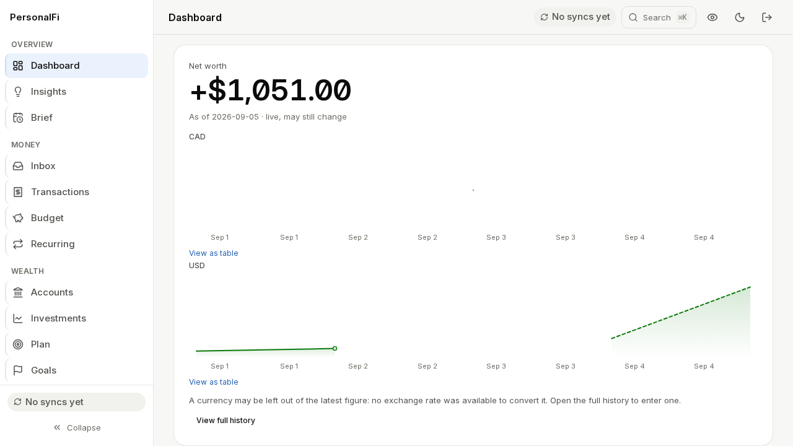 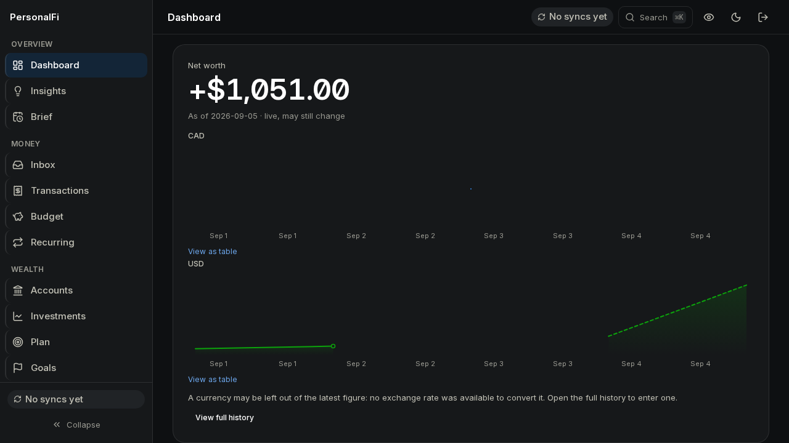       | 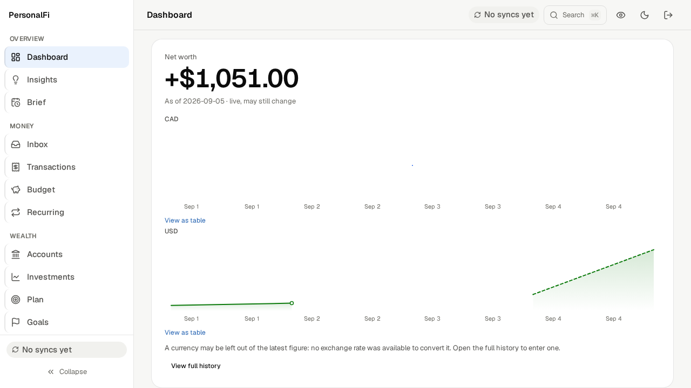 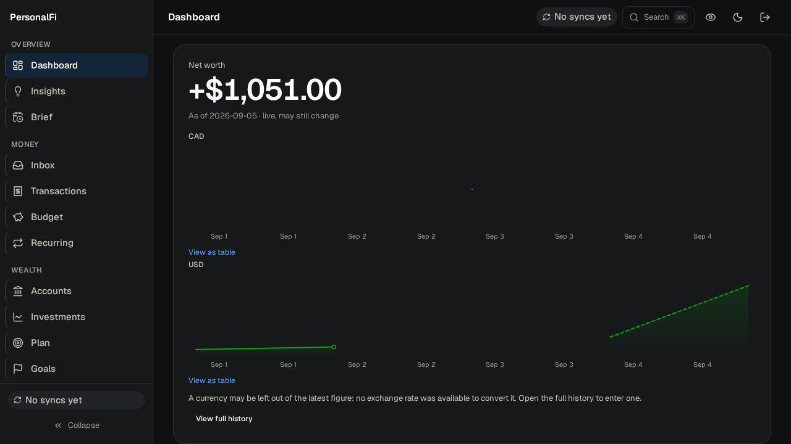       |
| Transactions | 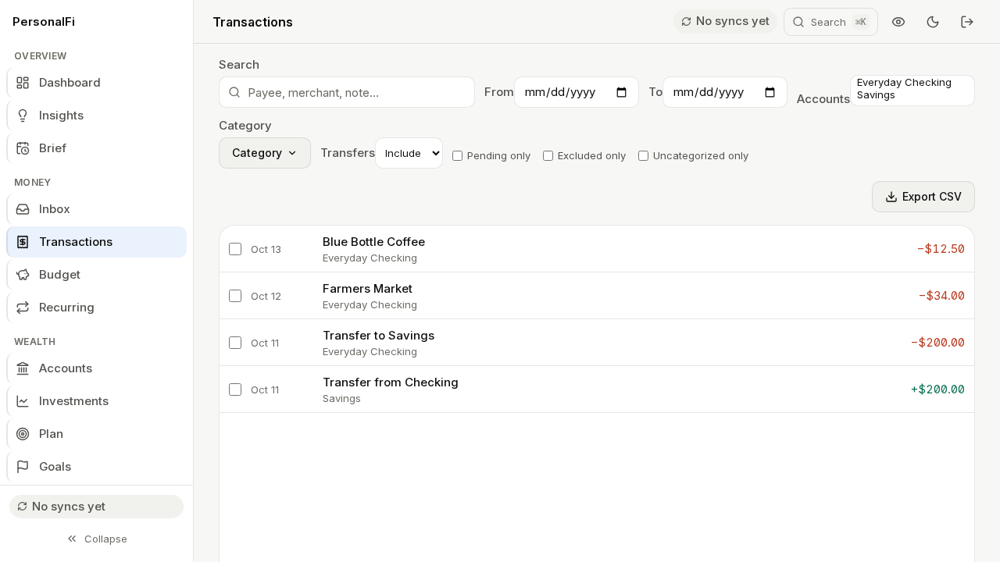 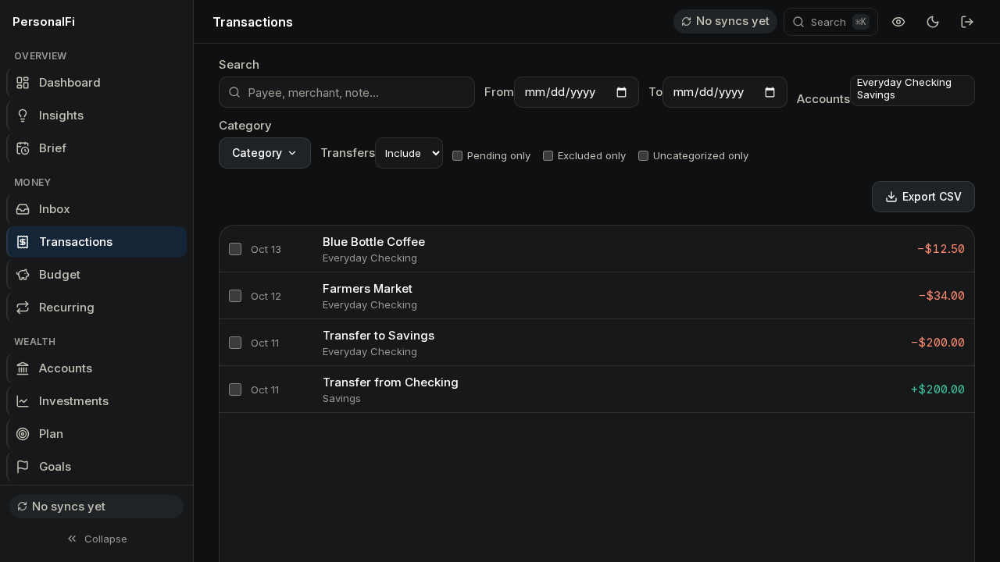 | 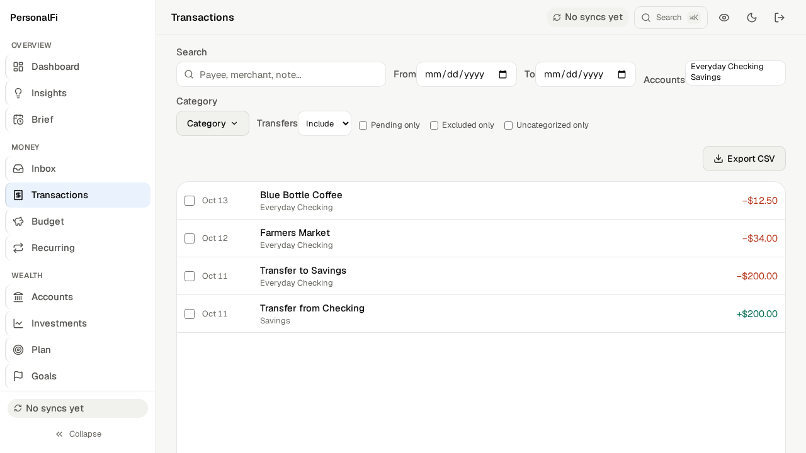 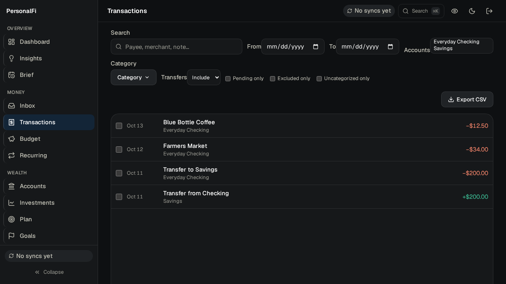 |
| Plan         | 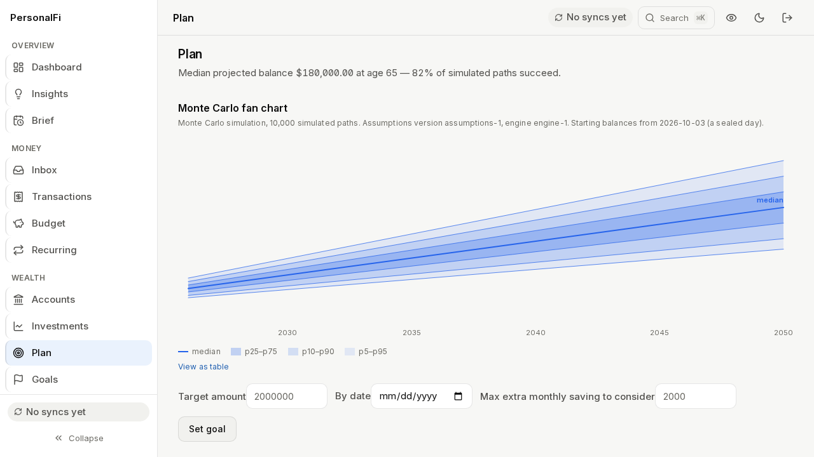 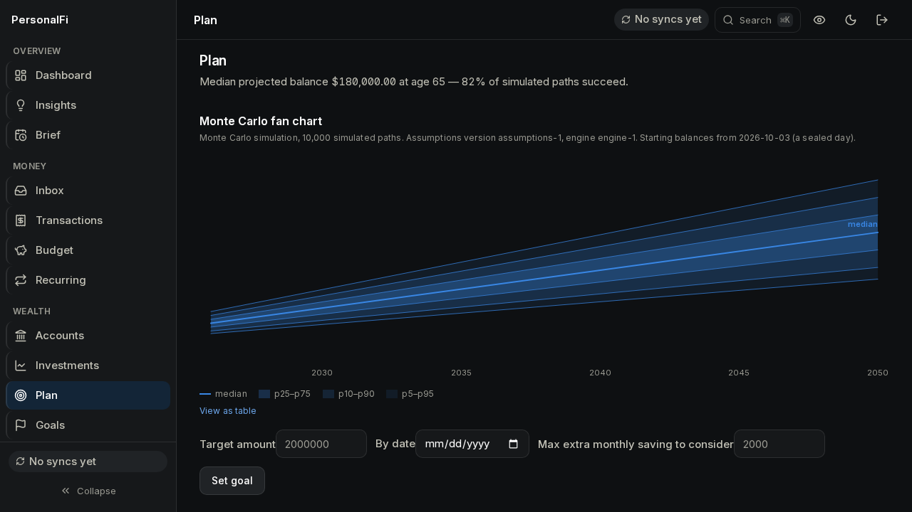                 | 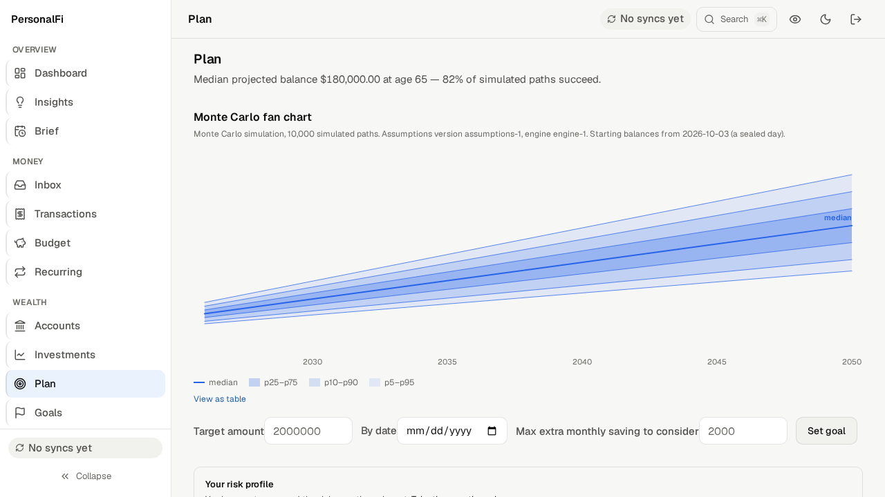 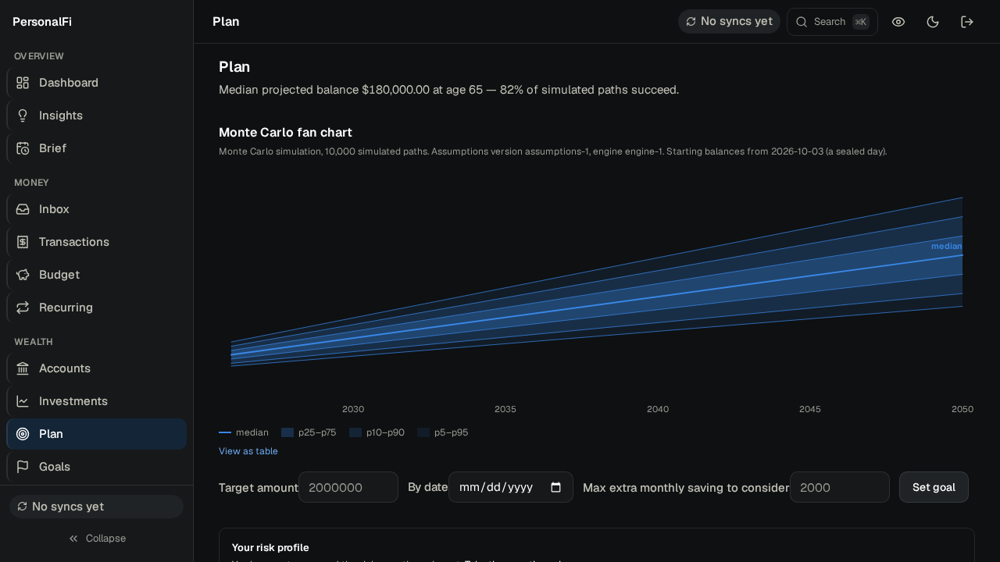                 |
| Brief        | 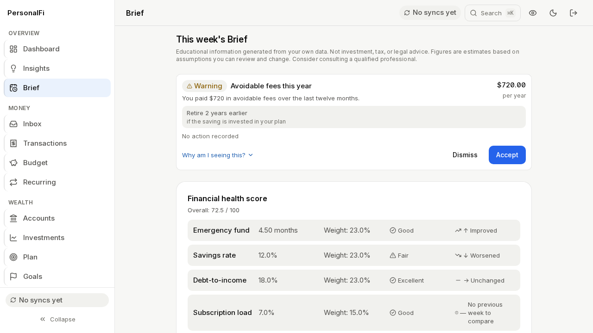 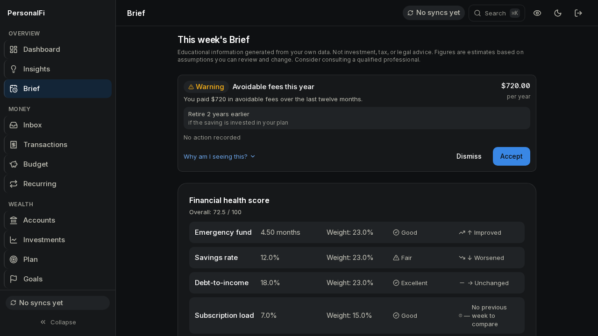               | 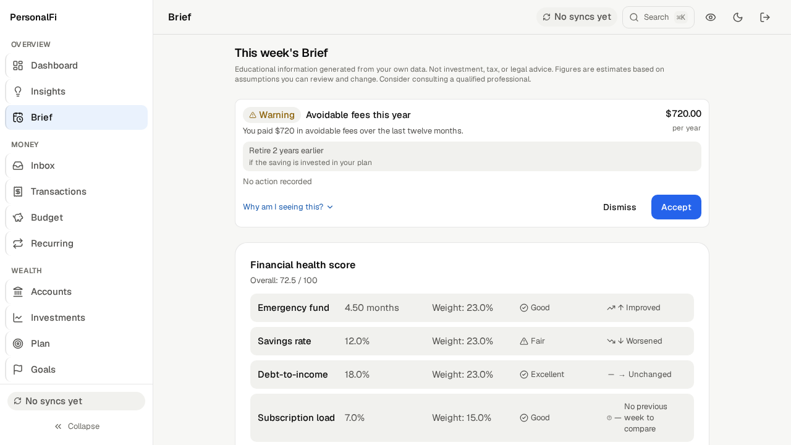 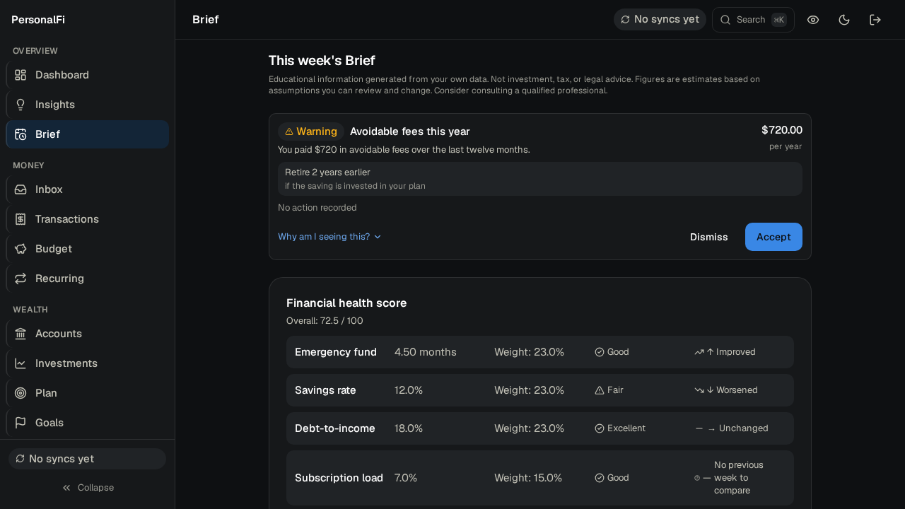               |

What is visible: the dashboard figure, previously a wide, mono-looking Inter tabular `+$1,051.00`,
is now a compact Geist figure; the amounts in the transactions list are a normal-width sans, still
right-aligned and aligned by digit; the minus sign is the real U+2212 in both. The a11y sweep's own
axe pass runs on these same screens.

## 6. Checks (all on the final tree)

| Check                                                                                                                    | Result                                                                                                   |
| ------------------------------------------------------------------------------------------------------------------------ | -------------------------------------------------------------------------------------------------------- |
| `pnpm --filter @app/web typecheck`                                                                                       | exit 0                                                                                                   |
| `pnpm --filter @app/web test` (includes `contrast.test.ts`)                                                              | 93 files, 568 tests passed                                                                               |
| `pnpm --filter @app/web build`                                                                                           | built; `check-sw-precache` OK; `check-csp` OK (no inline script or style)                                |
| Precache manifest (`dist/sw.js`)                                                                                         | `fonts/geist-variable-latin.woff2`, `fonts/geist-mono-variable-latin.woff2`; no Inter entry; 120 entries |
| Built CSS `@font-face`                                                                                                   | two rules, both `url(/fonts/...)` on this origin                                                         |
| `PW_SUITE=a11y playwright --project chromium -g "320\|200 %\|text spacing\|reflow"`                                      | 64 passed (320 px reflow, 200 % zoom, text spacing, every route)                                         |
| `a11y-sweep.spec.ts`: axe in both themes with every overlay open, axe canaries, harness, reduced motion, add-wallet form | 48 passed                                                                                                |
| `playwright --project csp` (real built app behind the production CSP header, fails on any violation)                     | 3 passed                                                                                                 |
| `node scripts/check-licenses.ts`                                                                                         | PASS; `THIRD_PARTY.md` regenerated and identical to the committed text                                   |
| `prettier --write` on every touched file; `eslint` on the three components                                               | clean                                                                                                    |

Not run: the keyboard spec (unaffected, per the dispatch), `a11y-sweep`'s per-route screenshot
test on the final tree beyond the evidence capture, and no browser other than Chromium.

## 7. Attribution

- `apps/web/public/fonts/OFL-Geist.txt` (the licence) and `README.md` (sources, versions, hashes).
- `THIRD_PARTY.md`: a paragraph for the two vendored typefaces. The file is generated by
  `scripts/check-licenses.ts` from the npm tree and a fixed preamble, and a hand edit alone would be
  overwritten on the next `just licenses`, so the paragraph is added to the preamble in the script as
  well; the regenerated file is byte-identical to the edited one.
- `docs/RELEASE-NOTES.md`: one bullet under v0.9.1.

## 8. Wiring outside the ownership list

- `apps/web/index.html` (the preload named the Inter file; a preload of a missing file is a 404
  and a console warning on every page load).
- `scripts/check-licenses.ts` (preamble paragraph, so the generator and `THIRD_PARTY.md` agree).
- `apps/web/src/styles/tokens.md` (documentation of the tokens, in the styles directory).
- Not changed: `docker/Caddyfile` (the CSP needs nothing: `font-src` falls back to `default-src
'self'`, and `/fonts/*` is already in the immutable static paths), `check-sw-precache.ts` (its
  allow-list names no font file), `vite.config.ts` (the precache glob is by extension).
