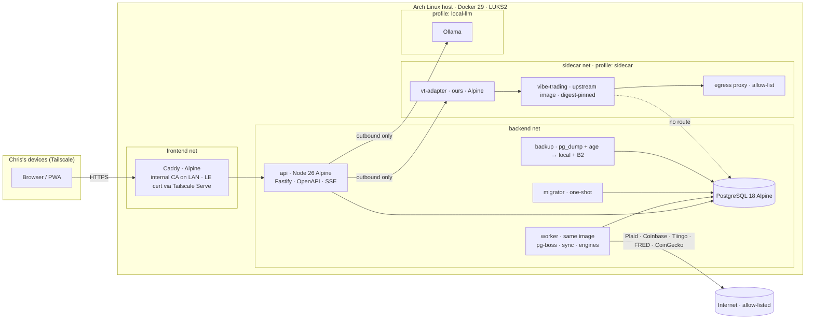

# PersonalFi — Master Implementation Plan

*Synthesized 2026-09-11 from a nine-seat expert panel (see [research index](../research/README.md)). Where memos disagreed, the decision and its reasoning are recorded in §1 and in [reconciliation-notes.md](reconciliation-notes.md). Every claim about a third-party service was verified against a primary source on 2026-09-10/11; those sources are cited in the memos, not repeated here.*

---

## 0. The one-paragraph version

A self-hosted, MIT-licensed, single-user personal-finance and advisory app. **TypeScript end to end** (Node 26, Fastify, Drizzle, React 19 + Vite), **PostgreSQL 18**, **Alpine containers behind Caddy on a Tailscale-only network with zero public ingress**. Plaid on its free **Trial plan** (verified: no business registration required as of 2026-04-15) for banks and brokerages, Coinbase's read-only API for crypto, Tiingo/FRED/CoinGecko for prices, all behind one `Connector` port so no provider is load-bearing. A **modular monolith** with eleven enforced bounded contexts, an append-only `domain_events` log, and an **Advisor contract** through which rules-based insights, a local LLM, and eventually the Vibe-Trading sidecar all deliver evidence-backed, human-reviewed recommendations. Vibe-Trading is a live-trading engine, not a research library, so it runs in an isolated container with no database, no credentials, and no path to place an order. Seven phases, roughly 70–105 solo developer-days with AI assistance, with the first genuinely advisory release at v0.7.

---

## 1. Decisions register

Decisions marked **irreversible** must hold before Phase 0 starts. Each cites the memo that argued it and notes any panel disagreement.

| # | Decision | Choice | Rationale and provenance |
|---|---|---|---|
| D1 | Language and runtime | **TypeScript on Node 26**, one language for API, worker, and UI. *Irreversible.* | 04 §1: Plaid SDKs are OpenAPI-generated for every language, so SDK quality is a non-differentiator; TS + Postgres is native-module-free on Alpine; Monte Carlo fits in a `worker_thread`. 03 preferred Go for supply-chain reasons but deferred; its condition is honored by making the supply-chain controls P0 (see D14). 08 said "Node 22 LTS"; overridden to Node 26 because it is what is installed, what 06 pinned (`node:26.8.2-alpine3.24`), and it enters LTS in October 2026. |
| D2 | Database | **PostgreSQL 18**. *Irreversible.* | 04 §2, 08 D2: `pg_trgm` for merchant clustering, `generate_series` for calendar math, `SKIP LOCKED` + `LISTEN/NOTIFY` for a transactional job queue, `NUMERIC`, JSONB, materialized views. SQLite would win on backup ergonomics; it loses on everything this app's hard problems need. 08 said PG 17; 06 verified `postgres:18.4-alpine` exists. |
| D3 | Money and quantities | `BIGINT` minor units paired with a currency code; `NUMERIC(38,18)` for security/crypto quantities; percentages as `Decimal`; banker's rounding at presentation only. *Irreversible.* | 04 §2.3, 07 §0, 08 D3. Floats are a correctness bug. |
| D4 | Multi-currency readiness | Currency on every amount; dual native+base storage with a historical FX rate on aggregates; USD-only UI in v1. *Irreversible.* | 08 D4, 09 Q2. |
| D5 | Key custody | Envelope encryption at the application layer (XChaCha20-Poly1305 + AAD, per-record DEKs for provider secrets, an epoch DEK for bulk PII columns). KEK derived via Argon2id from a passphrase delivered as a **Docker secret sourced from `systemd-creds`**, held mlock'd, **never in an env var**. A passkey-gated unlock page is the recovery path; TPM2 sealing is a P2 upgrade. **Scope rule: key loss = re-link providers, never = lose the ledger.** *Irreversible.* | 03 §2 (cipher, AAD, custody ladder), 08 D5 (scope rule). Reconciled: row-level encryption of provider secrets, exchange keys, LLM keys, and channel configs is P0; bulk encryption of memo/description columns is P2. Not `pgcrypto` (key would transit to the server and land in query logs). |
| D6 | Ownership column | `user_id` on every user-scoped table from the first migration. *Irreversible.* | 08 D6, 09 Q3. Single user now; multi-user is additive later. No role system is built. |
| D7 | Event log | `domain_events` transactional outbox from Phase 0, before any consumer exists. *Irreversible.* | 08 §3, D7. Budgeting, Recurring, Insights, Notifications are replayable consumers. |
| D8 | Module boundaries | Eleven bounded contexts with a boundary lint and a schema-ownership CI check from day one. *Irreversible.* | 08 §1, D8. |
| D9 | API style | **OpenAPI-first REST**, RFC 9457 errors, SSE for sync progress, TS client generated with `@hey-api/openapi-ts`. *Irreversible.* | 04 §6, 05 §1, 08 D9. tRPC would lock the API to TS consumers, foreclosing the sidecar adapter and Chris's own scripts. |
| D10 | Identifiers | UUIDv7 primary keys; provider natural keys as separate unique columns; pending→posted handled as identity migration on the surrogate key. *Irreversible.* | 01 §5.2, 04 §2.2, 08 D10. |
| D11 | Immutable facts + user overlay | Provider-sourced rows are never mutated by sync; user edits (category, splits, notes, exclusions) live in an overlay resolved by one pure function; denormalized effective columns for query speed. | 04 §2.2 (riskiest design decision #1). Equivalent to Maybe's `locked_attributes` idea, reimplemented clean-room. |
| D12 | Ingress | **Zero public ingress.** LAN + Caddy internal CA by default; remote via **Tailscale Serve**. Plaid **polling** of `/transactions/sync` on a 4–6 h cadence plus manual sync; webhooks are an optional compose profile. Bank OAuth redirect URI is `https://<node>.<tailnet>.ts.net/link/oauth`. | 03 §4, 06 §3. 01 recommended webhooks and flagged OAuth as needing a public URL; verified 2026-09-10 that the redirect is browser-only and needs HTTPS, not public reachability, and that Tailscale issues Let's Encrypt certificates. Choose a bland node name (it appears in CT logs). |
| D13 | Base images | **Alpine 3.24** for every image we own (Caddy, API/worker, migrator, backup, adapter). The Vibe-Trading sidecar and any scientific-Python container use upstream's image or `python:3.14-slim`. Pin by digest; multi-arch amd64+arm64. | 06 §1. Use `@node-rs/argon2`, avoid `better-sqlite3`. |
| D14 | Supply chain (P0, not P1) | Lockfiles with pinned digests; Renovate with 7-day `minimumReleaseAge`; `--ignore-scripts` globally; dependency-count budget; `gitleaks` pre-commit; SBOM + trivy/grype gates; cosign keyless signing. | 03 §7 (the May 2026 TanStack worm shipped with valid SLSA attestations). Promoted from P1 because D1 chose TypeScript. |
| D15 | License policy | MIT for our code, SPDX headers, `THIRD_PARTY.md` generated. CI **fails** on GPL/AGPL/SSPL/BUSL/Elastic/Commons-Clause/non-commercial CC and on `UNKNOWN` in the runtime tree; MPL-2.0 and LGPL allowed with review as unmodified deps. Deny-list seeded: `hyperformula`, `Levenshtein`, `python-Levenshtein`, `fuzzywuzzy`, `ofxtools`, `beancount*`. Vibe-Trading's dependency tree is out of scope (separate image). DCO, not CLA. | 06 §5.4, §7; 02 §4. |
| D16 | Aggregation | **Plaid Trial plan** as primary, requesting only `transactions`, `investments`, `liabilities`. No Auth, no Identity. **SimpleFIN Bridge** as the designated fallback adapter (banking only). Coinbase direct via CDP keys with `can_view` only. Never apply for paid Production "to see pricing": it forfeits Trial. | 01 §1–3. The 10-Item cap is a ratchet (`/item/remove` does not free slots), so the institution list is decided before the first Production link. |
| D17 | Market data | Tiingo default (personal-use ToS matches our deployment), FRED for macro, OpenFIGI for symbol mapping, CoinGecko Demo for crypto with the required attribution UI. Yahoo/yfinance opt-in only, labeled best-effort. | 01 §4, 02 §4.6. |
| D18 | Recurring detection | **Built in-house** (Plaid Recurring Transactions is not in the Trial bundle). Port Actual Budget's `find-schedules` algorithm (ISC), add merchant normalization from MIT/BSD primitives, confidence bands with a `candidate` state and user-confirmed pinning. | 01 §5.7, 02 §4.1–4.2, 04 §5.1, 07 §2. |
| D19 | Budgeting model | **Envelope-lite** as the default: flexible category targets + rollover + a "to be budgeted" pool + sinking funds; strict envelope and 50/30/20 as derived views on the same ledger. | 07 §1.9, 09 Q7 (both converge on this; Monarch's Flex model is the closest commercial analogue). |
| D20 | Frontend | React 19 + Vite 7 + TanStack Router/Query, SPA (no SSR), Tailwind v4 + shadcn/ui on Base UI vendored as source, **visx** for all charts, Lucide icons, CVD-safe teal/vermilion money colors, everything self-hosted (no CDNs, no analytics). Monte Carlo runs client-side in a Web Worker for slider interactivity; the server engine is the source of truth for saved scenarios. | 05. |
| D21 | Authentication | Passkeys (WebAuthn) primary with two or more authenticators enrolled, TOTP fallback, ten single-use recovery codes. `__Host-` cookies, Secure/HttpOnly/SameSite=Strict, 15 min idle soft-lock and 8 h absolute by default, with an explicit "trusted device" toggle extending refresh to 14 days under rotation with reuse detection. Step-up WebAuthn for credential access, Item add/remove, export, and sidecar acknowledgments. Rate limiting and lockout persisted in Postgres. | 03 §3 (defaults), 09 Q8 (trusted-device convenience). |
| D22 | LLM posture | Deterministic engine first. Local model (Ollama) is the shipped default for anything touching transaction-level data; a hosted API is permitted only for market-research queries carrying no personal data. Data minimization: aggregates, tokenized merchants, bucketed amounts. Every insight carries evidence links; LLM output may narrate a built-in finding but may not introduce numbers absent from the snapshot. | 03 §8, 08 §4, 07 §7. |
| D23 | Vibe-Trading | Never forked, never trusted. Separate upstream image pinned by digest, own internal network, egress allow-list, no DB route, no Plaid tokens, no broker credentials, app→adapter→sidecar traffic only, strict JSON schema on output, inert trade cards with step-up acknowledgment. Stage 0 (CSV export) first; Stage 0 may be permanent. **Phase 6, explicitly optional.** | 02 §1–2, 03 §8, 06 §7.3, 08 §5. Verified MIT, v0.1.15, executes live orders on 14+ brokers. |
| D24 | Backups | Nightly `pg_dump` encrypted with `age`, local plus Backblaze B2 with object lock (~$1/month); monthly restore drill via `just restore-drill` whose result shows on the in-app dashboard. LUKS2 on the host volume. | 03 P0-11/P0-13, 06 §4. |
| D26 | Plaid Link CSP/COEP exception (**PROPOSED — awaiting Chris's ratification**, Phase 1 re-gate condition D-1) | Amends D20's "no CDNs" for exactly one script: Plaid Link (`https://cdn.plaid.com/link/v2/stable/link-initialize.js`), which Plaid does not publish for self-hosting and rotates without versioned URLs or SRI hashes. Only when `PLAID_ENABLED=true` the proxy: (a) adds `https://cdn.plaid.com` to `script-src-elem`, `frame-src`, and the Plaid API hosts to `connect-src`; (b) sets `Cross-Origin-Embedder-Policy: unsafe-none` because Link runs in a cross-origin iframe that COEP `require-corp` and `credentialless` both block (proven in the real browser, gate §8.4); (c) sets `style-src-elem 'unsafe-inline' https://cdn.plaid.com` because Link injects an inline style element. With Plaid disabled the Phase 0 policy is byte-identical. Compensating controls: `object-src 'none'`, `base-uri 'none'`, `frame-ancestors 'none'`, no `unsafe-eval`, `script-src` (non-elem) unchanged so inline handlers stay blocked, the CSP e2e asserts both variants against committed expected strings, and `check-proxy-routes` plus the Caddyfile map keep the widening keyed to the flag. Rejected: self-hosting a copied `link-initialize.js` (breaks Plaid's rotation and terms, and a stale copy fails silently); a sandboxed same-origin wrapper page (still needs the cross-origin frame); giving up COEP everywhere (rejected — it stays `require-corp` when Plaid is off). Residual risk accepted: a compromise of cdn.plaid.com could run script in the app origin while Plaid is enabled; the same is true of every Plaid customer using Link, and the token custody design means the page holds no long-lived credential. Revisit if Plaid publishes SRI hashes or a self-host option. | gate-security-review.md §8.4, gate-remediation-web.md, D20, 01 §1.7. |

---

## 2. Product scope

### 2.1 Principles (from 09 §1)
1. Data leaves the box only to providers Chris chose, and every outbound destination is allow-listed.
2. Every recommendation shows its evidence and its dollar impact.
3. Calm, not gamified: no streaks, no confetti, no dark patterns.
4. The app never moves money and never executes trades.
5. Assumptions are always visible and editable.
6. The ledger must be trustworthy before anything is built on it.
7. Single user now, multi-user additive later; schema ready, UI not built.

### 2.2 MVP thesis (09 §6.1)
The minimum advisory slice is: connect accounts → trustworthy ledger with transfers and duplicates handled → detect every subscription and recurring bill → forward cash-flow projection → retirement projection with editable assumptions → a **Weekly Advisory Brief** of at most five evidence-backed actions, each showing its dollar impact and its effect on the retirement date.

### 2.3 Release ladder (09 §6.2, aligned with the phases in §5)

| Rung | Name | Done means | Phase |
|---|---|---|---|
| v0.1 | Foundation | Compose stack up, passkey login over TLS, one institution linked, restart without data loss, restore from backup verified, zero outbound traffic outside the allow-list | 0 |
| v0.2 | Trustworthy ledger | A month of real data reconciles: zero internal transfers in spend totals, no duplicates, pending resolves cleanly. **The trust gate.** | 1 |
| v0.3 | Understanding | ≥85% auto-categorization on real data; weekly review queue clears in under 2 minutes | 1 |
| v0.4 | Recurring and forward-looking | Subscriptions detected at recall ≥0.85 / precision ≥0.95; 30-day cash projection directionally correct | 2 |
| v0.5 | Portfolio | Holdings reconcile to balances; allocation matches a spreadsheet check; crypto on-ramps classified as transfers | 3 |
| v0.6 | Planning | Deterministic projection within 1% of a reference calculator; Monte Carlo reproducible with a fixed seed | 4 |
| v0.7 | Advisory | Weekly Brief yields ≥3 useful actions in its first month; every recommendation renders a full evidence panel | 2, 5 |
| v0.8 | Budget and report | Budgets exclude transfers and net refunds; full export round-trips into a clean instance | 2 |
| v0.9 | Polish and harden | Performance targets met, WCAG 2.2 AA checks pass, security review closed, a stranger can install from the README | all |
| v1.0 | PersonalFi 1.0 | 90 days as Chris's only finance tool; unattended upgrade from v0.1 works | — |
| v1.x | Trading research | Vibe-Trading optional, read-only, isolated; app fully functional with it absent | 6 |

Cut order under pressure: Sankey → health score → sinking funds → tax-aware rebalancing detail → crypto cost basis. **Never cut:** transfer pairing, evidence panels, backup/restore, projection validation.

### 2.4 Out of scope for v1
Bill negotiation, automated cancellation, trade execution, any money movement, multi-user UI, tax filing, regulated advice, credit monitoring, native mobile apps, receipt OCR, insurance/estate/college planning, DeFi/NFT position tracking, public multi-tenant hosting. Full table with reasons in 09 §6.4.

---

## 3. Architecture at a glance

### 3.1 Bounded contexts (08 §1)
Identity & Security · Connections (the `Connector` port and adapters) · Ledger · Categorization & Rules · Budgeting · Recurring · Investments & Market Data · Planning (goals, projections) · Insights/Advisory (the `Advisor` contract) · Notifications · Integrations (sidecar adapter). Each owns its tables; cross-context coupling goes through `domain_events`. Import boundaries are linted in CI.

### 3.2 Runtime topology

### 3.3 Key seams
- **`Connector` port** (08 §2, 04 §4.1): `connect`, `capabilities()`, `listAccounts`, `syncTransactions(cursor)`, `syncHoldings`, `syncLiabilities`, `disconnect`, plus an error taxonomy that maps `ITEM_LOGIN_REQUIRED` to a one-click update-mode flow. Adapters: Plaid, SimpleFIN, Coinbase, WalletRpc, CsvImport, Manual. A shared conformance suite makes a new adapter a ~200-line, one-day job.
- **Sync pipeline** (04 §4.2): `/transactions/sync` cursor loop, commit data + cursor atomically per page, restart from the page-1 cursor on `TRANSACTIONS_SYNC_MUTATION_DURING_PAGINATION`, pending→posted as identity migration, historical backfill with `days_requested: 730`, `Plaid-Version: 2020-09-14`, `personal_finance_category_version: "v2"`.
- **Analytics engines as pure modules** (04 §5, 07): recurring detection, categorization (rules → provider category → local classifier), Envelope-lite budgeting math, net-worth snapshots, portfolio analytics (TWR and MWR/XIRR, classification waterfall, lots with FIFO/LIFO/HIFO/specific-ID), projections (deterministic + Monte Carlo, seeded), and a 52-rule insight catalog with dollar-impact formulas.
- **`Advisor` contract** (08 §4): versioned JSON schema; input is a read-only, minimized snapshot; output is `Insight[]` with evidence refs, confidence, severity ceiling, `requires_review: true`; sandbox harness, circuit breaker, four-level kill switch. Built-in rules in Phase 2, local LLM in Phase 5, Vibe-Trading in Phase 6, all through the same contract.

### 3.4 Non-functional targets (08 §7, 09 §5)
Transactions list p95 under 200 ms at 50k rows; 10k Monte Carlo paths ≤ 800 ms p95 with byte-identical output for a fixed seed; nightly sync completes in under 5 minutes; backup RPO 24 h, RTO 1 h; whole stack under 2 GB RAM without the LLM profile; WCAG 2.2 AA; zero-touch migrations on upgrade.

---

## 4. Security baseline

The full P0/P1/P2 checklist with "done" evidence is 03 §9. **No Plaid Production credentials until every P0 is green.** The P0 set, in one screen:

1. Provider tokens, exchange keys, LLM keys encrypted app-layer before insert; a test reads the raw column via `psql` and asserts no plaintext.
2. KEK never in env or cleartext on disk; Argon2id (m≥1 GiB, t=4, p=4); `docker inspect` and `/proc/<pid>/environ` clean.
3. Only the proxy publishes a port, bound to a LAN/Tailscale address; external `nmap` output saved.
4. Passkeys working, ≥2 authenticators, 10 recovery codes.
5. Session cookie attributes asserted by test; refresh reuse kills the session family.
6. No Docker socket mounted; no `privileged`, `--net=host`, `--pid=host`; CI greps compose files.
7. All containers non-root, `cap_drop: ALL`, `no-new-privileges`, `read_only: true`.
8. Sidecar cannot resolve or reach `db`.
9. Sidecar holds no broker write credentials; only an LLM key under `/run/secrets`.
10. `gitleaks` and `trivy --scanners secret` clean.
11. Encrypted backups running and restore tested end to end.
12. No token or account number in logs; CI test greps captured sandbox-sync logs.
13. LUKS2 on the `pgdata` and backup volume.
14. Rate limiting and lockout on auth endpoints, persisted across restart.

Plus, per D14: Renovate cooldown, `--ignore-scripts`, license gate, and digest pinning are P0.

---

## 5. Phased roadmap

Effort is for one developer with AI agents doing most of the typing; ranges are from 08 §8.1, adjusted where the panel's decisions changed scope (polling instead of webhooks removes work in Phase 1; Plaid Trial removes the "longest-lead" wait).

### Phase 0 — Foundations (8–12 days) → v0.1
**Deliverables:** monorepo (`apps/api`, `apps/web`, `packages/domain-*` one per context, `packages/kernel` for Money/Quantity/DateOnly/Clock/ids, `packages/contracts` for OpenAPI and the Advisor schema); boundary lint + schema-ownership check; typed config with boot validation; Postgres + Drizzle migrations with advisory-lock boot; `domain_events` outbox + consumer pump + pg-boss + scheduler; structured logging with correlation ids and redaction; auth (passkeys via SimpleWebAuthn, TOTP, recovery codes, sessions); `SecretBox` envelope encryption + KEK custody; `compose.yml` with Caddy, api, worker, migrator, backup, db, all hardened per §4; CI (typecheck, lint, unit, migration test, multi-arch build, SBOM, trivy, license gate, gitleaks); Renovate config; backup + restore scripts + first restore drill; `RUNBOOK.md`; demo-seed generator skeleton; feature-flag table; LICENSE (MIT), `THIRD_PARTY.md` generation, DCO.
**Exit:** `docker compose up` on a clean box yields a passkey login over TLS in under 60 s; a boundary violation fails CI; a killed worker resumes a job; restore verified; secrets-in-logs test passes; all 14 P0 items have recorded evidence.
**Start in parallel:** Plaid dashboard signup (Sandbox now; Trial identity verification), Tiingo/FRED/CoinGecko/OpenFIGI keys, Coinbase CDP `can_view` key, Backblaze bucket with object lock, Tailscale HTTPS + MagicDNS enabled.

### Phase 1 — Ledger, Plaid, categorization, transactions UI (13–20 days) → v0.2, v0.3
**Deliverables:** Ledger context (accounts, transactions, splits, transfer pairing, refund netting, duplicate detection across providers, closed accounts); `Connector` port + conformance suite; `PlaidConnector` (Link, token exchange, `/transactions/sync` polling, update mode, `/item/remove` + local purge + DEK destroy); `CsvImportConnector` (vendor Actual's OFX/QIF/CAMT parsers) + `ManualConnector`; `SyncOrchestrator` with per-page commit, backoff, idempotency, `sync_runs` history; Categorization (own taxonomy of ~20 top-level × 2 levels seeded from PFCv2 structure with our own labels, rules engine with split/link/notify actions, merchant normalization pipeline, provider category as a feature, user override with provenance, `learn_categories` on payees); transactions UI (virtualized list, keyset pagination, URL-serialized filters, search, bulk edit, split, rule-from-transaction, review inbox); connections UI with reconnect CTA.
**Exit:** two real institutions syncing on schedule; 50k-row seed meets list/search budgets; conformance suite green for Plaid, CSV, Manual; a forced reauth completes without data loss or duplicate accounts; ≥85% auto-categorization on seeded data; **spend totals contain zero internal transfers** on a month of real data.

### Phase 2 — Budgeting, recurring, insights v1, notifications (10–15 days) → v0.4, v0.8
**Deliverables:** Budgeting (Envelope-lite: periods incl. non-calendar, targets, rollover, "to be budgeted", sinking funds, pace indicator, actuals read model, threshold events); Recurring (candidate detection via ported `find-schedules`, confirm/merge/reject, cadence and amount tolerance, price-change and dormancy detection, duplicate-service detection, upcoming calendar, forward cash-flow and safe-to-spend); Insights v1 with the full Advisor contract for `builtin` advisors (~20 rules from 07 §3: subscriptions U1–U8, cash C1–C7, spending S1–S10 subset), insight feed with evidence, dollar impact, accept/snooze/dismiss with persistence; Notifications (ntfy + SMTP, thresholds, quiet hours, digest coalescing); reports (spending/income, Sankey, drill-through) and full export/import.
**Exit:** a month closes and rolls over correctly across a timezone and DST boundary; recurring detection meets recall ≥0.85 / precision ≥0.95 against Chris's confirmed list; every built-in advisor produces resolvable evidence refs; a 2,000-transaction backfill yields one coalesced notification; export round-trips into a clean instance.

### Phase 3 — Investments, crypto, net worth, market data (12–18 days) → v0.5
**Deliverables:** Investments context (securities with `SecurityResolver` via OpenFIGI, holdings and snapshots, investment transactions, cost-basis lots with FIFO/LIFO/HIFO/specific-ID, corporate-action splits, asset-profile overrides); `CoinbaseConnector` (Advanced Trade v3, CDP JWT, `key_permissions` assertion at startup) with the **v3 ledger-gap prototype done first**; `WalletRpcConnector` for watch-only BTC (xpub derivation + Esplora) and ETH (Etherscan v2 / Alchemy) balances; price + FX ingestion (Tiingo, FRED, CoinGecko with attribution) with source priority and staleness flags; `net_worth_daily` snapshotter with seal semantics; net worth (assets vs debts), allocation (asset class / region / sector look-through), holdings aggregated by ticker across accounts, TWR and MWR, fee drag, idle cash, concentration, drift vs target; investing insights I1–I10 and debt rules D1–D6.
**Exit:** net worth reconciles to a hand computation across every account type including a manual asset and a liability; a past date's net worth is immutable across a re-run; ETH on Coinbase and in a wallet resolves to one security; a missing FX rate surfaces rather than defaulting; allocation matches a spreadsheet check.

### Phase 4 — Goals and retirement projection (8–12 days) → v0.6
**Deliverables:** Planning context (goals, contribution plans, risk profile with the consistency-penalty questionnaire, scenarios, assumptions from 07 Appendix A in one config file); deterministic projection from **revealed behavior** (rolling 12-month actual savings and spending); Monte Carlo in a `worker_thread` (parametric lognormal by default, bootstrapped Shiller as an option, crypto as its own asset class) with stored seed; glidepath, Social Security and pension inputs, tax-bucket awareness; projection UI (fan chart with labeled percentiles and an explicit "median" label, clickable dotted gap line that solves for required monthly savings, draggable life events, scenario compare); client-side Web Worker for slider interactivity; `GoalOffTrack` events into Insights; R1–R7 rules.
**Exit:** 10k paths ≤ 800 ms p95; identical seed ⇒ identical bytes; deterministic output within 1% of an independent reference calculator on the shipped fixtures; assumptions visible, editable, cited.

### Phase 5 — Advisory engine v2 (8–12 days) → v0.7
**Deliverables:** Weekly Advisory Brief (≤5 actions ranked by dollar impact, each with its effect on retirement date); health score with breakdown; anomaly and fee hunter; `local_model` advisor kind behind the Advisor contract with Ollama (no egress), grounded narration only (every numeric claim must exist in the snapshot); prompt-injection defenses (delimited untrusted blocks, Unicode/control sanitization, schema-validated output) with a ≥20-payload adversarial corpus; sandbox harness, circuit breaker, four-level kill switch; advisor management UI with scope grants; run inspector with `input_digest`; payload preview before the first send of any new query type; dismiss-reason feedback loop into rule tuning.
**Exit:** LLM advisor killable at all four levels with the app unaffected; red-team pass yields zero schema-valid insights with fabricated figures; ≥95% of generated insights pass evidence-ref validation on first attempt; the Brief produces ≥3 genuinely useful actions in its first month.

### Phase 6 — Vibe-Trading sidecar (Stage 0: 0.5 day · Stage 1: 3–5 days · Stage 2: 5–8 days) → v1.x
**Deliverables:** per 02 §2.5 and 08 §5.5. Stage 0 is a CSV export. Stage 1 adds `vt-adapter`, the sidecar compose profile, egress proxy, contract tests, compatibility matrix file, Renovate watching upstream. Stage 2 adds an interactive panel behind a flag.
**Exit:** container-inspection test asserts no credential, no DB route, no writable shared mount, no inbound port; dashboard renders identically with the profile down; any trade-shaped output is an inert card requiring step-up acknowledgment.
**Explicitly last and explicitly optional.** Stage 0 may be the permanent answer.

### Phase 9 — Polish and harden (runs across phases, converges before v0.9/v1.0)
WCAG 2.2 AA pass, performance pass, external-style security review against ASVS 5.0 L2 (L3 on credential storage and auth), docs (install, upgrade, backup, restore, threat model), 90-day real-use soak, multi-version upgrade test.

---

## 6. Delegation strategy

The panel worked. The same pattern executes the build: **specialist agents own work packages, a small set of gates enforce quality, and the human decides only the irreversible things.**

### 6.1 Roles

| Role | Agent type | Responsibility |
|---|---|---|
| Orchestrator | this session (or `sc:pm`) | Sequences work packages, keeps the decisions register, runs gates, never writes domain code itself |
| Foundation engineer | `backend-architect` / `python-expert`-class for TS | Phase 0 kernel, migrations, outbox, queue, config |
| Security engineer | `security-engineer` | Owns `SecretBox`, auth, compose hardening, P0 evidence, red-team corpus, reviews every phase's diff |
| Platform engineer | `devops-architect` | Dockerfiles, compose, CI matrix, Renovate, license gate, backups, Tailscale |
| Ledger engineer | `backend-architect` | Ledger, Connector port, Plaid/CSV/Manual adapters, sync orchestrator |
| Analytics engineer | `backend-architect` + `performance-engineer` | Recurring, categorization, budgeting math, portfolio analytics, projections |
| Frontend engineer | `frontend-architect` | Design system, screens, charts, Plaid Link UX, accessibility |
| Quality engineer | `quality-engineer` | Conformance suites, golden fixtures, property tests for money, seed generator, Playwright e2e, migration tests |
| Domain reviewer | `deep-research` / `requirements-analyst` | Validates engine outputs against reference calculators and the 07 formulas; owns the labeled recurring/merchant golden set |
| Simplifier | `refactoring-expert` / `simplify` skill | Post-phase cleanup pass so the modular monolith stays modular |

### 6.2 Work-package rules
1. **One context per package.** A package touches one bounded context plus its tests; cross-context needs go through an event or a port, never a shared package.
2. **Contract before implementation.** OpenAPI paths, Zod schemas, Drizzle tables, and the event names for a package are written and reviewed before the implementation agent starts. The frontend agent codes against the generated client in parallel.
3. **Tests are part of the package, not a follow-up.** Each package ships unit tests, and where applicable a conformance-suite entry, a golden fixture, or a property test.
4. **Evidence, not assertion.** A package is "done" when its exit criterion from §5 has a recorded artifact (test output, `docker inspect` capture, scan report) checked into `docs/evidence/`.
5. **Parallel by default, serial at seams.** Within a phase, packages on different contexts run concurrently. The Phase 0 kernel, the Connector port, and the Advisor contract are serial gates that other packages wait on.

### 6.3 Gates (run by the orchestrator at the end of every phase)
- **Security review** of the phase diff by `security-engineer`, checking the relevant P0/P1 items and the "never" list (no env secrets, no eval of advisor output, no dollars to the sidecar).
- **Boundary and license CI** green, dependency-count delta justified.
- **Domain validation** for any engine: reference-calculator comparison or golden-set precision/recall recorded.
- **Simplify pass** on the changed code.
- **Runbook update** if any operational step changed.

### 6.4 Parallelism map
- Phase 0: platform, security, and foundation packages run concurrently; frontend scaffolds the design system and Storybook-free component set against mock data.
- Phase 1: ledger + Plaid adapter (serial gate: Connector port) ∥ categorization engine ∥ transactions UI ∥ quality seed generator.
- Phase 2: budgeting ∥ recurring ∥ notifications; insights v1 waits on recurring; reports UI waits on budgeting read model.
- Phase 3: investments context (serial gate: `SecurityResolver`) ∥ Coinbase prototype ∥ market-data ingestion ∥ net-worth UI.
- Phase 4: engine ∥ projection UI (against a stub engine) ∥ domain reviewer builds reference fixtures.
- Phase 5: LLM advisor ∥ Brief UI ∥ red-team corpus.

### 6.5 Human decision points
Chris decides: the §1 irreversible set (ratify or override now), the §8 must-answer questions, the institution list before the first Production link (10-Item ratchet), the first send of any payload to a hosted LLM, and whether Phase 6 goes beyond Stage 0. Everything else proceeds on the stated defaults.

---

## 7. Risk register

| # | Risk | Likelihood × impact | Mitigation | Owner memo |
|---|---|---|---|---|
| R1 | Malicious dependency reads the KEK in-process | High × Critical | D5 custody, D14 supply-chain controls as P0, dependency-count budget, `--ignore-scripts` | 03 |
| R2 | Vibe-Trading compromise or prompt injection reaches money | Med × Critical | D23 structural isolation; no broker credentials exist; inert trade cards; Stage 0 first | 03, 08 |
| R3 | Recurring detection false positives erode trust | High × Med | Confidence bands, `candidate` state, user-confirmed pinning, golden set with P/R gate, rules as escape hatch | 04, 07 |
| R4 | Overlay-resolution logic leaks into ad-hoc SQL | Med × High | One pure resolver, denormalized effective columns, golden test for pending→posted overlay survival | 04 |
| R5 | Plaid 10-Item ratchet burned by experimentation | Med × High | Sandbox for every flow first; institution list decided and documented before the first Production link | 01 |
| R6 | Coinbase v3 lacks deposit/withdrawal/staking ledger | High × Med | Prototype against the real account first in Phase 3; fall back to CSV export for cost basis | 01, 02 |
| R7 | Alpine/musl breaks a native dependency | Low × Med | Pure-JS stack by construction; `@node-rs/argon2`; verify any new native module in Phase 0; escape hatch documented | 04, 06 |
| R8 | Key loss | Low × High | Scope rule: key loss = re-link providers only; recovery codes; unlock-page recovery; restore drills | 03, 08 |
| R9 | Data loss (disk, house fire) | Low × Critical | Nightly encrypted backups to local + B2 with object lock; monthly restore drill on the dashboard | 06 |
| R10 | Scope creep past the advisory MVP | High × Med | Release ladder and cut order in §2.3; never-cut list; phase exit criteria | 09 |
| R11 | Advice liability language | Low × Med | Educational, non-directive phrasing enforced by a regex lint (07 §7); every insight paired with its cost; audit trail of what was shown and why | 07 |
| R12 | Copyleft creep via look-alike packages or copied AGPL schema | Med × High | D15 deny-list and two scanners; clean-room rule for AGPL prior art | 02, 06 |
| R13 | Plaid taxonomy or API changes retroactively shift history | Med × Low | Provider category stored immutable; own taxonomy with a mapping layer; pinned API version | 01 |
| R14 | Polling freshness floor disappoints | Med × Low | 4–6 h cadence, manual "sync now", optional webhook profile if ever wanted | 06 |
| R15 | Solo-maintainer burnout from ops ceremony | Med × High | Unattended restart via Docker secret, no unlock ceremony in the default path, one-command restore drill, Renovate | 03 §0 |

---

## 8. Open questions for Chris

Work proceeds on the default; an answer becomes a cheap change. Full list with rationale in 09 §7.

**Must answer before Phase 1 (defaults in bold):**
1. Tax residence: **US, one configurable state**.
2. Base currency and non-USD assets: **USD base, currency-aware model, USD-only UI in v1**.
3. Household vs individual: **individual; `user_id` everywhere so a partner can be added later**.
4. Institutions and account count, and which of them go into the 10 Plaid slots: **~8 institutions / ~12 accounts; manual or SimpleFIN for the rest**.
5. Crypto sources: **Coinbase read-only key; watch-only addresses; manual otherwise; never private keys**.
6. Auth appetite: **passkeys + TOTP + recovery codes; 15 min idle / 8 h absolute; optional 14-day trusted device**.
7. Remote access: **Tailscale only; no public ingress**.
8. Retirement inputs: **derive from data; onboarding wizard asks age (65), target spend (observed), Social Security at full retirement age**.
9. Target allocation: **ask in onboarding; drift alerts suppressed until set**.
10. History depth and pre-Plaid records: **730-day backfill; CSV/OFX import in Phase 2**.

**Can defer:** notification channels, whether a hosted LLM is ever allowed, PWA installability, anomaly aggressiveness, crypto in the retirement projection, rebalancing bands, which parts of Vibe-Trading are wanted, retention, a read-only scripting API, strict envelope mode.

---

## 9. Immediate next actions (Phase 0 kickoff)

1. Ratify or override the §1 irreversible decisions D1–D10 and D15.
2. Answer the ten must-answer questions in §8, or accept the defaults.
3. Create the Plaid account (Sandbox first) and complete Trial identity verification; do **not** request paid Production.
4. Enable Tailscale HTTPS certificates and MagicDNS; pick a bland node name.
5. Provision keys: Tiingo, FRED, CoinGecko Demo, OpenFIGI, Coinbase CDP (`can_view` only), Backblaze B2 bucket with object lock.
6. `git init`, add the MIT LICENSE, commit `docs/`, and open the Phase 0 work packages per §6.4.

---

## 10. Research index

| Memo | What it settles |
|---|---|
| [01 Aggregation & Plaid](../research/01-aggregation-plaid.md) | Trial plan, product scope, sync semantics, fallbacks, crypto and market-data providers |
| [02 Ecosystem & Vibe-Trading](../research/02-ecosystem-vibe-trading.md) | What Vibe-Trading is, the integration contract, prior art, vendorable components, license traps |
| [03 Security architecture](../research/03-security-architecture.md) | Threat model, key custody, auth, network, container hardening, supply chain, LLM controls, P0/P1/P2 checklist |
| [04 Backend architecture](../research/04-backend-architecture.md) | Stack, database, ER diagram, sync pipeline, analytics engines, API, testing, repo layout |
| [05 Frontend architecture](../research/05-frontend-architecture.md) | Stack, design tokens, charts, sitemap, interactions, Plaid Link UX, security UX, accessibility |
| [06 Platform, DevOps, licensing](../research/06-platform-devops-licensing.md) | Alpine strategy, compose topology, ingress, backups, CI matrix, license policy, sidecar upgrades |
| [07 Advisory domain](../research/07-advisory-domain.md) | Budgeting math, recurring detection spec, 52-rule insight catalog, portfolio analytics, projection engine, guardrails, 2026 US parameters |
| [08 System architecture](../research/08-system-architecture.md) | Bounded contexts, Connector port, event flow, Advisor contract, sidecar seam, NFRs, phase table, irreversible decisions |
| [09 Requirements PRD](../research/09-requirements-prd.md) | Principles, persona, MoSCoW feature map with acceptance criteria, benchmark matrix, NFRs, MVP ladder, open questions, success metrics |
| [Reconciliation notes](reconciliation-notes.md) | Where memos disagreed and how each was resolved |
