# Backend & Data Architecture Memo — PersonalFi

**Author:** Backend/Data panel seat
**Date:** 2026-09-10
**Status:** Proposed (decision record)
**Scope:** Server-side stack, persistence, domain model, sync, analytics, API, testing, repo layout.

> Constraints assumed: one human user (Chris), self-hosted on his own Linux box, Docker 29 (Alpine base
> preferred), MIT license for the core, security is a first-class requirement, and a separately-maintained
> Python LLM sidecar (HKUDS/Vibe-Trading) will later be integrated **across a network boundary**.

---

## 0. TL;DR

| Decision | Choice | Confidence |
|---|---|---|
| Language / runtime | **TypeScript on Node 26** | High |
| HTTP framework | **Fastify 5** (JSON Schema → OpenAPI) | High |
| ORM / query layer | **Drizzle** (SQL-first, owned migrations) | Medium-High |
| Database | **PostgreSQL 18** | High |
| Job runner | **pg-boss** (Postgres-backed, no Redis) | High |
| API style | **REST + OpenAPI**, typed client generated for the frontend | High |
| Heavy numerics | **In-process TypeScript + Float64Array + worker_threads**; Python quant sidecar only if proven necessary | Medium |
| Sidecar integration | Network boundary, separate container, separate repo, scoped token, data-minimised | High |

The governing principle: **one language for everything that touches the ledger, service boundaries for
everything else.** Polyglot at the process boundary is cheap; polyglot inside one codebase is what kills
solo projects.

---

## 1. Stack Decision

### 1.1 What actually differentiates the candidates

Most stack comparisons for this kind of app are noise, because the three candidates are all *fine*. Let me
kill the non-differentiators first, then argue only the axes that really move:

**Non-differentiator — Plaid SDK quality.** Plaid's Node, Python and Go bindings are all generated from the
same OpenAPI schema, all support only the current API version (`2020-09-14`), and all are refreshed on
roughly a monthly cadence. There is no meaningful feature or maturity gap between them for Transactions
Sync / Investments / Liabilities. Anyone who tells you "the Python SDK is better" is pattern-matching on
2019. *(Sources: Plaid Libraries + Changelog docs, checked 2026-09-10.)*

**Non-differentiator — raw performance.** One user. Peak load is a sync fanning out over maybe 8 items and a
few thousand transactions. All three languages are four orders of magnitude faster than required. The only
place performance is arguable is Monte Carlo, addressed in §1.4.

**Non-differentiator — "Python is better at money."** `decimal.Decimal` is genuinely more ergonomic than
anything in JS or Go. But the correct design stores money as **integer minor units**, which makes the
question moot (§2.3). Decimal ergonomics only matter if you were going to do decimal arithmetic, and you
aren't.

That leaves four axes that actually decide it.

### 1.2 Axis 1 — Single-language full stack (decisive)

The frontend seat will pick React/Next or SvelteKit. Either way the browser runs TypeScript. For a **solo
maintainer**, a TypeScript backend collapses:

- One toolchain, one linter, one formatter, one test runner, one dependency-audit surface.
- One set of validation schemas. The Zod/JSON-Schema object that validates `POST /budgets` is the same
  object that types the form, the same object that generates the OpenAPI entry. Write the invariant once.
- Shared domain vocabulary: `Money`, `AccountingDate`, `CategoryId` are literally the same types on both
  sides of the wire, so a rename is a compile error rather than a runtime 500 six weeks later.

The cost of the alternative is not "learning Python" — Chris knows it — it is **context-switching tax paid
forever on a project with one contributor and no deadline pressure**. Projects like this die of friction,
not of missing features. This axis alone is worth more than all the others combined.

Go and Python both fail it. Go worst: no type sharing with the frontend at all, plus roughly 2–3× the line
count for what is fundamentally a CRUD-plus-aggregation application. Go's strengths (concurrency, static
binaries, predictable latency) are answers to problems this app does not have.

### 1.3 Axis 2 — Alpine / musl native-module pain (decisive, and counter-intuitive)

This axis usually gets hand-waved. It shouldn't, and it does **not** point where people expect.

**TypeScript can be made 100% native-module-free — but only if you choose Postgres.** The Postgres drivers
`pg` and `postgres.js` are pure JavaScript. Fastify is pure JS. Drizzle is pure JS. Argon2 and WebAuthn/
passkey verification have pure-JS or `node:crypto`-backed implementations. So the entire Alpine image is
`node:26-alpine` + a `node_modules` tree with **zero** compilation steps, zero `node-gyp`, zero Python
build dependency in the image, and a Dockerfile that never breaks on a Node upgrade.

Contrast with the SQLite path in Node: `better-sqlite3` builds against raw V8 internals (not N-API), so it
needs a fresh prebuilt binary matched to every Node ABI bump, and the musl builds have historically lagged
the glibc ones by months — with `node-gyp` fallback compilation inside Alpine as the failure mode.
Node 26's built-in `node:sqlite` sidesteps this, but it is a much thinner API than `better-sqlite3`.
**This is a real argument for Postgres, not just a preference** (§2).

**Python is the *worst* fit for Alpine here**, which is the opposite of the intuition that "Python is the
data language so it must be fine." musllinux wheels (PEP 656) have rolled out broadly and NumPy/pandas now
publish them, but SciPy's musl wheels remain patchy on PyPI, and any package without a musl wheel triggers
a full source build — the well-documented "Alpine makes Python Docker builds dramatically slower" problem.
The standard mitigation is *don't use Alpine for Python* (use `python:3.14-slim`, i.e. Debian), which
directly contradicts the stated Alpine preference. *(Checked 2026-09-10.)*

Go wins this axis outright — static binary, `FROM scratch`, ~15 MB image. But it loses Axis 1 so badly that
winning here doesn't save it.

**Net: Go > TypeScript-with-Postgres >> Python, on Alpine.** And TypeScript-with-Postgres is close enough to
Go to be a non-issue.

### 1.4 Axis 3 — Numerics and the Python sidecar gravity (the strongest Python argument, and it's weaker than it looks)

Two sub-claims are usually made for Python here. Both deserve scrutiny.

**Claim A: "Same language as the Vibe-Trading sidecar."** This is mostly illusory. Vibe-Trading is
separately maintained, runs as its own process, and — per its own docs — exposes **22 MCP tools over a
stdio subprocess** for any MCP-compatible client. You are not going to `import` it. You are going to speak
a protocol to it. A protocol boundary is language-agnostic *by construction*. Worse, sharing a language
with a fast-moving third-party research project creates **dependency-resolution coupling** you actively
don't want: its pinned LLM-SDK and pandas versions start constraining your web framework's. Keeping it in a
separate container with a separate lockfile is strictly better engineering *and* better license hygiene
(§8). *(Vibe-Trading details checked 2026-09-10.)*

**Claim B: "Monte Carlo needs NumPy."** Let's size it. A retirement projection is ~10,000 paths × 40 years
× 12 months = 4.8M simulation steps. In TypeScript using `Float64Array`, a seeded xoshiro128\*\* PRNG and a
pre-generated normal pool, that is **tens to low hundreds of milliseconds** on a modern core — run inside a
`worker_thread` so the event loop never stalls. NumPy might be 3–5× faster. Nobody cares about 80 ms vs
250 ms on a projection the user runs a handful of times a day.

Python 3.14's free-threading being production-supported (PEP 779 accepted) is real and nice, but it is an
answer to a scaling problem that a single-user app does not have.

**Where Python would genuinely win** is if the projection work grows into: fitting distributions to
historical return data, block-bootstrap resampling with regime detection, portfolio optimisation, or any
scikit-learn-shaped categorisation model. That is a real possibility, and it is exactly why the
recommendation is *architected for it* rather than *pre-paying for it* — see §1.6.

### 1.5 Axis 4 — Long-term maintainability and testing ergonomics for one person

- **TypeScript:** `node --test` and `tsx` are built in; Vitest if you want watch-mode niceties. Fastify's
  `inject()` gives full HTTP-level tests with no socket. Strong: the type system catches the entire class of
  "I renamed a field and forgot a call site" bugs, which is *the* dominant bug class in a slowly-evolving
  solo project you return to after three months away.
- **Python:** pytest is the best test runner of the three, full stop. Fixtures and parametrisation are
  excellent. But Pydantic v2 + SQLAlchemy 2 + mypy is three separate type systems that agree only if you
  keep them agreeing, and the failure mode is runtime.
- **Go:** table-driven tests are pleasant and the compiler is a great collaborator, but the verbosity tax on
  a domain this schema-heavy is brutal — every optional Plaid field becomes a pointer or a `sql.Null*`.

TypeScript wins on the strength of end-to-end type flow; Python wins on test ergonomics alone. Not enough.

### 1.6 Recommendation

> **Build the core in TypeScript on Node 26: Fastify + Drizzle + PostgreSQL 18, packaged as a pure-JS
> `node:26-alpine` image with zero native modules.**
>
> **Do not** pre-emptively add a Python service. **Do** design the projection engine behind an interface
> (`ProjectionEngine`, §5.6) so that if the quant work outgrows TypeScript, a NumPy/SciPy implementation
> can be dropped in behind the same contract as an HTTP sidecar — the identical pattern already required
> for Vibe-Trading. You get Python's ceiling without paying Python's tax today.

Sub-choices and why:

- **Fastify over Hono.** Hono has better type inference and momentum, but Fastify has the operational
  maturity that matters for a long-lived self-hosted service: structured logging, graceful shutdown,
  lifecycle hooks, and — decisively — **JSON Schema validation that doubles as OpenAPI generation**. That
  OpenAPI document is the contract the sidecar and the generated frontend client both consume (§6). Hono's
  edge-runtime advantages are irrelevant on a box in Chris's house.
- **Fastify over NestJS.** NestJS's decorators and DI are an organisational tool for teams of 15. For a team
  of one it is ceremony, a heavier upgrade treadmill, and a layer of indirection between you and the bug.
- **Drizzle over Prisma.** Drizzle emits plain SQL migration files you can read, hand-edit and review. That
  is not a nice-to-have here: the ledger/overlay design (§2.2) needs partial indexes, generated columns,
  expression indexes and `pg_trgm` GIN indexes — things that live comfortably in SQL and awkwardly in a
  Prisma schema. Drizzle is also pure TypeScript with no separate engine binary to worry about on musl.
  Prisma's larger ecosystem and Studio are genuine advantages, and Prisma 7.x is a stable, mature line —
  this is the closest call in the memo.

### 1.7 What would change my mind

| If this were true | I'd switch to |
|---|---|
| Chris wants to write the analytics as notebooks first and productionise them second | **Python** (FastAPI + SQLAlchemy 2 + Pydantic v2), on `python:3.14-slim`, abandoning Alpine |
| The frontend seat picks a non-TS stack, or the app goes API-only with no web UI | **Python** or **Go** — Axis 1 evaporates and Python's numerics win |
| Monte Carlo grows to distribution fitting / regime models / scikit-learn categorisation **in the core path** | Keep TS core, add the Python quant sidecar (already the designed escape hatch) |
| The goal becomes "ship a single static binary others can self-host trivially" | **Go** — `FROM scratch` + embedded migrations is unbeatable for distribution |
| Prisma Studio's browse-and-edit UI turns out to be how Chris wants to debug data | **Prisma** over Drizzle; the rest of the stack is unaffected |

---

## 2. Database

### 2.1 PostgreSQL 17/18 vs SQLite — the honest both-sides

**The case for SQLite (it is stronger than Postgres partisans admit):**

- One user means **zero concurrent-write pressure**. SQLite's single-writer limitation, the usual
  disqualifier, is simply not a constraint here.
- **Backup is `cp`.** A consistent snapshot is one file. Litestream v0.5 (actively maintained, now using
  TXID-based LTX files enabling point-in-time recovery from ~a dozen files) gives continuous streaming
  replication to object storage. Restore is a single command. Postgres's equivalent story is `pg_dump` cron
  plus WAL archiving plus praying you tested the restore.
- **One fewer container, one fewer failure domain, one fewer thing to upgrade.** Self-hosted software dies
  of operational burden.
- Sub-millisecond reads with no network hop or connection pool.
- SQLCipher gives whole-database encryption at rest in one flag, which is a genuinely attractive answer to
  "financial data on a home server."
- Modern SQLite is not a toy: window functions, CTEs, `JSONB` (3.45+), partial and expression indexes,
  generated columns, strict tables.

**The case for PostgreSQL (why it wins anyway):**

1. **`pg_trgm` is load-bearing.** Merchant normalisation and clustering (§5.1) is the single hardest
   algorithmic problem in this app, and trigram similarity with a GIN index is the right tool. In SQLite
   you would hand-roll it in application code over a full table scan, or bolt on an extension and lose the
   "it's just a file" simplicity that was SQLite's whole pitch.
2. **`generate_series` + real `DATE`/`TIMESTAMPTZ` types.** Daily net-worth snapshot backfill (§5.4),
   budget period boundaries, and recurring-series calendars are all calendar arithmetic. Postgres has real
   date types, interval arithmetic, `date_trunc`, `AT TIME ZONE`, and date ranges with exclusion
   constraints. SQLite has ISO-8601 strings and `strftime`. For an app whose hardest correctness bugs will
   be **date bugs**, this is not a small difference.
3. **`LISTEN`/`NOTIFY` makes the job queue free.** pg-boss/Graphile Worker give durable, transactional,
   observable background jobs **inside the database you already have**, with no Redis. The job queue and the
   data it operates on commit in the same transaction — that is how you get real idempotency (§4.4). With
   SQLite you'd add Redis or hand-roll a poller, and the container you "saved" comes right back.
4. **JSONB + GIN for raw provider payloads.** Storing the verbatim Plaid response per fact (§2.2) is
   essential for debugging and replay, and you want it queryable.
5. **Marginal ops cost is near zero.** The counter-argument — "one more container" — assumes Docker Compose
   isn't already in play. It is. `postgres:18-alpine` plus a named volume plus a `pg_dump -Fc` sidecar cron
   into restic is maybe 25 lines of YAML, written once.
6. **Correctness affordances:** `NUMERIC` for crypto quantities, `CHECK` constraints, real `FOREIGN KEY`
   enforcement on by default (SQLite's is opt-in per connection — a classic footgun), transactional DDL so
   a failed migration rolls back cleanly, and exclusion constraints for non-overlapping budget periods.

**Postgres 18 specifically** (released 2025-09-25, so ~12 months of field maturity as of today — safely past
the x.0 window): native `uuidv7()` for time-ordered primary keys without an extension, the new async I/O
subsystem (`io_method=io_uring` on Linux), skip-scan on multicolumn B-trees, and `NOT NULL` additions
without a full table scan. The UUIDv7 support is the one that matters most day-to-day: time-ordered UUID
PKs give you index locality *and* non-guessable identifiers, which previously meant an extension.
*(Checked 2026-09-10.)*

> **Recommendation: PostgreSQL 18.** The deciding factor is that this app's hard problems — fuzzy merchant
> matching, calendar/time-series math, and transactional background jobs — map directly onto Postgres
> features and onto SQLite workarounds.
>
> **What would change my mind:** if the goal shifted from "Chris's app" to "an app others install in one
> command," SQLite + Litestream + SQLCipher would win on distribution and operational simplicity, and I'd
> accept hand-rolled merchant matching as the price.

**Non-negotiable operational rider:** a nightly `pg_dump -Fc` into a restic/borg repository with a
**documented, actually-executed restore drill**. Postgres's weakest point versus SQLite is backup ergonomics;
the mitigation is discipline, and undrilled backups are decoration.

### 2.2 Schema principle #1 — Immutable provider facts + mutable user overlays

This is the most important design decision in the whole document. Get it wrong and every re-sync silently
destroys user work; users lose trust in the app and stop using it.

**The rule: provider-sourced data is append-only and never edited. User intent lives in a separate table
and is applied as a projection on read.**

Three layers:

```
  transaction_fact      (immutable, append-only, one row per provider revision)
        |
        v
  transaction           (stable identity + current pointer + denormalised effective values)
        ^
        |
  transaction_overlay   (user intent: category, notes, tags, splits, excluded, field locks)
```

- `transaction_fact` — every `added`/`modified` payload from Plaid becomes a **new row**, versioned by
  `(provider_transaction_id, revision)`, carrying the verbatim JSONB. Nothing is ever `UPDATE`d. A `removed`
  event writes a tombstone fact, not a `DELETE`. This gives free auditability, free "what did Plaid say last
  Tuesday" debugging, and free replay of derived data after an algorithm fix.
- `transaction` — the stable identity users and foreign keys point at. Holds a `current_fact_id` pointer and
  denormalised effective columns for query performance. Rebuildable from facts + overlays at any time; treat
  it as a materialised projection, not a source of truth.
- `transaction_overlay` — sparse. Only fields the user actually touched. A `locked_fields TEXT[]` column
  records *explicit* user intent so the resolver can distinguish "user set category to Groceries" from
  "a rule set it" from "Plaid said so."

**Resolution order (the only place this logic may live — one pure function, §5.2):**

```
effective(field) = overlay[field]           if field ∈ overlay.locked_fields   -- explicit user intent
                 | rule_result[field]        if a rule matched                 -- automation
                 | fact[field]               otherwise                         -- provider truth
```

**Pending → posted migration (the subtle part).** Plaid surfaces a posted transaction carrying
`pending_transaction_id` pointing at the pending row it replaces. Naively you delete the pending row — and
the user's categorisation, note and split die with it. Correct handling:

1. Locate the `transaction` whose `provider_transaction_id` equals the incoming `pending_transaction_id`.
2. **Re-point its overlay** at the new posted `transaction` (or, better, keep one stable `transaction`
   identity and let its `current_fact_id` advance from the pending fact to the posted fact — the overlay
   never moves at all, because identity never changed).
3. Mark the pending fact superseded, and record the linkage in `transaction.superseded_by_id` for audit.

Design (2) is strongly preferred: **make the `transaction` row the stable identity across the pending→posted
transition**, so overlays, splits and recurring-series memberships survive automatically. This is the single
highest-value invariant in the schema and deserves a dedicated golden test.

The same overlay discipline applies to accounts (nickname, manual exclusion from net worth), securities
(user-assigned asset class when the provider's metadata is junk), and holdings (manual cost basis, because
Plaid's cost basis is frequently absent or wrong after transfers between brokerages).

### 2.3 Schema principle #2 — Money as integer minor units

**Never floats. Anywhere. In the ledger.**

```sql
amount_minor  BIGINT      NOT NULL,   -- e.g. -1234 == -$12.34
currency      CHAR(3)     NOT NULL,   -- ISO 4217
minor_scale   SMALLINT    NOT NULL    -- 2 for USD/EUR, 0 for JPY, 3 for BHD
```

- Carry `minor_scale` per row rather than assuming 2. It is three bytes and it removes an entire class of
  JPY/KWD bug.
- In TypeScript the in-memory type is `bigint`, wrapped: `type Money = { minor: bigint; currency: Currency; scale: number }`. Arithmetic only via a `money.ts` module that **refuses to add mismatched currencies** (throws, not coerces).
- **`pg` driver gotcha:** `node-postgres` returns `BIGINT` (OID 20) as a *string* by default to avoid silent
  precision loss. Configure a global type parser to produce `bigint`, and assert it in a test. Left
  unconfigured, this is how `"1234" + "567"` becomes `"1234567"` in production.
- **Quantities are not money.** Security and crypto quantities need far more precision and are genuinely
  fractional: use `NUMERIC(38, 18)`, handled as a decimal string in TS, never as a `number`. `0.00000001 BTC`
  must survive a round trip.
- **Prices** are `NUMERIC(20, 8)` with a currency, not minor units — prices have sub-cent precision.
- **Where floats are correct:** Monte Carlo projections, percentages, allocation ratios, confidence scores.
  These are estimates, not obligations. Insisting on decimals there costs performance and buys nothing. The
  boundary rule: *floats may never flow back into a `*_minor` column without an explicit, rounded,
  audited conversion.*

**Sign convention — normalise at the adapter boundary.** Plaid's Transactions API uses **positive = money
leaving the account**, which is the opposite of most people's intuition and of most double-entry
conventions. Every provider adapter must normalise to the house rule — **negative = outflow, positive =
inflow** — at the edge, and the house rule must be stated in a comment on the column. Mixed sign
conventions are a top-three source of financial-app bugs.

### 2.4 Schema principle #3 — Dates, timezones, and which date is "the" date

A transaction has up to four temporal attributes, and confusing them produces bugs that appear only near
month boundaries — i.e. exactly where budgets live.

| Field | Type | Meaning |
|---|---|---|
| `authorized_date` | `DATE` | When the card was swiped. Often null. |
| `authorized_datetime` | `TIMESTAMPTZ` | Precise swipe time. Frequently null. |
| `posted_date` (Plaid `date`) | `DATE` **NOT NULL** | When it settled. Always present. |
| `datetime` | `TIMESTAMPTZ` | Precise settle time. Frequently null. |

Rules:

1. **A transaction date is a calendar date, not an instant.** Store it as `DATE`. Never `TIMESTAMPTZ`.
   Coercing a date to an instant is how a 2026-03-01 transaction becomes 2026-02-28 for a user in UTC-5.
2. **Define one `accounting_date` and use it everywhere** for budgets, recurring detection and reporting.
   Default `COALESCE(authorized_date, posted_date)` — the swipe is when the user *experienced* the spend —
   and make it a **stored generated column** so it is indexable:
   ```sql
   accounting_date DATE GENERATED ALWAYS AS (COALESCE(authorized_date, posted_date)) STORED
   ```
   Make the preference user-configurable at the app level; if changed, regenerate via migration rather than
   computing per-query.
3. **One `display_timezone` on `user`** (IANA, e.g. `America/New_York`). Every period boundary — month
   start/end, "today", snapshot keys — is computed in that zone. Server `TZ=UTC` always.
4. **`TIMESTAMPTZ` for event times** (`created_at`, `synced_at`, `webhook_received_at`) — these are genuine
   instants. `DATE` for business dates. Never mix.
5. Node 26 enables **Temporal by default**, so use `Temporal.PlainDate` for business dates and
   `Temporal.ZonedDateTime` for period math. This is a real, current-year reason to be on Node 26: it
   eliminates the `Date`-object timezone footguns that cause most of these bugs. *(Checked 2026-09-10.)*

---

## 3. Domain Model

### 3.1 Entity–relationship diagram

```mermaid
erDiagram
    USER ||--o{ CREDENTIAL : "registers"
    USER ||--o{ SESSION : "opens"
    USER ||--o{ CONNECTION : "owns"
    USER ||--o{ CATEGORY : "defines"
    USER ||--o{ RULE : "authors"
    USER ||--o{ BUDGET : "plans"
    USER ||--o{ GOAL : "sets"
    USER ||--o{ SCENARIO : "models"
    USER ||--o{ INSIGHT : "receives"
    USER ||--o{ AUDIT_LOG : "generates"

    PROVIDER ||--o{ CONNECTION : "backs"
    CONNECTION ||--o{ ITEM : "contains"
    CONNECTION ||--o{ SYNC_RUN : "records"
    ITEM ||--o{ ACCOUNT : "exposes"
    ITEM ||--o{ PROVIDER_EVENT : "emits"

    ACCOUNT ||--o{ TRANSACTION : "holds"
    ACCOUNT ||--o{ HOLDING : "holds"
    ACCOUNT ||--o{ INVESTMENT_TRANSACTION : "records"
    ACCOUNT ||--o| LIABILITY : "detailed_by"
    ACCOUNT ||--o{ BALANCE_SNAPSHOT : "measured_by"

    TRANSACTION ||--o{ TRANSACTION_FACT : "versioned_by"
    TRANSACTION ||--o| TRANSACTION_OVERLAY : "adjusted_by"
    TRANSACTION ||--o{ TRANSACTION_SPLIT : "divided_into"
    TRANSACTION }o--o| MERCHANT : "attributed_to"
    TRANSACTION }o--o| CATEGORY : "classified_as"
    TRANSACTION }o--o| RECURRING_SERIES : "instance_of"
    TRANSACTION ||--o| TRANSACTION : "supersedes"

    MERCHANT ||--o{ RECURRING_SERIES : "bills_via"
    CATEGORY ||--o{ CATEGORY : "parent_of"
    CATEGORY ||--o{ BUDGET_LINE : "budgeted_by"
    RULE ||--o{ RULE_CONDITION : "tests"

    BUDGET ||--o{ BUDGET_PERIOD : "instantiates"
    BUDGET_PERIOD ||--o{ BUDGET_LINE : "allocates"

    RECURRING_SERIES ||--o{ RECURRING_OCCURRENCE : "expects"
    RECURRING_SERIES ||--o{ PRICE_CHANGE_EVENT : "experiences"

    SECURITY ||--o{ HOLDING : "held_as"
    SECURITY ||--o{ INVESTMENT_TRANSACTION : "traded_in"
    SECURITY ||--o{ PRICE_SNAPSHOT : "priced_by"

    GOAL ||--o{ GOAL_CONTRIBUTION_PLAN : "funded_by"
    GOAL ||--o{ SCENARIO : "evaluated_by"
    SCENARIO ||--o{ PROJECTION_RUN : "produces"

    INSIGHT ||--o{ INSIGHT_EVIDENCE : "justified_by"

    USER {
        uuid id PK
        text email
        text display_timezone "IANA"
        char3 base_currency
        text accounting_date_pref "authorized|posted"
        timestamptz created_at
    }
    CREDENTIAL {
        uuid id PK
        uuid user_id FK
        bytea webauthn_credential_id UK
        bytea public_key
        bigint sign_count
        text transports
        text aaguid
        text friendly_name
        timestamptz last_used_at
    }
    SESSION {
        uuid id PK
        uuid user_id FK
        bytea token_hash UK "sha256, never plaintext"
        inet created_ip
        timestamptz expires_at
        timestamptz revoked_at
    }
    PROVIDER {
        text id PK "plaid|coinbase|onchain|manual|csv"
        text display_name
        jsonb capabilities "transactions,investments,liabilities"
    }
    CONNECTION {
        uuid id PK
        uuid user_id FK
        text provider_id FK
        text status "active|degraded|reauth_required|revoked"
        bytea encrypted_secret "AEAD envelope; access_token"
        text key_version "for rotation"
        timestamptz connected_at
    }
    ITEM {
        uuid id PK
        uuid connection_id FK
        text provider_item_id UK
        text institution_id
        text institution_name
        text transactions_cursor "opaque Plaid cursor"
        text error_code "ITEM_LOGIN_REQUIRED etc"
        timestamptz error_since
        jsonb available_products
        jsonb consent_expiration
    }
    ACCOUNT {
        uuid id PK
        uuid item_id FK
        text provider_account_id UK
        text name
        text mask
        text type "depository|credit|loan|investment|crypto"
        text subtype
        char3 currency
        bigint current_balance_minor
        bigint available_balance_minor
        bigint credit_limit_minor
        boolean include_in_net_worth
        boolean is_manual
        timestamptz balance_as_of
    }
    BALANCE_SNAPSHOT {
        uuid id PK
        uuid account_id FK
        date as_of_date
        bigint balance_minor
        text source "provider|interpolated|manual"
    }
    TRANSACTION {
        uuid id PK
        uuid account_id FK
        text provider_transaction_id UK
        uuid current_fact_id FK
        uuid superseded_by_id FK "pending to posted link"
        date posted_date
        date authorized_date
        date accounting_date "GENERATED STORED"
        bigint amount_minor "negative = outflow"
        char3 currency
        boolean is_pending
        uuid merchant_id FK
        uuid category_id FK
        uuid recurring_series_id FK
        text categorization_source "user|rule|provider|ml"
    }
    TRANSACTION_FACT {
        uuid id PK
        uuid transaction_id FK
        int revision
        text change_type "added|modified|removed"
        bigint amount_minor
        text raw_name
        text provider_merchant_name
        text pfc_primary "personal_finance_category"
        text pfc_detailed
        jsonb raw_payload
        uuid sync_run_id FK
        timestamptz observed_at
    }
    TRANSACTION_OVERLAY {
        uuid transaction_id PK
        uuid category_id FK
        uuid merchant_id FK
        text note
        text[] tags
        boolean excluded_from_budget
        boolean excluded_from_net_worth
        text[] locked_fields "explicit user intent"
        timestamptz updated_at
    }
    TRANSACTION_SPLIT {
        uuid id PK
        uuid transaction_id FK
        uuid category_id FK
        bigint amount_minor "splits must sum to parent"
        text note
    }
    MERCHANT {
        uuid id PK
        text normalized_key UK "canonical slug"
        text display_name
        text[] aliases "raw descriptors seen"
        text website
        text logo_url
        boolean is_subscription_like
    }
    CATEGORY {
        uuid id PK
        uuid parent_id FK
        text slug
        text display_name
        text source "plaid_pfc_seed|user"
        text pfc_detailed_code "seed mapping"
        boolean is_income
        boolean is_transfer
        boolean archived
    }
    RULE {
        uuid id PK
        uuid user_id FK
        int priority
        text match_mode "all|any"
        uuid set_category_id FK
        uuid set_merchant_id FK
        text[] add_tags
        boolean stop_processing
        boolean enabled
    }
    RULE_CONDITION {
        uuid id PK
        uuid rule_id FK
        text field "name|merchant|amount|account|pfc"
        text op "contains|regex|eq|gt|lt|between"
        text value
    }
    BUDGET {
        uuid id PK
        uuid user_id FK
        text name
        text method "envelope|category|zero_based"
        text cadence "monthly|weekly|custom"
        smallint period_start_day
        boolean rollover_enabled
        char3 currency
    }
    BUDGET_PERIOD {
        uuid id PK
        uuid budget_id FK
        date period_start
        date period_end
        bigint expected_income_minor
        text status "open|closed"
    }
    BUDGET_LINE {
        uuid id PK
        uuid budget_period_id FK
        uuid category_id FK
        bigint allocated_minor
        bigint rollover_in_minor
        bigint rollover_out_minor
        bigint actual_minor "cached"
    }
    RECURRING_SERIES {
        uuid id PK
        uuid merchant_id FK
        uuid account_id FK
        text label
        text cadence "weekly|biweekly|monthly|quarterly|annual"
        int interval_days_median
        smallint anchor_day_of_month
        bigint typical_amount_minor
        bigint amount_tolerance_minor
        char3 currency
        numeric confidence "0..1"
        date first_seen
        date last_seen
        date next_expected_date
        text status "active|lapsed|cancelled|candidate"
        text detection_version
        boolean user_confirmed
    }
    RECURRING_OCCURRENCE {
        uuid id PK
        uuid series_id FK
        uuid transaction_id FK
        date expected_date
        date actual_date
        bigint amount_minor
        text state "matched|missed|early|late"
    }
    PRICE_CHANGE_EVENT {
        uuid id PK
        uuid series_id FK
        date effective_date
        bigint old_amount_minor
        bigint new_amount_minor
        numeric pct_change
    }
    SECURITY {
        uuid id PK
        text provider_security_id UK
        text ticker
        text cusip
        text isin
        text name
        text type "equity|etf|mutual_fund|crypto|bond|cash"
        char3 currency
        numeric expense_ratio
        text asset_class "user or provider"
        text sector
        text region
        boolean is_cash_equivalent
    }
    HOLDING {
        uuid id PK
        uuid account_id FK
        uuid security_id FK
        numeric quantity "NUMERIC(38,18)"
        numeric cost_basis_per_unit
        bigint institution_value_minor
        boolean cost_basis_is_user_supplied
        date as_of_date
    }
    INVESTMENT_TRANSACTION {
        uuid id PK
        uuid account_id FK
        uuid security_id FK
        text provider_investment_txn_id UK
        date trade_date
        date settle_date
        text type "buy|sell|dividend|fee|transfer"
        numeric quantity
        numeric price
        bigint amount_minor
        bigint fees_minor
    }
    PRICE_SNAPSHOT {
        uuid id PK
        uuid security_id FK
        date as_of_date
        numeric close_price
        char3 currency
        text source
    }
    LIABILITY {
        uuid id PK
        uuid account_id FK
        text kind "credit|mortgage|student"
        numeric apr_percentage
        text apr_type "purchase|cash|balance_transfer"
        bigint minimum_payment_minor
        bigint last_payment_minor
        date next_payment_due_date
        bigint origination_principal_minor
        date maturity_date
        boolean is_interest_only
    }
    GOAL {
        uuid id PK
        uuid user_id FK
        text kind "retirement|emergency_fund|purchase|payoff"
        text name
        bigint target_amount_minor
        date target_date
        uuid[] funding_account_ids
        int priority
        text status "active|met|abandoned"
    }
    GOAL_CONTRIBUTION_PLAN {
        uuid id PK
        uuid goal_id FK
        bigint amount_minor
        text cadence "monthly|biweekly"
        date starts_on
        date ends_on
        numeric annual_escalation_pct
        uuid source_account_id FK
    }
    NET_WORTH_SNAPSHOT {
        uuid id PK
        uuid user_id FK
        date as_of_date UK
        bigint assets_minor
        bigint liabilities_minor
        bigint net_worth_minor
        jsonb by_account "account_id to minor"
        text source "computed|backfilled"
    }
    SCENARIO {
        uuid id PK
        uuid user_id FK
        uuid goal_id FK
        text name
        jsonb assumptions "returns,inflation,vol,swr,horizon"
        boolean is_baseline
    }
    PROJECTION_RUN {
        uuid id PK
        uuid scenario_id FK
        text engine_version
        bigint prng_seed "reproducibility"
        int path_count
        numeric success_probability
        jsonb percentiles "p10,p50,p90 by year"
        jsonb deterministic_path
        int duration_ms
        timestamptz computed_at
    }
    INSIGHT {
        uuid id PK
        uuid user_id FK
        text kind "unused_sub|dup_service|high_fee|cash_drag"
        text source "rules|llm_sidecar"
        text severity
        text title
        text body_md
        jsonb payload
        bigint estimated_annual_impact_minor
        text status "new|seen|dismissed|acted|expired"
        text dedupe_key UK
        timestamptz generated_at
        timestamptz resolved_at
    }
    INSIGHT_EVIDENCE {
        uuid id PK
        uuid insight_id FK
        text entity_type "transaction|series|holding"
        uuid entity_id
        text note
    }
    SYNC_RUN {
        uuid id PK
        uuid connection_id FK
        uuid item_id FK
        text trigger "webhook|schedule|manual|backfill"
        text operation "transactions|holdings|liabilities"
        text status "running|success|partial|failed"
        text cursor_before
        text cursor_after
        int added_count
        int modified_count
        int removed_count
        text error_code
        jsonb error_detail
        timestamptz started_at
        timestamptz finished_at
    }
    PROVIDER_EVENT {
        uuid id PK
        uuid item_id FK
        text webhook_type
        text webhook_code
        jsonb payload
        bytea signature_verified_by
        text processing_status
        timestamptz received_at
    }
    AUDIT_LOG {
        uuid id PK
        uuid user_id FK
        text action
        text entity_type
        uuid entity_id
        jsonb before
        jsonb after
        text actor "user|system|sidecar"
        inet ip
        timestamptz at
    }
```



### 3.2 Notes on selected entities

- **`CONNECTION.encrypted_secret`** holds the Plaid `access_token` / Coinbase key under AEAD envelope
  encryption (AES-256-GCM), with `key_version` present from day one so key rotation is a migration rather
  than an outage. The data key lives in a file or env var outside the DB volume — encrypting the token with
  a key stored in the same database it protects is theatre.
- **`CATEGORY`** is seeded from Plaid's `personal_finance_category` taxonomy (`primary`/`detailed`), with
  `source='plaid_pfc_seed'`. User categories are peers in the same tree with `source='user'`, so a user can
  nest custom categories under a seeded parent. `is_transfer` is essential: transfers must be excluded from
  both spending and income or every aggregate is wrong.
- **`SECURITY.asset_class`/`sector`/`region`** should be treated as *low-confidence provider metadata* with
  a user overlay. Plaid's security metadata for ETFs is often thin; allocation analysis is only as good as
  this classification, so make it editable and remember the edit.
- **`NET_WORTH_SNAPSHOT.as_of_date`** is unique per user and is a *local* date in `display_timezone`.

---

## 4. Sync Pipeline

### 4.1 Provider abstraction

Every provider implements one interface. Plaid, Coinbase, on-chain wallet watching, CSV import and manual
entry all sit behind it, which means the scheduler, the job runner, the error handling and the audit trail
are written once.

```ts
// packages/core/src/providers/types.ts

export type Cursor = string & { readonly __brand: 'Cursor' };

export interface SyncPage<T> {
  readonly added: readonly T[];
  readonly modified: readonly T[];
  readonly removed: readonly { providerId: string }[];
  readonly nextCursor: Cursor;
  readonly hasMore: boolean;
}

export interface ProviderAdapter {
  readonly id: ProviderId;
  readonly capabilities: ReadonlySet<Capability>;

  /** Exchange a short-lived public token for a durable, encryptable secret. */
  connect(input: ConnectInput): Promise<ConnectResult>;

  /** Re-auth without losing the item identity (Plaid update-mode Link). */
  createUpdateLink(item: ItemRef): Promise<{ linkToken: string }>;

  listAccounts(item: ItemRef): Promise<ProviderAccount[]>;

  /** MUST be resumable and MUST NOT mutate state until the caller commits. */
  syncTransactions(item: ItemRef, cursor: Cursor | null): Promise<SyncPage<ProviderTransaction>>;

  syncHoldings(item: ItemRef): Promise<{ holdings: ProviderHolding[]; securities: ProviderSecurity[] }>;
  syncInvestmentTransactions(item: ItemRef, range: DateRange): Promise<ProviderInvestmentTxn[]>;
  syncLiabilities(item: ItemRef): Promise<ProviderLiability[]>;

  /** Verify a provider webhook signature. Returns null if untrusted. */
  verifyWebhook(headers: Headers, rawBody: Buffer): Promise<VerifiedWebhook | null>;

  disconnect(item: ItemRef): Promise<void>;
}
```

Design notes:

- `syncTransactions` returns a page and **does not write to the database**. The caller owns persistence and
  the transaction boundary. This keeps the adapter pure enough to test against recorded cassettes.
- `removed` carries only IDs, matching Plaid's shape.
- Non-Plaid adapters degrade honestly: the Coinbase adapter advertises `holdings` but not `liabilities`, and
  the orchestrator skips what isn't advertised rather than catching `NotImplemented`.
- CSV/manual is a first-class adapter with a null cursor and an empty webhook verifier. Treating manual
  accounts as "a provider" avoids a parallel code path — worth it for the ~5% of accounts that need it.

### 4.2 Plaid cursor sync semantics

The loop below encodes three subtleties that are easy to get wrong:

```ts
async function syncTransactionsForItem(item: ItemRecord): Promise<SyncRunResult> {
  const MAX_RESTARTS = 3;

  for (let attempt = 0; attempt <= MAX_RESTARTS; attempt++) {
    // (1) Always restart from the cursor persisted BEFORE this run began.
    const startCursor = item.transactionsCursor;
    let cursor = startCursor;
    const batch: PageAccumulator = newAccumulator();

    try {
      let hasMore = true;
      while (hasMore) {
        const page = await plaid.syncTransactions(item, cursor);
        batch.absorb(page);
        cursor = page.nextCursor;
        hasMore = page.hasMore;
      }
    } catch (err) {
      // (2) A mutation mid-pagination invalidates the WHOLE page sequence,
      //     not just the failed request. Discard everything and restart
      //     from startCursor. Retrying the single call corrupts the stream.
      if (isPlaidError(err, 'TRANSACTIONS_SYNC_MUTATION_DURING_PAGINATION')) {
        await sleep(backoffWithJitter(attempt));
        continue;
      }
      throw err;
    }

    // (3) Persist the accumulated changes AND the advanced cursor in ONE
    //     database transaction. If the process dies before commit, the old
    //     cursor survives and the next run replays the same data — which is
    //     safe precisely because writes are idempotent (§4.4).
    return await db.transaction(async (tx) => {
      const result = await applyTransactionDelta(tx, item, batch);
      await tx.update(items).set({ transactionsCursor: cursor }).where(eq(items.id, item.id));
      return result;
    });
  }
  throw new SyncExhaustedError(item.id);
}
```

- **Never advance the cursor outside the write transaction.** Cursor-advanced-but-data-not-written is silent
  permanent data loss: those transactions never appear again.
- `applyTransactionDelta` handles `added` (insert fact + upsert transaction), `modified` (insert a new fact
  revision, advance `current_fact_id`, leave overlays untouched), and `removed` (write a tombstone fact and
  soft-delete; never hard `DELETE`, because a user may have split or annotated it and Plaid does occasionally
  remove and re-add).

### 4.3 Webhooks vs polling

**Both, with webhooks as the optimisation and polling as the guarantee.**

- **Webhooks** (`SYNC_UPDATES_AVAILABLE`, `DEFAULT_UPDATE`, `HISTORICAL_UPDATE`, `ITEM_ERROR`,
  `PENDING_EXPIRATION`, `USER_PERMISSION_REVOKED`) are the low-latency path. The handler does exactly three
  things: verify the signature (JWT via Plaid's key endpoint, with key caching), write a `PROVIDER_EVENT`
  row, enqueue a job, return `200`. **No business logic in the webhook handler** — it must be fast and it
  must never fail in a way that makes Plaid retry into a duplicate.
- Self-hosting means an inbound path from the internet. Options in preference order: Cloudflare Tunnel /
  Tailscale Funnel to a `/webhooks/plaid` route (no open ports), or accept polling-only.
- **Polling** is the floor and must exist regardless: a scheduled sync (every 6h for transactions, daily for
  holdings/liabilities, daily for prices and net-worth snapshots) with jitter. Webhooks get lost; the
  scheduler is what makes the system self-healing.

### 4.4 Idempotency

Three layers, because any one alone leaks:

1. **Natural keys + upsert.** `UNIQUE (provider_transaction_id)` and
   `UNIQUE (transaction_id, revision)` with `INSERT ... ON CONFLICT DO NOTHING`. Replaying a page is a no-op.
2. **Content hashing.** A `modified` event whose payload hash matches the current fact does not create a new
   revision. Plaid re-sends unchanged rows more often than you'd like, and without this the fact table grows
   without bound and the audit trail becomes noise.
3. **Job-level singleton keys.** pg-boss `singletonKey = 'sync:transactions:<item_id>'` guarantees only one
   sync per item is queued or running. Two webhooks arriving 50 ms apart must not produce two concurrent
   cursor loops on the same item — that is the fastest way to corrupt cursor state.

### 4.5 Item error states

```
healthy ──ITEM_LOGIN_REQUIRED/PENDING_EXPIRATION──▶ reauth_required
   ▲                                                      │
   │                                     user completes update-mode Link
   └──────────────────────────────────────────────────────┘
healthy ──INSTITUTION_DOWN / RATE_LIMIT──▶ degraded ──(backoff retry)──▶ healthy
any ──USER_PERMISSION_REVOKED / ITEM_NOT_FOUND──▶ revoked (terminal)
```

- `reauth_required` **stops scheduled syncs for that item** (retrying is guaranteed to fail and burns rate
  limit) and raises a persistent, high-severity `INSIGHT`. Silent data staleness is the worst failure mode
  in a finance app: the user makes decisions on numbers they believe are current.
- `degraded` uses exponential backoff with full jitter, capped at ~6h, tracked in `SYNC_RUN`.
- `revoked` is terminal: purge the encrypted secret immediately, retain the historical data.
- **Track data freshness per account** and surface it. Every balance in the UI should be able to answer "as
  of when?"

### 4.6 Job runner

> **Choice: pg-boss.**

- **vs BullMQ:** BullMQ is the most capable and fastest, but it requires **Redis** — a second stateful
  container, a second backup concern, a second failure domain, for a workload of *dozens of jobs per day*.
  Its throughput advantage (thousands/sec vs low hundreds/sec) is irrelevant here. Rejected on operational
  cost, not capability.
- **vs Graphile Worker:** excellent, leaner, lower latency via `LISTEN`/`NOTIFY`, and lets you enqueue from
  SQL. But pg-boss ships more of what this app actually wants out of the box — **cron scheduling,
  singleton keys, dead-letter queues and automatic archiving**. Singleton keys in particular map directly
  onto the per-item concurrency guarantee in §4.4. Close second; either is defensible.
- **vs Python (APScheduler/Celery/arq) or Go (river):** all fine, all moot once the language decision is
  made. Note that had we gone Python, **arq** or **APScheduler** would be right and **Celery** would be
  massively over-scoped for one user.

The decisive property: pg-boss jobs are rows in the same Postgres, so **enqueueing a job and writing the
data that justifies it happen in one transaction.** That is what makes the whole pipeline reliable rather
than merely retryable.

### 4.7 Historical backfill

Plaid's initial sync returns limited history immediately and then fires `HISTORICAL_UPDATE` when the full
window (up to 24 months, institution-dependent) is ready. Strategy:

1. On connect, run an immediate sync so the user sees data within seconds — **perceived speed at onboarding
   matters more than completeness**.
2. Mark the item `backfill_pending`. Show a progress indicator driven by SSE (§6.4).
3. On `HISTORICAL_UPDATE`, run the cursor loop to exhaustion. This may be thousands of transactions; chunk
   the writes (~500/transaction) to avoid long-running locks.
4. **Only after backfill completes**, enqueue the derived-data jobs in order: merchant normalisation →
   rule application → recurring detection → net-worth snapshot backfill. Running recurring detection on
   partial history produces garbage series with high confidence, which is worse than no series at all
   because the user has to clean it up.
5. **Backfill is re-runnable.** `POST /items/{id}/backfill` resets the cursor to `null` and replays. Safe
   because of §4.4, and indispensable when an algorithm bug requires recomputation.
6. Investment history is a separate, date-ranged concern (`/investments/transactions/get` is paginated by
   date, not cursored) — walk backwards in 90-day windows until empty or the 24-month limit.

---

## 5. Analytics Engines

**Architectural rule for all of §5: every engine is a pure function.** No database handle, no clock, no
network, no randomness except via an injected seeded PRNG. The shape is always:

```ts
type Engine<I, O> = (input: I, config: Config) => O;
```

The repository layer loads a plain-data input bundle, the engine computes, a writer persists the output.
This is not architectural purity for its own sake — it is what makes golden tests (§7.3) possible, and
golden tests are the only practical way to keep heuristic algorithms honest as they evolve.

Every engine carries a `version` string that is stamped onto its outputs (`RECURRING_SERIES.detection_version`,
`PROJECTION_RUN.engine_version`), so you can find and recompute everything produced by a buggy version.

### 5.1 Recurring / subscription detection

The hardest and highest-value engine. Four stages.

**Stage 1 — Merchant normalisation.** Raw descriptors are hostile: `SQ *BLUE BOTTLE 4471`,
`AMZN Mktp US*2H45L9`, `NETFLIX.COM 866-579-7172 CA`.

```ts
export function normalizeMerchant(raw: string, providerMerchantName?: string): MerchantKey {
  // 1. Trust the provider's merchant_name when present — Plaid's enrichment beats our regexes.
  const base = providerMerchantName ?? stripPaymentProcessorPrefix(raw);
  return base
    .toUpperCase()
    .replace(/\b(SQ|TST|PY|PAYPAL|SP|IC)\s*\*+/g, '')      // processor prefixes
    .replace(/\b\d{3}-?\d{3}-?\d{4}\b/g, '')                // phone numbers
    .replace(/\b[A-Z]{2}\s*\d{5}(-\d{4})?\b/g, '')          // state + ZIP
    .replace(/\b(?:REF|ID|INV|TXN)[#:]?\s*\w+\b/g, '')      // reference ids
    .replace(/#?\d{4,}/g, '')                               // store / order numbers
    .replace(/\b\d{1,2}\/\d{1,2}(\/\d{2,4})?\b/g, '')       // embedded dates
    .replace(/[^A-Z0-9 ]+/g, ' ')
    .replace(/\s+/g, ' ')
    .trim();
}
```

Then cluster near-duplicate keys with `pg_trgm` (`similarity(a, b) > 0.82`, tuned against a golden fixture)
so `NETFLIX` and `NETFLIX COM` collapse to one `MERCHANT`. Persist every raw descriptor seen into
`MERCHANT.aliases` — that array is both a debugging aid and free training data for later tuning.

**Stage 2 — Interval clustering.** Group by `(merchant_id, account_id, sign)`, sort by `accounting_date`,
take successive deltas.

- Compute **median** interval and **MAD** (median absolute deviation). Median/MAD rather than mean/stddev
  because a single missed or double-posted month otherwise destroys the estimate.
- Snap the median to the nearest canonical cadence in `{7, 14, 15, 30.44, 91.3, 365.25}` if it falls within
  tolerance `min(0.15 × cadence, 5 days)`.
- **Monthly cadence must be day-of-month anchored, not 30-day arithmetic.** Adding 30 days repeatedly drifts
  five days a year and your `next_expected_date` slowly decorrelates from reality. Use
  `Temporal.PlainDate.add({ months: 1 })` with end-of-month clamping (Jan 31 → Feb 28/29).
- Require **≥ 3 occurrences** before proposing a series. Two points define an interval but not a pattern.

**Stage 3 — Amount modelling and price-change detection.** Track the median amount and relative MAD. The
tolerance band is `max(5% of median, $1.00)` — the floor matters so a $0.99 subscription isn't flagged on a
2-cent variance.

Price increases are a **changepoint**, not an outlier. Using a simple, explainable rule rather than a
statistical changepoint library:

```
Let recent = last 2 occurrences, prior = the 3 before those.
If median(recent) differs from median(prior) by > 3%,
   and spread within recent is < tolerance,
   and spread within prior was < tolerance
Then record a PRICE_CHANGE_EVENT, and re-baseline typical_amount_minor to median(recent).
```

Requiring stability on *both* sides is what distinguishes a genuine price rise from a one-off proration or a
partial-month charge. This produces the "your Netflix went up 15%" insight, with
`INSIGHT_EVIDENCE` rows pointing at the specific before/after transactions — **every insight must be
clickable through to the raw data, or the user cannot verify it and will not trust it.**

**Stage 4 — Confidence scoring.**

```ts
const confidence =
    0.30 * clamp01(Math.log2(occurrences) / Math.log2(12))  // more history, more trust
  + 0.30 * clamp01(1 - intervalMad / (0.25 * medianInterval)) // cadence regularity
  + 0.25 * clamp01(1 - amountMad / Math.max(tolerance, 1))    // amount stability
  + 0.10 * merchantMatchQuality                               // trigram tightness
  + 0.05 * (knownSubscriptionMerchants.has(key) ? 1 : 0);     // curated allowlist
```

Bands: `≥ 0.75` auto-create as `active`; `0.50–0.75` create as `candidate` requiring one-tap confirmation;
`< 0.50` discard. `user_confirmed = true` pins a series permanently — **detection never overrides a human.**

**Lapse detection:** `now > next_expected_date + grace` (grace = `max(5 days, 0.2 × interval)`) → `lapsed`,
which feeds both the "did you mean to cancel?" and the "you're still paying for X you haven't used" insights.

### 5.2 Categorisation

A deterministic waterfall, evaluated in strict order, with the winning stage recorded in
`categorization_source` so the UI can explain itself:

1. **User overlay** (`locked_fields` contains `category_id`) — absolute, never overridden.
2. **Rules**, by ascending `priority`, `stop_processing` short-circuits. Conditions over
   name/merchant/amount/account/PFC. Rules are *the* power feature; make them cheap to create from a
   transaction detail view ("always categorise CHEWY as Pets").
3. **Merchant memory** — if ≥ 3 prior transactions for this merchant share a user-assigned category, adopt
   it. This is the highest-value automation and it costs one `GROUP BY`; it makes the app feel like it's
   learning without any ML.
4. **Plaid `personal_finance_category`** mapped through the seed taxonomy.
5. **Local ML/LLM fallback** — *optional, off by default, behind an interface.* A local model (Ollama) or
   a small classifier proposes a category with a probability; below a threshold it stays `uncategorized`
   rather than guessing. **Never silently apply an LLM categorisation** — mark `categorization_source='ml'`
   so it is visibly distinguishable and bulk-correctable.

Re-running categorisation must be safe and idempotent: it only ever touches rows whose source is a
*lower-priority* stage than the one now matching.

### 5.3 Budgeting math

```ts
interface BudgetPeriodResult {
  readonly lines: readonly {
    categoryId: CategoryId;
    allocated: Money; rolloverIn: Money; actual: Money;
    available: Money;      // allocated + rolloverIn - actual
    rolloverOut: Money;    // carried to next period, per policy
  }[];
  readonly toBeBudgeted: Money;  // zero-based: income - sum(allocated); must reach 0
  readonly overspentTotal: Money;
}
```

Rules:

- **Period boundaries in `display_timezone`**, using `accounting_date`. A monthly budget with
  `period_start_day = 1` runs `[2026-09-01, 2026-10-01)` — half-open intervals everywhere, which eliminates
  the entire family of "is the last day included?" bugs.
- **Rollover policy is per-line**, not global: `carry_positive` (classic envelope), `carry_all` (debt
  carries forward, YNAB-style), `reset` (use-it-or-lose-it). Overspend handling is where budgeting apps
  differ, so make it explicit rather than implicit.
- **Conservation invariant (property-tested, §7.2):**
  `Σ rolloverOut(period n) == Σ rolloverIn(period n+1)`. Money must not be created or destroyed by period
  transition. This is the single most valuable property test in the app.
- **Transfers and the transfer-category exclusion are mandatory**, or moving $2,000 to savings reads as
  $2,000 of spending.
- **Income smoothing** for irregular income: expose a trailing-median (not mean — one bonus shouldn't reset
  the baseline) over a configurable 3/6/12-month window as the suggested `expected_income_minor`. Suggest,
  never auto-apply.
- **Closed periods are immutable.** Once `BUDGET_PERIOD.status = 'closed'`, cache `actual_minor` and stop
  recomputing. A late-arriving transaction dated into a closed period raises an insight and is offered for
  manual reassignment rather than silently rewriting history the user already reconciled.

### 5.4 Net-worth time series

- A daily job computes today's `NET_WORTH_SNAPSHOT` from current balances, with per-account breakdown in
  JSONB so the series is decomposable without a join explosion.
- **Backfill** is the interesting part, because providers give you *current* balances plus *historical
  transactions*, not historical balances. Reconstruct by walking backwards:
  `balance(d-1) = balance(d) - Σ(transactions on d)`.
  - Mark these `source='interpolated'`, because they are a reconstruction and will diverge from reality
    where transaction history is incomplete (transfers in from untracked accounts, fees Plaid didn't return).
  - **Investment accounts cannot be reconstructed this way.** Value moves with market prices, not just
    transactions. Rebuild from `HOLDING` quantities × `PRICE_SNAPSHOT` on each date, which requires
    historical prices, which requires holding-quantity history. Pragmatic compromise: interpolate
    investment-account values linearly between known observations and label them clearly. Do not pretend to
    a precision you don't have.
  - Use `generate_series` for the calendar spine so there are no gaps on days with no activity — a gapless
    series is what makes charts and deltas trivial downstream.
- Snapshots are immutable once written, except by an explicit recompute job that logs to `AUDIT_LOG`.

### 5.5 Portfolio analytics

```ts
interface PortfolioAnalytics {
  totalValue: Money;
  allocation: { byAssetClass: Allocation[]; bySector: Allocation[]; byRegion: Allocation[] };
  costBasis: { total: Money; unrealizedGain: Money; unrealizedGainPct: number };
  feeDrag: { weightedExpenseRatio: number; annualCostAtCurrentValue: Money };
  drift: { targetId: string; byAssetClass: { target: number; actual: number; deltaPct: number }[];
           rebalanceTrades: SuggestedTrade[] };
  concentration: { topHoldingPct: number; herfindahl: number };
}
```

- **Look-through matters.** A portfolio of three ETFs is not "100% ETF" — it is whatever those ETFs hold.
  Full look-through needs fund-composition data nobody gives you for free; v1 should classify at the fund
  level via `SECURITY.asset_class` and be honest in the UI that it is fund-level. Building this so it
  *looks* like look-through when it isn't would be actively misleading.
- **Cost basis is the weak link.** Plaid's cost basis is frequently absent or wrong after an ACATS transfer.
  `HOLDING.cost_basis_is_user_supplied` exists so user corrections are never overwritten by a sync — the
  §2.2 overlay principle applied to holdings. Where basis is unknown, report unrealized gain as *unavailable*
  rather than computing it from a zero basis.
- **Fee drag** is the highest-ROI insight in the whole app and almost trivial to compute:
  `Σ(holding_value × expense_ratio)`. Expressing it as "these funds cost you $1,840/year" and projecting it
  over 30 years is genuinely life-changing information and costs one multiplication.
- **Cash drag**: uninvested cash in brokerage accounts above a user-set buffer.
- **Drift**: compare to a user-defined `TargetAllocation`; suggest rebalancing only when any band exceeds an
  absolute threshold (e.g. 5 percentage points), to avoid nagging on noise.

### 5.6 Retirement / goal projection

```ts
export interface ProjectionEngine {
  readonly version: string;
  deterministic(input: ProjectionInput): DeterministicResult;
  monteCarlo(input: ProjectionInput, opts: { paths: number; seed: bigint }): MonteCarloResult;
}

export interface ProjectionInput {
  readonly startingBalances: ReadonlyMap<AccountId, Money>;
  readonly contributions: readonly ContributionSchedule[];  // with annual escalation
  readonly horizonMonths: number;
  readonly assumptions: {
    nominalReturnMean: number;   // annual
    returnVolatility: number;    // annual stddev
    inflationMean: number;
    inflationVolatility: number;
    safeWithdrawalRate: number;
    retirementMonth: number;     // index into horizon
    spendingInRetirement: Money; // today's dollars; inflated internally
  };
  readonly taxTreatment?: TaxBuckets;  // taxable / traditional / roth
}

export interface MonteCarloResult {
  readonly successProbability: number;             // P(never depleted before horizon)
  readonly percentiles: { year: number; p10: number; p50: number; p90: number }[];
  readonly medianEndingBalance: Money;
  readonly depletionYearP10: number | null;
  readonly seed: bigint;                           // reproducibility
  readonly durationMs: number;
}
```

Implementation decisions:

- **Seeded PRNG (xoshiro128\*\*), seed persisted on `PROJECTION_RUN`.** Non-reproducible projections are
  untestable and, worse, unexplainable — the user reruns and gets 84% instead of 87% and loses confidence.
  Same seed + same assumptions ⇒ byte-identical results, which also makes golden tests possible.
- **Float64 throughout, in flat `Float64Array` buffers.** Projections are estimates; decimals here cost
  performance and buy nothing (§2.3). Money only re-enters at the reporting boundary, rounded once.
- **Run in a `worker_thread`**, so a 10k-path run never blocks the event loop. Cache by
  `hash(scenario.assumptions + engine_version + seed)`; re-serve identical requests from `PROJECTION_RUN`.
- **Block bootstrap ≥ IID normal draws.** Sampling *contiguous blocks* of historical returns (e.g. 12-month
  blocks) preserves autocorrelation and fat tails, and therefore models **sequence-of-returns risk** — the
  dominant risk in early retirement, and the one plain normal draws systematically understate. Offer both;
  default to bootstrap; document the difference in the UI.
- **Correlate inflation with returns** rather than drawing independently, or you will generate impossible
  worlds (high real returns with runaway inflation) and overstate success probability.
- Expected cost: ~4.8M steps for 10k paths × 40 years. Tens to low hundreds of ms. If this ever becomes a
  bottleneck, the `ProjectionEngine` interface is the seam where a NumPy sidecar drops in (§1.6) — the
  interface exists *specifically* to preserve that option.
- **Report honestly.** Success probability is wildly sensitive to assumptions. Surface P10/P50/P90 bands and
  a sensitivity table (what if returns are 1% lower?) rather than a single seductive number.

### 5.7 Recommendation engine

```ts
export interface InsightGenerator {
  readonly kind: InsightKind;
  readonly version: string;
  /** Pure. Returns candidates; the caller dedupes, ranks and persists. */
  generate(ctx: InsightContext): Promise<InsightCandidate[]>;
}

export interface InsightCandidate {
  kind: InsightKind;
  dedupeKey: string;                 // stable across runs — governs create-vs-update
  title: string;
  bodyMd: string;
  severity: 'info' | 'suggestion' | 'warning' | 'urgent';
  estimatedAnnualImpact?: Money;     // drives ranking
  evidence: { entityType: string; entityId: string; note?: string }[];  // REQUIRED, non-empty
  source: 'rules' | 'llm_sidecar';
}
```

Ship rules-based generators first. They are deterministic, testable, explainable, and cover most of the
value:

| Generator | Trigger |
|---|---|
| `unused_subscription` | Active `RECURRING_SERIES`, subscription-like merchant, no user engagement signal, ≥ 3 charges |
| `duplicate_service` | ≥ 2 active series in the same service class (e.g. two music streamers) |
| `price_increase` | `PRICE_CHANGE_EVENT` above threshold |
| `high_fee_fund` | Holding with `expense_ratio > 0.5%`; impact = annual cost + 30y compounded drag |
| `cash_drag` | Brokerage cash above buffer for > 30 days |
| `credit_utilization` | Statement utilisation > 30% on any card |
| `emergency_fund_gap` | Liquid assets < N months of trailing median essential spend |
| `uncategorized_spike` | Uncategorised share of period spend above baseline |
| `lapsed_series` | Expected charge missed — "did you cancel, or did your card fail?" |
| `item_reauth_required` | Stale data — highest severity, because it invalidates everything else |

Cross-cutting mechanics:

- **`dedupeKey` is the whole game.** Regenerating insights nightly must *update* the existing row, not spam
  a new one. Dismissal must stick: a dismissed `dedupeKey` stays suppressed for a cooling-off window
  (e.g. 90 days) unless the underlying magnitude changes materially.
- **Rank by `estimatedAnnualImpact`**, not severity. Show three insights, not thirty. An insight list nobody
  reads is worse than none, because it trains the user to ignore the surface.
- **The LLM sidecar is just another `InsightGenerator`** — it submits candidates through the *same*
  interface via the internal API (§6.5), lands in the *same* review queue, obeys the *same* evidence
  requirement, and is tagged `source='llm_sidecar'`. It gets **no write access to any other table** and its
  insights are never auto-acted. This is the key containment decision: an LLM proposing
  `"you should rebalance into NVDA"` must be visibly, structurally a *suggestion pending review*, indistinguishable
  in privilege from a rules-based one. Candidates failing schema validation or with empty `evidence` are
  rejected at the boundary.

---

## 6. API Design

### 6.1 REST + OpenAPI, not tRPC, not GraphQL

**tRPC** is the tempting choice: end-to-end types with zero codegen, perfect for a single TS client. It is
rejected for one structural reason — **there is more than one client.** The Vibe-Trading sidecar is Python,
and any future shell script, mobile client or `curl` debugging session needs a language-neutral, inspectable
contract. tRPC's types exist only inside TypeScript's compile step; there is no artifact to hand to a
Python process.

**GraphQL** is rejected as unjustified complexity: resolver plumbing, N+1 management, query-depth limiting,
and a caching story — to serve one user with a known set of screens. GraphQL solves "many unpredictable
clients." We have one predictable client.

**REST + OpenAPI wins the best of both.** Fastify's JSON Schema validation *is* the OpenAPI document, so the
contract is generated from the code that enforces it and cannot drift. Then:

```
fastify schemas ──▶ openapi.json ──┬──▶ openapi-typescript ──▶ fully typed frontend client
                                   └──▶ datamodel-code-generator ──▶ Pydantic models for the sidecar
```

You get tRPC-grade DX on the frontend *and* a real contract for the sidecar. The only cost is a codegen step
in the build.

### 6.2 Versioning

- `/api/v1/...`. Within a major version, **additive changes only** — new optional fields, new endpoints.
  Removing or retyping a field requires `v2`.
- Internal sidecar API is versioned separately (`/internal/v1/`) because it changes on a different clock and
  has a different consumer.
- Since client and server ship in the same compose file, aggressive versioning is less critical than usual —
  but the sidecar is independently updated, so `/internal/` versioning is *not* optional.

### 6.3 Resource sketch

```
POST   /api/v1/auth/passkey/register/options   # WebAuthn ceremonies
POST   /api/v1/auth/passkey/login/verify
DELETE /api/v1/auth/session

GET    /api/v1/accounts
PATCH  /api/v1/accounts/{id}                   # nickname, include_in_net_worth (overlay)

GET    /api/v1/transactions?cursor=&limit=&from=&to=&categoryId=&q=
PATCH  /api/v1/transactions/{id}               # writes TRANSACTION_OVERLAY, sets locked_fields
POST   /api/v1/transactions/{id}/splits
POST   /api/v1/transactions/bulk-categorize

GET    /api/v1/recurring-series
PATCH  /api/v1/recurring-series/{id}           # confirm / cancel / relabel

GET    /api/v1/budgets/{id}/periods/{period}
PUT    /api/v1/budgets/{id}/periods/{period}/lines

GET    /api/v1/net-worth?from=&to=&granularity=
GET    /api/v1/portfolio/analytics
POST   /api/v1/scenarios/{id}/project          # 202 + job id, or 200 from cache
GET    /api/v1/projections/{runId}

GET    /api/v1/insights?status=new
POST   /api/v1/insights/{id}/dismiss
POST   /api/v1/insights/{id}/act

POST   /api/v1/link/token                      # Plaid Link
POST   /api/v1/link/exchange
POST   /api/v1/items/{id}/sync                 # manual trigger -> 202
GET    /api/v1/sync/stream                     # SSE

POST   /webhooks/plaid                         # unauthenticated, signature-verified
```

**Pagination: keyset, never offset.** Cursor over `(accounting_date DESC, id DESC)`, base64-encoded. Offset
pagination breaks badly here because backfill and re-sync insert rows *into the middle* of the ordering,
causing skipped and duplicated rows as the user scrolls. This is not a performance preference — it is a
correctness requirement.

### 6.4 Sync progress: SSE, not WebSocket

`GET /api/v1/sync/stream` emits `text/event-stream`. Chosen because progress is **unidirectional**
(server → client), SSE gets automatic browser reconnection with `Last-Event-ID` for free, it traverses
reverse proxies without upgrade negotiation, and it needs no extra dependency. WebSockets would add a
protocol, a library and a heartbeat implementation to solve a problem we don't have (client → server
streaming).

```
event: sync.progress
data: {"itemId":"...","operation":"transactions","phase":"paginating","added":347,"hasMore":true}

event: sync.completed
data: {"itemId":"...","added":412,"modified":3,"removed":0,"durationMs":4821}

event: item.error
data: {"itemId":"...","code":"ITEM_LOGIN_REQUIRED","action":"reauth_required"}
```

Backed by Postgres `LISTEN`/`NOTIFY` so the job worker and the HTTP process can be separate containers
without a message broker.

### 6.5 Error model — RFC 9457 Problem Details

```json
{
  "type": "https://personalfi.local/errors/provider-reauth-required",
  "title": "Institution requires re-authentication",
  "status": 409,
  "detail": "Chase requires you to sign in again before transactions can sync.",
  "instance": "/api/v1/items/018f.../sync",
  "itemId": "018f...",
  "providerErrorCode": "ITEM_LOGIN_REQUIRED",
  "remediation": { "action": "update_link", "href": "/api/v1/link/token?itemId=018f..." }
}
```

A standard envelope with a machine-readable `remediation` block lets the frontend render the correct
recovery affordance without hardcoding a mapping of every provider error string.

### 6.6 Integration contract for the Vibe-Trading sidecar

The sidecar is **untrusted, network-isolated, and read-mostly.** Note that Vibe-Trading natively exposes
**MCP tools over stdio** rather than an HTTP client, so the integration is an adapter we write — a small
bridge process that speaks MCP to Vibe-Trading and HTTP to us. That is an advantage: the bridge is the
enforcement point, and it is our code.

```
┌───────────────┐   scoped bearer   ┌──────────────┐   MCP/stdio   ┌───────────────┐
│  PersonalFi   │◀─────────────────▶│    bridge    │◀─────────────▶│ Vibe-Trading  │
│  core (MIT)   │  /internal/v1/*   │  (our code)  │               │  (3rd party)  │
└───────────────┘                   └──────────────┘               └───────────────┘
     docker network: personalfi_internal (no egress to core DB)
```

```
GET  /internal/v1/portfolio/export      # aggregated holdings only
GET  /internal/v1/watchlist
POST /internal/v1/insights:propose      # -> InsightCandidate, status always 'new'
```

Security invariants, all enforced server-side:

1. **Separate credential.** A scoped bearer token in its own table with an explicit capability list, never a
   user session token. Revocable independently.
2. **Data minimisation.** `/portfolio/export` returns `{ticker, assetClass, quantity, valuePct, costBasisPct}` —
   **percentages and tickers, not dollar amounts, not account numbers, not transaction history, not names.**
   The sidecar can reason about allocation without knowing net worth. If a prompt-injected LLM exfiltrates
   the payload, the loss is "owns some VTI."
3. **No Plaid tokens, no PII, ever.** Not reachable through any `/internal/` route.
4. **Proposals are candidates.** `insights:propose` validates against the same schema as internal generators,
   requires non-empty `evidence`, forces `source='llm_sidecar'` and `status='new'`, and is rate-limited.
   It cannot set severity above `suggestion`.
5. **Separate Docker network**, no port published to the host, no database credentials in its environment.
6. Every sidecar call is written to `AUDIT_LOG` with `actor='sidecar'`.

The sidecar is treated as **a hostile source of suggestions**, because an LLM consuming untrusted market
commentary is exactly that. Containment is structural, not prompt-based.

---

## 7. Testing Strategy

### 7.1 Plaid sandbox fixtures + recorded cassettes

- **Tier 1 — recorded cassettes (the workhorse).** Capture real sandbox HTTP exchanges once with `nock`
  (`nock.recorder`) or Polly.js; commit the JSON under `fixtures/plaid/`. Tests replay them offline:
  deterministic, fast, no network, no credentials in CI. **Scrub tokens on record** via a redaction hook —
  a leaked sandbox token in git history is still a bad day.
- **Tier 2 — hand-authored edge-case fixtures** for scenarios sandbox will not produce on demand: a
  `TRANSACTIONS_SYNC_MUTATION_DURING_PAGINATION` on page 3 of 5; a pending transaction arriving *after* its
  posted counterpart (out-of-order delivery); `removed` for an ID never seen; a `modified` that changes the
  amount sign; an item transitioning to `ITEM_LOGIN_REQUIRED` mid-pagination. **These are where the real
  bugs live** — the happy path is the easy part.
- **Tier 3 — a nightly live sandbox smoke test**, off the main CI path, that catches Plaid's own API drift.
  Cassettes are frozen in time and will otherwise hide breaking changes indefinitely.

### 7.2 Property tests for money math (`fast-check`)

Properties, not examples, because the bugs are at boundaries you won't think to enumerate:

```ts
// Splits conserve value, exactly, with no rounding leak.
fc.assert(fc.property(arbMoney(), fc.array(fc.nat(), {minLength: 2}), (total, weights) => {
  const splits = allocateProportionally(total, weights);
  expect(sum(splits)).toEqual(total);            // never off by a cent
  expect(splits.every(s => s.currency === total.currency)).toBe(true);
}));

// Rollover conserves money across a period boundary.
fc.assert(fc.property(arbBudgetPeriod(), (p) => {
  expect(sum(rolloverOut(p))).toEqual(sum(rolloverIn(nextPeriod(p))));
}));

// Currency mixing throws rather than silently coercing.
fc.assert(fc.property(arbMoney('USD'), arbMoney('EUR'), (a, b) => {
  expect(() => addMoney(a, b)).toThrow(CurrencyMismatchError);
}));

// No float ever reaches a money value.
fc.assert(fc.property(arbMoney(), (m) => { expect(typeof m.minor).toBe('bigint'); }));
```

Plus targeted regression cases for the classics: allocating $0.01 across 3 ways, JPY (scale 0), negative
zero, and `BIGINT` round-tripping through the `pg` driver (§2.3).

### 7.3 Golden tests for detection algorithms

Heuristics rot silently. Golden tests are the only defence.

```
fixtures/golden/recurring/
  netflix-with-price-increase/{input.json,expected.json}
  gym-membership-annual/
  rent-varying-day-of-month/
  amazon-noise-not-recurring/          # negative case — must NOT detect
  biweekly-paycheck/
  cancelled-midway/
```

`npm run golden:update` regenerates `expected.json`, and **the diff is reviewed in the PR**. The point is
not that the output is always right — it is that *every change to the output is seen and consciously
approved*. Negative fixtures matter as much as positive: a detector that flags every Amazon order as a
subscription is worse than no detector.

Same pattern for categorisation, budget rollover, and projections (deterministic under a fixed seed).

### 7.4 Migration tests

Run against real Postgres via Testcontainers — never a mock, since the whole point is Postgres-specific
behaviour:

1. **Forward from empty:** all migrations apply cleanly; final schema matches the Drizzle snapshot.
2. **Forward from seeded:** load a v1-era dataset, migrate to head, assert **row counts preserved** and
   spot-check that user overlays survived. This catches the destructive-migration class directly.
3. **Idempotency:** re-running the migrator is a no-op.
4. **Every migration wrapped in a transaction** (Postgres has transactional DDL — use it), except
   `CREATE INDEX CONCURRENTLY`, which must be in its own migration file and hand-written.

### 7.5 Seed dataset generator (demo mode)

`packages/seed` generates a synthetic but *plausible* financial life from a fixed seed:

- 3 years of transactions across checking / savings / 2 credit cards / brokerage / 401k / mortgage.
- Realistic merchant mix with messy raw descriptors (processor prefixes, store numbers, embedded dates) —
  **the seed data must be as ugly as real data** or it tests nothing.
- Embedded ground truth: 7 real subscriptions (one with a price increase, one lapsed, one annual), 2
  duplicate streaming services, 1 high-expense-ratio fund, deliberate cash drag.
- Paycheck every 2 weeks with occasional bonuses; irregular freelance income for the smoothing path.

This serves three purposes at once: demo mode without exposing real data, a fixture source for integration
tests, and a load target. Because ground truth is known, it also gives you a **precision/recall score for
the recurring detector** — the only objective quality metric available for a heuristic.

### 7.6 What is deliberately *not* tested

No end-to-end browser tests beyond one login + one core flow smoke test. For a solo project they are the
highest-maintenance, lowest-yield tests. Invest instead in property and golden tests, which catch the bugs
that actually cost money.

---

## 8. Repository Layout and Module Boundaries

### 8.1 Monorepo for the core, separate repo for the sidecar

```
personalfi/                          # ONE repo, MIT, pnpm workspaces
├─ apps/
│  ├─ api/                           # Fastify HTTP server
│  ├─ worker/                        # pg-boss job runner (same image, different entrypoint)
│  └─ web/                           # frontend (owned by the frontend seat)
├─ packages/
│  ├─ domain/                        # ZERO dependencies: Money, dates, entity types, errors
│  ├─ db/                            # Drizzle schema + migrations + repositories
│  ├─ providers/                     # ProviderAdapter impls: plaid, coinbase, onchain, csv, manual
│  ├─ engines/                       # §5 pure analytics. Depends ONLY on `domain`.
│  │   ├─ recurring/ categorization/ budgeting/ networth/ portfolio/ projection/ insights/
│  ├─ contracts/                     # JSON Schemas -> openapi.json -> generated clients
│  └─ seed/                          # demo data generator
├─ docker/                           # Dockerfile (multi-stage), compose.yml, compose.sidecar.yml
└─ docs/
```

**Monorepo, yes** — one version, one PR for a cross-cutting change, no dependency-publishing dance. The
entire justification for polyrepo (independent release cadences across teams) does not apply to one person.

### 8.2 Dependency rule (enforced, not aspirational)

```
domain  ←  engines
   ↑          ↑
   └──  db  ──┤
   ↑          │
providers ────┤
              │
     apps/* ──┘
```

- **`domain` imports nothing.** Not the DB, not Fastify, not Plaid.
- **`engines` may import only `domain`.** No DB handle, no clock, no network — this is what makes §5's
  purity claim structural rather than a convention people forget. Enforce with
  `eslint-plugin-boundaries` or `dependency-cruiser` in CI; a comment in a README will not hold.
- **`providers` never touches `db`.** Adapters return plain data; the orchestrator in `apps/worker`
  persists it. This is what lets adapters be tested against cassettes with no database.
- Only `apps/*` may wire things together.

The payoff is concrete: the recurring detector can be tested with a JSON array and no Postgres, and the
Plaid adapter can be tested with a cassette and no Postgres. Most of the test suite runs in milliseconds.

### 8.3 Keeping the core MIT and the sidecar isolated

1. **The sidecar lives in a different repository.** Not a submodule, not a vendored directory. The core repo
   contains at most: a `compose.sidecar.yml`, an `openapi` contract fragment, and the bridge adapter — all
   original MIT-licensed work.
2. **No source-level dependency, ever.** The only coupling is an HTTP contract. Vibe-Trading's license,
   whatever it is now or becomes later, cannot contaminate the core, because nothing is linked, vendored or
   copied. This is the strongest reason to use a network boundary even if a library were available — and it
   is a second, independent argument against the "just use Python so you can import it" position in §1.4.
3. **The sidecar is opt-in.** `docker compose up` runs the core alone. `--profile sidecar` adds it. A fresh
   clone must be fully functional with no LLM, no API keys, and no third-party research code running.
4. **CI license gate:** run `license-checker` and fail on anything not in an allowlist
   (MIT/BSD/Apache-2.0/ISC). Catches an accidental GPL transitive dependency before it is a problem.
5. **`NOTICE` file** enumerating third-party services (Plaid, Coinbase) and optional components, so the
   licensing story is documented rather than reconstructed later.

### 8.4 Container topology

```yaml
services:
  db:      { image: postgres:18-alpine, volumes: [pgdata:/var/lib/postgresql/data] }
  api:     { build: ., command: node apps/api,    depends_on: [db], ports: ["127.0.0.1:8080:8080"] }
  worker:  { build: ., command: node apps/worker, depends_on: [db] }          # no ports
  backup:  { image: restic, command: nightly pg_dump -Fc | restic backup }
  sidecar: { profiles: [sidecar], networks: [internal] }                       # no host port
```

- `api` binds to **loopback only**; a reverse proxy (Caddy) or Tailscale handles TLS and exposure. Never
  publish `0.0.0.0:8080` on a machine holding financial data.
- `worker` publishes no ports at all.
- Same image for `api` and `worker`, different entrypoints — one build, one thing to keep patched.
- Encryption data key supplied via file-mounted secret, **not** an env var (env vars leak into `docker
  inspect`, logs and crash dumps) and **not** stored in the database it protects.

---

## 9. Open Questions for the Panel

1. **Frontend seat:** if SvelteKit is chosen, does its server layer absorb the BFF role, or does it call the
   Fastify API directly? I'd argue the latter — one API surface, no duplicated auth.
2. **Security seat:** passkey-only with no fallback risks total lockout if the authenticator is lost. I
   propose a sealed, offline recovery code generated at setup. Needs review.
3. **Webhook ingress:** Cloudflare Tunnel introduces a third-party dependency into a self-hosted app. If
   that is unacceptable, we are polling-only, and the 6-hour freshness floor must be an explicit,
   accepted product decision rather than an accident.
4. **Crypto scope:** on-chain wallet watching (multi-chain, token discovery, NFTs, price oracles) is a much
   larger project than it looks. Recommend v1 = Coinbase API + manual holdings only.

---

## 10. Three Riskiest Decisions

1. **Immutable-facts + overlay resolution (§2.2).** Correct and essential, but it is the most complex part
   of the schema and every read path pays for it. If the resolution logic leaks out of its one pure function
   into ad-hoc SQL, the system becomes unmaintainable. *Mitigation:* single resolver function, denormalised
   effective columns on `transaction` for query performance, and a golden test for pending→posted overlay
   survival.
2. **Recurring detection is heuristic and will be wrong in public (§5.1).** False positives erode trust
   fast. *Mitigation:* confidence bands with a `candidate` state requiring confirmation, `user_confirmed`
   pinning, versioned detection with full recompute, negative golden fixtures, and precision/recall measured
   against the seed generator's ground truth.
3. **The LLM sidecar boundary (§6.6).** An LLM consuming untrusted market commentary and proposing financial
   actions is a prompt-injection target with real money downstream. *Mitigation:* percentages-not-dollars
   data minimisation, scoped revocable credential, mandatory evidence links, severity ceiling, no
   auto-action, full audit, separate network, opt-in profile — containment is structural, never
   prompt-based.

---

## Sources (time-sensitive claims, verified 2026-09-10)

- [PostgreSQL 18.0 Release Notes](https://www.postgresql.org/docs/release/18.0/) — released 2025-09-25; async I/O, `uuidv7()`, skip scan.
- [Node.js 26.0.0 release](https://nodejs.org/en/blog/release/v26.0.0) — released 2026-05-05, Current; LTS expected October 2026; Temporal enabled by default.
- [Plaid Transactions docs](https://plaid.com/docs/transactions/) and [Transactions errors](https://plaid.com/docs/errors/transactions/) — cursor/`has_more` semantics; `TRANSACTIONS_SYNC_MUTATION_DURING_PAGINATION` requires restarting the whole pagination loop.
- [Plaid API Libraries](https://plaid.com/docs/api/libraries/) / [Changelog](https://plaid.com/docs/changelog/) — all SDKs OpenAPI-generated, monthly cadence, single API version.
- [HKUDS/Vibe-Trading](https://github.com/HKUDS/Vibe-Trading) — MCP tools over stdio subprocess; multi-provider LLM support.
- [better-sqlite3 #1382 — musl prebuilds](https://github.com/WiseLibs/better-sqlite3/issues/1382) — non-N-API, ABI-tied, musl builds lag.
- [Using Alpine can make Python Docker builds slower](https://pythonspeed.com/articles/alpine-docker-python/) and [scipy #18981 — musllinux wheels](https://github.com/scipy/scipy/issues/18981) — musl wheel coverage still incomplete.
- [Litestream v0.5.0](https://fly.io/blog/litestream-v050-is-here/) — actively maintained; LTX format, point-in-time recovery.
- [Python 3.14 free-threading HOWTO](https://docs.python.org/3/howto/free-threading-python.html) — PEP 779, officially supported.
- [Drizzle vs Prisma 2026](https://encore.dev/articles/drizzle-vs-prisma) and [NestJS vs Fastify vs Hono 2026](https://encore.dev/articles/nestjs-vs-fastify-vs-hono) — maturity positioning.
- [BullMQ alternatives 2026](https://imqueue.org/blog/bullmq-alternatives/) — pg-boss vs Graphile Worker vs BullMQ trade-offs.
