# 05 — Frontend Architecture

**Project:** PersonalFi — self-hosted, MIT, Dockerized (Alpine), single user (Chris)
**Author:** Frontend/UX panel seat
**Date:** 2026-09-10
**Status:** Proposal for panel review

---

## 0. TL;DR

| Decision | Choice |
|---|---|
| Framework | **React 19 + Vite 7 + TanStack Router + TanStack Query v5** (SPA, no SSR) |
| API binding | **OpenAPI contract → `@hey-api/openapi-ts` with the TanStack Query plugin** (not tRPC) |
| Styling | **Tailwind CSS v4** (`@theme`, OKLCH, CSS-first config) |
| Components | **shadcn/ui on Base UI** (vendored source, pinned), plus ~15 hand-rolled finance primitives |
| Charts | **visx v4** (SVG + React over stable `d3-*` modules) as the single chart library |
| Icons | **Lucide** (tree-shaken, self-hosted) |
| Type | **Inter Variable**, self-hosted woff2 subset, `tabular-nums` for all aligned money |
| Tables | **TanStack Table v8 + TanStack Virtual v3** |
| Projection engine | **Web Worker (Comlink), client-side Monte Carlo**, server run for saved scenarios |
| Packaging | **One Alpine image; the API container serves `dist/`**. Caddy only as an optional TLS front door |
| PWA | Installable manifest + app-shell-only service worker. **No API response caching on disk by default** |
| Testing | Vitest + Testing Library + MSW; Playwright e2e vs. demo-seeded backend; **no Storybook** — a `/__design` route + Playwright visual snapshots |

**Top 3 UX principles:** (1) *Calm by default, dense on demand.* (2) *Every number is explainable in one tap.* (3) *Never block on the network.*

---

## 1. Stack decision

### 1.1 The constraints that actually decide this

| Constraint | Consequence |
|---|---|
| One user, self-hosted, behind auth | **SSR and SEO are worth zero.** No crawler, no cold-start TTFB contest, no CDN edge story. |
| Backend may be TS (Hono/Fastify) *or* Python (FastAPI) | The frontend must not assume a TS server. **This kills tRPC.** |
| Dockerized Alpine, solo maintenance for years | Prefer a build that is a pure static-asset emit and a framework whose upgrade path is boring. |
| 10k+ transactions | This is a **table** problem, not a chart problem (see §3.1). Virtualization, not canvas. |
| Form-heavy CRUD (rules, splits, budgets, goals, settings) | Needs excellent form + validation ergonomics and a mature a11y component layer. |
| PWA/offline "nice to have" | Any of the four candidates can do it; SPA makes it simplest. |

### 1.2 Candidate comparison

| | React 19 + Vite + TanStack | Next.js App Router | SvelteKit 2 / Svelte 5 | SolidStart |
|---|---|---|---|---|
| **SSR/SEO value here** | n/a (correctly absent) | Its main value prop — **wasted** | Present, unused | Present, unused |
| **Baseline bundle** (gz, app shell) | ~45–60 KB (React 19 + Router + Query) | ~90–120 KB (RSC runtime + router) | **~15–25 KB** | ~12–20 KB |
| **Build output for Docker** | `dist/` static files. Trivial. | Needs a Node server for App Router, or `output: export` which forfeits most of Next | `adapter-static` → `dist/`. Trivial. | Needs adapter; static works |
| **TypeScript quality** | Excellent. TanStack Router gives **typed routes, typed search params, typed loader data** — the single best type story in the list | Good, but route params/searchParams are `string | string[] \| undefined` soup | Very good (Svelte 5 runes + `svelte-check`); template type-narrowing still weaker than TSX | Excellent (JSX, no compiler magic) |
| **Form-heavy CRUD** | React Hook Form + Zod + shadcn `Form` — most-travelled path in existence | Same, plus Server Actions we don't want | Superforms + Zod, very good, smaller community | Modular Forms — good but thin |
| **Dataviz/table ecosystem** | visx, Recharts, Nivo, ECharts, TanStack Table/Virtual — **deepest by far** | Same as React | LayerChart/LayerCake (good, smaller), svelte-headless-table | Weakest; usually wraps D3 by hand |
| **Component libraries (a11y)** | shadcn/Base UI, Radix, Ark, Mantine — huge | Same | shadcn-svelte, Bits UI, Melt — good and improving | Kobalte, Park UI — real but small |
| **Plaid SDK support** | First-party `react-plaid-link` | First-party | Vanilla `Plaid.create()` by hand | Vanilla by hand |
| **Solo maintainability (5yr)** | Highest hireable/LLM-assisted knowledge base; React 19 is a long plateau | Highest churn rate of the four (App Router has reinvented itself twice) | Svelte 5 runes stabilized the reactivity story; ecosystem is the risk | Smallest ecosystem = you maintain more yourself |
| **Alpine image size impact** | Zero at runtime (static files). Builder stage discarded. | **Non-zero** — node_modules + server must ship unless you `export` | Zero | Zero |

### 1.3 Recommendation: React 19 + Vite + TanStack Router + TanStack Query

Reasoning, in priority order:

1. **The backend is undecided and may be Python.** A TypeScript-only RPC layer (tRPC) would lock in Hono/Fastify. An OpenAPI contract does not. React's OpenAPI codegen tooling is the most mature, and `@hey-api/openapi-ts`'s TanStack Query plugin emits `queryOptions` factories (not bespoke hooks), which compose with `prefetchQuery`, `useQueries`, and `getQueryData` — exactly what a dashboard with 8 parallel widgets needs.
2. **TanStack Router's typed search params are a load-bearing feature here, not a nicety.** The transactions screen is a URL-serialized filter state machine: date range, accounts, categories, amount range, text query, `uncategorized=true`, sort, cursor. TanStack Router validates and types that object end to end, makes it shareable/bookmarkable, and gives back/forward semantics for free. Every other option makes me hand-write and hand-validate that.
3. **TanStack Query is the correct architecture for this app's data**, independent of framework — stale-while-revalidate on account balances, optimistic mutations on categorize/split, background refetch after a Plaid sync, and query invalidation graphs. It exists for Svelte and Solid too, but React is where it's exercised hardest.
4. **Dataviz + virtualized table depth.** visx, TanStack Table, and TanStack Virtual are all React-first. This app is 60% "dense data surface."
5. **No SSR means Next.js is paying rent it never earns** — an RSC runtime, a Node server in the image, and a framework that has materially rewritten its data story twice in four years. For a solo, decade-horizon, self-hosted app that is the wrong risk profile.

### 1.4 What would change my mind

| If this were true… | I'd switch to… |
|---|---|
| Bundle size / low-power device performance became a hard requirement (e.g. this must feel instant on a 5-year-old Android over 3G) | **SvelteKit 2 + `adapter-static` + Svelte 5 runes + shadcn-svelte + LayerChart.** ~3× smaller shell. The cost is that I hand-build more of the transactions grid. |
| The backend were decided as TypeScript **and** we accepted permanent lock-in to it | **tRPC v11** over OpenAPI codegen (keep React/Vite otherwise). Saves a codegen step and gives inference without a schema round-trip. |
| We wanted the trading-research sidecar to be publicly shareable (read-only public portfolio pages) | Next.js or TanStack Start for that surface **only**, as a separate app — not a reason to move the main SPA. |
| Chris strongly prefers writing Svelte | SvelteKit. The gap is real but not decisive; the argument above is about ecosystem depth, not language merit. |

### 1.5 Concrete stack manifest

```
react 19  react-dom 19
vite 7 + @vitejs/plugin-react-swc
@tanstack/react-router  (file-based routes, typed search params)
@tanstack/react-query v5 + @tanstack/react-query-devtools (dev only)
@tanstack/react-table v8
@tanstack/react-virtual v3
tailwindcss v4 + @tailwindcss/vite
shadcn/ui (vendored into src/components/ui) on @base-ui-components/react
react-hook-form + zod v4 + @hookform/resolvers
@visx/*  (scale, shape, axis, group, tooltip, hierarchy, sankey, curve, gradient, responsive)
d3-scale d3-shape d3-array d3-time-format   (direct, for non-visx math)
lucide-react
@simplewebauthn/browser        (passkeys)
react-plaid-link               (Plaid Link)
comlink                        (Web Worker RPC for projections)
date-fns v4 (+ tz)             (no moment, no luxon)
dinero.js v2 or a tiny internal Money type  (integer minor units — never floats)
sonner (toasts)  ·  cmdk (command palette)  ·  vaul (mobile bottom sheets)
```

**Money never touches `number` arithmetic.** The API returns integer minor units + ISO-4217 code; the client formats with `Intl.NumberFormat` and does arithmetic only in minor units.

---

## 2. Design system

### 2.1 Reading the two references

**Wealthfront** — the *calm* half.
- Restrained palette: near-white/near-black surfaces, one saturated accent, colour used almost exclusively to encode data, not to decorate chrome.
- **Big-number hero stats.** The top of every screen is a single 40–56px figure with a small delta chip beneath it. Everything else is subordinate.
- Very generous whitespace; low information density per viewport but high *clarity* per glance.
- Soft, near-flat cards: 1px hairline + a barely-there shadow, large radii (16–20px).
- Subtle motion: 150–250ms, ease-out, opacity + 4–8px translate. Nothing bounces. The Path projection chart's slider→fan-chart response is the one place motion is continuous and load-bearing.
- Typography is a single grotesque at 4–5 sizes with tight tracking on the big numbers.

**Rocket Money** — the *dense, mobile-first* half.
- Dark-mode-native. Dark is the design, not an inversion.
- **Card-based scannable lists**: merchant logo → merchant name + date → right-aligned amount. Tap target is the whole row.
- Progress rings and horizontal progress bars everywhere, as the primary "how am I doing" encoding.
- Higher density: a phone viewport shows 8–10 meaningful rows.
- Colour is used more expressively (category colours, a mint/green brand accent) but always paired with a glyph or label.

**Our synthesis:** Wealthfront's *chrome and typography* (calm, hairline cards, one accent, hero numbers, restrained motion) wrapped around Rocket Money's *list and progress density*. Formally: **calm containers, dense contents.** The page frame whispers; the data rows talk.

### 2.2 Colour tokens

Two layers. **Ramps** (raw) → **semantic tokens** (what you actually use). Never reference a ramp step in a component.

Surfaces:
- Light chart/card surface `#FFFFFF`, page plane `#F7F7F5`
- Dark chart/card surface `#16181A`, page plane `#0E1012`

All values below were validated with the dataviz validator against **these** surfaces (see §3.5 for the runs).

#### Core semantic tokens

| Token | Light | Dark | Use |
|---|---|---|---|
| `--bg-page` | `#F7F7F5` | `#0E1012` | App background plane |
| `--bg-surface` | `#FFFFFF` | `#16181A` | Cards, sheets, chart surface |
| `--bg-surface-raised` | `#FFFFFF` | `#1C1F22` | Popovers, menus, dialogs |
| `--bg-subtle` | `#F1F1EE` | `#202326` | Table zebra, input wells, hover rows |
| `--bg-inset` | `#EAEAE6` | `#0A0C0D` | Progress-track, skeleton base |
| `--border-hairline` | `rgba(11,11,11,0.10)` | `rgba(255,255,255,0.10)` | Card ring, table rules |
| `--border-strong` | `#D6D6D0` | `#33373B` | Input borders, dividers that must read |
| `--text-primary` | `#0B0B0B` | `#FFFFFF` | Headings, amounts |
| `--text-secondary` | `#52514E` | `#C3C2B7` | Labels, merchant sub-lines |
| `--text-muted` | `#6B6A64` | `#9A9A92` | Axis ticks, timestamps, help text |
| `--focus-ring` | `#1F5FB0` | `#6DA7EC` | 2px ring + 2px offset, always visible |

#### Accent (exactly one)

| Token | Light | Dark | Contrast vs surface |
|---|---|---|---|
| `--accent` (marks, fills) | `#2A78D6` | `#3987E5` | 4.42 / 4.89 |
| `--accent-text` (links, text-on-surface) | `#1F5FB0` | `#3987E5` | 6.32 / 4.89 |
| `--accent-contrast` (text on accent fill) | `#FFFFFF` | `#0B0B0B` | — |
| `--accent-wash` (selected row, chip bg) | `#EAF2FD` | `#132537` | — |

#### Money semantics — colourblind-safe

The classic green/red pair is a deuteranopia failure. We use a **teal-green ↔ vermilion** pair, which is separable under both protanopia and deuteranopia, and **never** carries meaning alone — every amount also carries a sign (`+` / `−`) and, where relevant, a direction glyph.

| Token | Light | Dark | Notes |
|---|---|---|---|
| `--money-pos` (chart fill / bar) | `#0F8A68` | `#1BA277` | Income, gains, "under budget" |
| `--money-pos-text` | `#0A6F54` (6.15:1) | `#3EC49A` (8.11:1) | The text step. Use for `+$1,204.33` |
| `--money-neg` (chart fill / bar) | `#D2452F` | `#E8604A` | Spending, losses, "over budget" |
| `--money-neg-text` | `#B8391F` (5.76:1) | `#FF8A6E` (7.72:1) | The text step |
| `--money-neutral` | `#6B6A64` | `#9A9A92` | Transfers, $0, "no change" |
| `--money-pending` | `#6B6A64` + 45° hatch | `#9A9A92` + 45° hatch | Pending/unsettled — texture, not colour |

Validator run (all-pairs): light `#D2452F`↔`#0F8A68` ΔE **9.9** (deutan), normal-vision **27.4** — PASS on every check. Dark `#E8604A`↔`#1BA277` ΔE **8.8** (deutan), normal-vision **27.8** — PASS on every check.

> **Rule:** `--money-pos/neg` is the *only* place hue encodes polarity. Status (`success/warning/error`) uses the separate status ramp below so an "error" toast can never be mistaken for "you spent money."

#### Status (fixed, never themed, always icon + label)

| Role | Hex (both modes) | Use |
|---|---|---|
| `--status-good` | `#0CA30C` | Sync healthy, backup verified |
| `--status-warning` | `#FAB219` | Sync stale > 48h, budget at 90% |
| `--status-serious` | `#EC835A` | `ITEM_LOGIN_REQUIRED`, expired consent |
| `--status-critical` | `#D03B3B` | Sync failed, restore failed, session compromised |

`--status-warning` and `--status-serious` are sub-3:1 on the light surface by design; they always ship with a Lucide glyph and a text label.

#### Categorical series (spending categories, allocation, sankey nodes)

Fixed order, never cycled. A 9th category folds into **"Other"** — never a generated hue.

| Slot | Hue | Light | Dark |
|---|---|---|---|
| 1 | blue | `#2A78D6` | `#3987E5` |
| 2 | orange | `#EB6834` | `#D95926` |
| 3 | aqua | `#1BAF7A` | `#199E70` |
| 4 | yellow | `#EDA100` | `#C98500` |
| 5 | magenta | `#E87BA4` | `#D55181` |
| 6 | green | `#008300` | `#008300` |
| 7 | violet | `#4A3AA7` | `#9085E9` |
| 8 | red | `#E34948` | `#E66767` |

Validated against our surfaces: worst adjacent CVD ΔE **9.1** light / **8.4** dark; worst adjacent normal-vision ΔE **19.6** light / **19.3** dark. All PASS.

Two caveats we must honour:
- **All-pairs forms cap at 3 slots.** Donut, treemap, sunburst and scatter compare *every* pair, not just neighbours. Slots 1–3 pass all-pairs in both modes (CVD ΔE 9.2 light / 9.4 dark). Beyond 3 in an all-pairs form: **rank by magnitude, colour the top 3, and render the rest as neutral-grey "Other" with direct labels** — which is also the better Wealthfront-ish design. Stacked bars and line charts (adjacent-pair forms) may use all 8.
- **Light-mode relief rule:** `#1BAF7A`, `#EDA100`, `#E87BA4` are below 3:1 on white. Any chart using them ships visible direct labels or the table view. Our donut/treemap always direct-label, so this is satisfied by construction.

Category colour is assigned **by category ID via a stable hash into the slot order**, persisted server-side, so a filter that removes categories never repaints the survivors.

#### Sequential ramp (heatmaps, Monte Carlo bands, calendar view)

Single hue, blue, light→dark: `#CDE2FB` `#B7D3F6` `#9EC5F4` `#86B6EF` `#6DA7EC` `#5598E7` `#3987E5` `#2A78D6` `#256ABF` `#1C5CAB` `#184F95` `#104281` `#0D366B`.

Diverging (month-over-month change, over/under budget): **blue ↔ red**, neutral grey midpoint (`#F0EFEC` light / `#383835` dark). Equal steps per arm. Never a rainbow; never a hue at the midpoint.

### 2.3 Typography

**Inter Variable**, self-hosted (SIL OFL), subset to `latin` + the currency block, served as one `woff2` with `font-display: swap` and a `<link rel=preload>`. No Google Fonts, no CDN — see §7. Monospace fallback for the debug/dev panels only: `ui-monospace, SFMono-Regular, Menlo, monospace`.

Enable Inter's `cv05` (single-storey l… actually: disambiguated `l`), `ss03`, and `tnum` where noted:

| Token | Size / line-height | Weight | Tracking | Use |
|---|---|---|---|---|
| `--type-hero` | 48 / 52 | 600 | −0.025em | Dashboard net worth. `tabular-nums` **only while animating** |
| `--type-display` | 34 / 40 | 600 | −0.02em | Screen-level hero (budget remaining, goal value) |
| `--type-h1` | 24 / 32 | 600 | −0.015em | Page title |
| `--type-h2` | 19 / 28 | 600 | −0.01em | Card title, section header |
| `--type-h3` | 16 / 24 | 600 | 0 | Sub-section, dialog title |
| `--type-body` | 15 / 22 | 400 | 0 | Default body, list primary line |
| `--type-body-strong` | 15 / 22 | 550 | 0 | Transaction merchant name, amounts in lists |
| `--type-small` | 13 / 18 | 400 | 0 | List secondary line, help text |
| `--type-caption` | 12 / 16 | 500 | 0.01em | Axis ticks, chips, table headers (uppercase optional) |
| `--type-mono-num` | inherits | 500 | 0 | `font-variant-numeric: tabular-nums slashed-zero` |

Mobile scales `--type-hero` to 38/42 and `--type-display` to 28/34 via a container query, not a media query (§8.4).

**Figure rule** (from the dataviz method): standalone hero figures use Inter's default proportional lining figures — they kern better at 48px. Anything that must align vertically (table columns, axis ticks, budget rows, holdings) uses `tabular-nums`. A counting/animating hero temporarily switches to `tabular-nums` to prevent width jitter, then switches back on settle.

### 2.4 Spacing, radii, elevation, motion

**Spacing** — 4px base. `space-0:0 · 1:4 · 2:8 · 3:12 · 4:16 · 5:20 · 6:24 · 7:28 · 8:32 · 10:40 · 12:48 · 16:64 · 20:80`. Card padding is `space-5` on mobile, `space-6` on desktop. Section gap `space-6` / `space-8`.

**Radii** — `sm:6 · md:10 · lg:14 · xl:20 · 2xl:28 · full:9999`. Cards = `lg` on mobile, `xl` on desktop. Inputs/buttons = `md`. Chips/pills = `full`. Sheets = `2xl` on the top corners only.

**Elevation** — soft and few. In dark mode elevation is expressed by *surface lightening + hairline*, not by shadow (shadows are invisible on `#16181A`).

| Token | Light | Dark |
|---|---|---|
| `--elev-0` | `border: 1px solid var(--border-hairline)` | same |
| `--elev-1` (card) | hairline + `0 1px 2px rgba(11,11,11,.04)` | hairline, `--bg-surface` |
| `--elev-2` (popover, sticky bar) | hairline + `0 4px 12px rgba(11,11,11,.06)` | hairline, `--bg-surface-raised` |
| `--elev-3` (dialog, sheet) | `0 16px 40px rgba(11,11,11,.12)` | hairline, `--bg-surface-raised` + `0 16px 40px rgba(0,0,0,.5)` |

**Motion**

| Token | Value | Use |
|---|---|---|
| `--dur-instant` | 100ms | Hover, checkbox, chip toggle |
| `--dur-fast` | 160ms | Tooltip, dropdown, row expand |
| `--dur-base` | 220ms | Sheet, dialog, page transition |
| `--dur-slow` | 320ms | Bottom sheet from offscreen, chart enter |
| `--ease-standard` | `cubic-bezier(.2,0,0,1)` | Enter / move (emphasized decelerate) |
| `--ease-exit` | `cubic-bezier(.3,0,1,1)` | Exit |
| `--ease-spring-none` | — | **No springs, no bounce.** Ever. |

Chart data transitions interpolate over `--dur-base` on *scale* changes only; on *data* changes (new month loaded) they cross-fade rather than morph, because morphing a fan chart reads as the projection changing when it hasn't.

Under `prefers-reduced-motion: reduce`, all durations collapse to `0ms` except opacity fades which clamp to 100ms, and the Monte Carlo fan updates by direct redraw rather than tweening. Implemented once as a `@media` block over the duration tokens, so no component opts in individually.

### 2.5 Component library choice

| Option | Verdict |
|---|---|
| **shadcn/ui + Tailwind v4** | **CHOSEN.** Source is vendored into the repo — no runtime dependency to be broken by an upstream release, no theme-override fights, and I can restyle a `Select` to our token set by editing the file. Accessibility comes from Base UI/Radix underneath. As of July 2026 `shadcn init` defaults to **Base UI**; both are supported and every component ships for both. I'd take Base UI for new work (better composition API, actively where the investment is going) but this is a low-stakes call — the vendored source means switching later is a per-component edit, not a migration. |
| **Mantine** | Batteries-included and genuinely good, but it is a *styled* system with its own theming engine. Making it look like Wealthfront means fighting it, and it ships a lot of code we'd never use (rich text editor, carousel, dates, charts). Wrong shape for "bespoke calm." |
| **Ark UI / Park UI** | Excellent headless machine-driven state, framework-agnostic (a hedge if we ever moved to Svelte). But Park UI pulls in Panda CSS, and I'd rather have Tailwind v4's `@theme` than a second build-time styling system. Smaller community for the long solo tail. |
| **Headless + fully hand-rolled** | Rejected. Combobox, date range picker, and menu keyboard/ARIA semantics are exactly the things a solo maintainer should not own. |

**Tailwind v4 specifics:** CSS-first config in `src/styles/theme.css` via `@theme`, OKLCH colour values, no `tailwind.config.js`. All tokens above are emitted as `@theme` custom properties, so they're simultaneously Tailwind utilities *and* plain CSS vars that visx and inline SVG can read.

**Components we hand-roll** (the finance layer shadcn doesn't have): `MoneyText`, `DeltaChip`, `AccountRow`, `TransactionRow`, `CategoryChip`, `ProgressRing`, `BudgetBar`, `HeroStat`, `SparkLine`, `SyncStatusPill`, `InsightCard`, `SplitEditor`, `AllocationSlider`, `DateRangeControl`, `EmptyState`.

### 2.6 Icons

**Lucide** (`lucide-react`), ISC-licensed, tree-shaken per-icon, drawn on a 24px grid with a 2px stroke — which matches the Wealthfront hairline aesthetic better than Heroicons' solid variants. Rendered at 16px (inline/list), 20px (buttons/tabs), 24px (empty states) with `stroke-width: 1.75` at 20px+ for optical consistency.

**Merchant logos**: never fetch from a third party at runtime (§7). Plaid returns `logo` as a base64 PNG on `/institutions/get`; we store institution and merchant logos in our own object store at sync time and serve them from our origin. Fallback is a monogram tile coloured by the category slot hash.

**Category icons**: a fixed set of ~30 Lucide glyphs mapped to our category taxonomy, so category identity is **glyph + colour + label**, never colour alone.

### 2.7 Number & currency formatting

```ts
// Single module: src/lib/money.ts — no component formats money itself.
export type Money = { amount: number; currency: string }; // amount = integer minor units

const fmtCache = new Map<string, Intl.NumberFormat>();
function nf(locale: string, opts: Intl.NumberFormatOptions) { /* memoized */ }
```

Rules:
- One memoized `Intl.NumberFormat` per (locale, currency, style). Constructing one per row is the #1 perf trap in a 10k-row virtualized list.
- **Sign is explicit and always present**: `+$1,204.33` / `−$86.20` (U+2212 minus, not hyphen — it aligns with digit width in tabular figures). `signDisplay: 'exceptZero'`.
- Compact notation for axis ticks and hero-adjacent labels only: `notation: 'compact'` → `$12.4K`, `$1.03M`. Never in a table cell or a transaction row.
- Percentages: 1 decimal below 10%, 0 decimals above, `signDisplay: 'exceptZero'`.
- Crypto/non-fiat units: `maximumFractionDigits: 8`, `minimumFractionDigits: 2`, trailing zeros trimmed; unit suffix rather than a currency symbol (`0.0421 BTC`).
- Screen readers get the unabbreviated value: `<span aria-hidden>$12.4K</span><span class="sr-only">12,412 dollars</span>`.
- All aligned money is `font-variant-numeric: tabular-nums slashed-zero`.

**Privacy "blur amounts" toggle.** A `data-privacy="on"` attribute on `<html>`, toggled by a keyboard shortcut (`⌘⇧H` / long-press the hero) and persisted in `localStorage`.

```css
[data-privacy="on"] .money-sensitive { filter: blur(7px); user-select: none; }
[data-privacy="on"] .money-sensitive:focus-visible,
[data-privacy="on"] .money-sensitive:hover { filter: none; }
```

Three requirements that make this actually work: (1) it must apply **before first paint** — a tiny blocking inline-free script is impossible under our CSP, so the attribute is written by the pre-hydration module in `main.tsx` before React renders, and the app shell renders blurred-by-default if the flag is set; (2) charts get a separate treatment — **axis labels blur, geometry stays**, because a blurred chart is useless and the shape is not the secret; (3) `aria-hidden` is *not* applied — screen-reader users are the ones who'd be reading it aloud, which is exactly the shoulder-surfing case, so blurred amounts also get `aria-label="hidden"` and the real value only on focus.

---

## 3. Charts

### 3.1 First, kill the false premise

"10k+ transactions" is not a chart workload. Every chart in this app renders an **aggregate**:

| Chart | Actual point count |
|---|---|
| Net worth, 10 years daily | ~3,650 points → downsampled to ~400 for display (LTTB) |
| Cash flow, 24 months | 24 bars × 2 series |
| Category donut/treemap | ≤ 20 leaves |
| Budget progress rings | 1 arc each |
| Monte Carlo fan | **not 1,000 paths** — 5 percentile polygons × 480 months |
| Allocation sunburst | ≤ 60 arcs |
| Holdings performance | ≤ 2,500 points, downsampled |

Nothing here needs canvas. The canvas argument for ECharts evaporates; the *real* perf problem is the **transactions table** (§5.1), which is solved by virtualization, not by a chart library.

### 3.2 Comparison

| | visx v4 | Recharts 3 | ECharts 6 | Observable Plot | Nivo | LayerChart |
|---|---|---|---|---|---|---|
| Renderer | SVG (React) | SVG (React) | Canvas/SVG (imperative) | SVG (imperative) | SVG/Canvas | SVG (Svelte) |
| Bundle (our chart set, gz) | **~30–45 KB** (only the `@visx/*` + `d3-*` we import) | ~85–100 KB | ~150–300 KB | ~65 KB | ~90–140 KB | n/a (wrong framework) |
| Net worth area + brush range selector | ✅ `@visx/brush` | ✅ | ✅ | ⚠️ no brush | ✅ | ✅ |
| **Cash-flow sankey** | ✅ `@visx/sankey` | ❌ | ✅ | ❌ | ✅ | ⚠️ |
| Category donut / **treemap** | ✅ `@visx/shape` / `@visx/hierarchy` | ✅ / ⚠️ weak | ✅ | ⚠️ / ❌ | ✅ | ✅ / ⚠️ |
| **Allocation sunburst** | ✅ `Partition` + `Arc` | ❌ | ✅ | ❌ | ✅ | ⚠️ |
| **Monte Carlo fan / percentile bands** | ✅ trivially (`AreaStack` / `Threshold`) | ⚠️ hacks (stacked transparent base) | ✅ via custom series | ✅ `Plot.areaY` | ⚠️ | ✅ |
| Budget progress rings | hand-rolled SVG (right answer anywhere) | — | — | — | — | — |
| Styling to our tokens | **total control**, reads CSS vars directly | theme props, fights you on details | JSON config, alien styling model | JS options | theme object | CSS |
| Accessibility | you own it → you can actually do it right | partial | **poor** (canvas → needs full table fallback) | poor | partial | partial |
| Dark mode | free (CSS vars) | manual | theme registration | manual | theme swap | free |
| Maintenance risk | ⚠️ Airbnb's release cadence has slowed; React 19 support landed in v4 | ✅ healthy | ✅ healthy (Apache) | ✅ healthy | ⚠️ moderate | ⚠️ small |

### 3.3 Recommendation: **visx v4**, single library, no second one

1. **It is the only option that covers all six chart types in one idiom** — area+brush, sankey, donut, treemap, fan bands, sunburst — without adding a second library. Two chart libraries in a design-system app is a permanent visual-consistency tax.
2. **It reads our CSS custom properties directly.** A visx `<Arc fill="var(--series-3)">` is theme-correct in light and dark with zero configuration. That is worth a lot when the whole point is "elegant and calm, consistent across modes."
3. **SVG means accessible by construction.** Every mark is a DOM node we can label; we add `role="img"` + `<title>`/`<desc>` at the figure level and a `<table>` view behind a "View as table" disclosure. That's the WCAG 2.2 AA story, and it's nearly impossible with a canvas library.
4. **The bundle is smallest**, because we import only the seven `@visx` packages we use.
5. **The lock-in risk is shallow, which defuses the maintenance concern.** visx is a thin React shell over `d3-scale`, `d3-shape`, `d3-sankey`, `d3-hierarchy` — libraries that have been stable for a decade and will outlive all of us. If visx froze tomorrow, the escape is inlining a few hundred lines of wrapper, not a rewrite. Contrast with ECharts, where the investment is in a proprietary config schema.
6. **Recharts is the honest runner-up** and I'd take it if the chart list stopped at "area, bar, donut." It doesn't — sankey and sunburst are on the list, and hacking a fan chart out of stacked transparent areas is exactly the kind of thing that rots.

**Cost I'm accepting:** ~2–3 days more upfront work building `src/charts/` (8 components + a shared `ChartFrame`, axis, tooltip, legend, and empty/skeleton states). That cost is paid once and then *reduces* per-chart cost, because every new chart composes the frame.

**Escape hatches, pre-declared:**
- If we ever need a genuinely high-frequency chart (the trading-research sidecar with tick data), add **uPlot** (~45 KB, canvas, time-series only) for that panel alone — not ECharts, and not as the general library.
- If visx becomes unmaintained *and* a React release breaks it, vendor the four wrappers we use into `src/charts/vendor/`.

### 3.4 Chart specs (applying the dataviz method)

Shared `ChartFrame` provides: responsive sizing (`ResizeObserver`, not window resize), the surface, hairline gridlines (`#E1E0D9` / `#2C2C2A`), muted axis ink (`#898781` both modes), a crosshair+tooltip layer, a legend slot, `role="img"` + `<title>`/`<desc>`, and a "View as table" disclosure.

| Chart | Form | Encoding & rules |
|---|---|---|
| **Net worth** | Area, single series, gradient fill fading to 4% opacity | One y-axis (never dual — assets and liabilities go in *separate* stacked bars below, not a second scale). Hero number above = latest value; delta chip = change over the selected range. Range selector is a **segmented control** (1M · 3M · 6M · YTD · 1Y · ALL) plus an optional `@visx/brush` on desktop only. Crosshair + tooltip by default. LTTB downsample to ~2 points/px. Zero-line always shown if any value is negative. |
| **Cash flow** | Grouped bars (income vs. spending) + a net line, *or* sankey for the "where did it go" drill | Bars use `--money-pos` / `--money-neg`, 2px surface gap between adjacent bars, 4px rounded data-ends anchored to the baseline. The sankey is the **drill-down**, not the default — sankeys are beautiful and hard to read; default to bars, offer sankey behind a toggle. Sankey nodes take categorical slots 1–3 + "Other" grey. |
| **Category breakdown** | Donut (≤6 slices) or treemap (>6) | All-pairs form → **top 3 coloured, rest neutral "Other"** with direct labels. Donut has a centre hero total. Every slice direct-labelled at >5%; the rest in the legend. Never a 3D pie, never exploded slices. |
| **Budget progress** | Hand-rolled SVG ring (mobile) / horizontal bar (desktop table) | Track `--bg-inset`, arc `--accent` under budget → `--status-warning` at 90% → `--money-neg` over 100%. Over-budget overflows as a second, darker arc lapping the first — never a >360° sweep. Centre shows remaining, with spent/total beneath. Colour is never the only signal: the label reads "$142 left" / "$38 over". |
| **Monte Carlo fan** | Layered percentile bands + median line | 5 bands (p5–p95, p10–p90, p25–p75) from the **sequential blue ramp**, lightest outside → darkest inside, plus a 2px `--accent` median line. This is a sequential encoding of *confidence*, so one hue, light→dark — not a rainbow. A dashed `--money-neutral` line marks the goal amount, with the crossing point direct-labelled. Tooltip reports "By 2054 there's a 75% chance you have at least $X." |
| **Allocation** | Sunburst (2 rings: asset class → holding) with a donut fallback on mobile | Ring 1 = asset class, categorical slots; ring 2 = holdings, inheriting the parent hue at a lighter sequential step (identity via *shade within family*, not new hues). Click-to-zoom with a breadcrumb. Direct labels on arcs >4°, legend for the rest. |
| **Sparklines** | 1px line, no axes, no tooltip | In account rows and holding rows only. 30-day. Pure geometry, `--accent` at 70% opacity, no fill. |

Global dataviz rules we enforce in code review: **no dual axes, ever**; categorical hues assigned in fixed order and never cycled; colour follows the entity not its rank; a legend for ≥2 series with direct labels when ≤4; text in text tokens, never series colour; status colours never reused as a series.

### 3.5 Palette validation (reproducible)

```bash
# money semantics — all-pairs (they can appear together in any form)
node scripts/validate_palette.js "#0f8a68,#d2452f" --mode light --surface "#ffffff" --pairs all
#  → ALL PASS · CVD ΔE 9.9 (deutan) · normal-vision ΔE 27.4
node scripts/validate_palette.js "#1ba277,#e8604a" --mode dark  --surface "#16181a" --pairs all
#  → ALL PASS · CVD ΔE 8.8 (deutan) · normal-vision ΔE 27.8

# categorical series — adjacent pairs (stacks, bars, lines)
node scripts/validate_palette.js "#2a78d6,#eb6834,#1baf7a,#eda100,#e87ba4,#008300,#4a3aa7,#e34948" --mode light --surface "#ffffff"
#  → PASS · worst adjacent CVD ΔE 9.1 · normal-vision 19.6 · WARN contrast: #1baf7a, #eda100, #e87ba4 (relief rule: direct labels — satisfied)
node scripts/validate_palette.js "#3987e5,#d95926,#199e70,#c98500,#d55181,#008300,#9085e9,#e66767" --mode dark --surface "#16181a"
#  → ALL PASS · worst adjacent CVD ΔE 8.4 · normal-vision 19.3

# all-pairs forms (donut/treemap/sunburst/scatter) — first 3 slots only
node scripts/validate_palette.js "#2a78d6,#eb6834,#1baf7a" --mode light --surface "#ffffff" --pairs all   # PASS, CVD 9.2
node scripts/validate_palette.js "#3987e5,#d95926,#199e70" --mode dark  --surface "#16181a" --pairs all   # PASS, CVD 9.4
```

This belongs in CI as a test (`pnpm test:palette`) so a future token edit can't silently break CVD safety.

---

## 4. Information architecture & navigation

### 4.1 Sitemap

```mermaid
graph TD
  ROOT["/ (authenticated shell)"]

  ROOT --> DASH["/ · Dashboard"]
  ROOT --> TX["/transactions"]
  ROOT --> BUD["/budgets"]
  ROOT --> REC["/recurring"]
  ROOT --> ACC["/accounts"]
  ROOT --> INV["/investments"]
  ROOT --> GOA["/goals"]
  ROOT --> INS["/insights"]
  ROOT --> SET["/settings"]
  ROOT --> RES["/research · sidecar panel (later)"]

  TX --> TXD["/transactions/:id · detail sheet"]
  TX --> TXR["/transactions/rules"]
  TXR --> TXRD["/transactions/rules/:id"]
  TX --> TXI["/transactions/import · CSV mapper"]

  BUD --> BUDM["/budgets/:month"]
  BUD --> BUDE["/budgets/envelopes"]

  REC --> RECD["/recurring/:id · price history + cancel guide"]

  ACC --> ACCD["/accounts/:id"]
  ACC --> ACCC["/accounts/connect · Plaid / Coinbase / Manual"]
  ACC --> ACCM["/accounts/manual/new"]
  ACCD --> ACCB["/accounts/:id/balances · manual balance history"]

  INV --> INVA["/investments/allocation"]
  INV --> INVP["/investments/performance"]
  INV --> INVH["/investments/holdings"]
  INVH --> INVHD["/investments/holdings/:symbol"]

  GOA --> GOAD["/goals/:id"]
  GOA --> GOAR["/goals/retirement · Path projection"]

  INS --> INSD["/insights/:id · explain-why"]

  SET --> S1["/settings/profile"]
  SET --> S2["/settings/security · passkeys, sessions"]
  SET --> S3["/settings/connections · Plaid items, Coinbase"]
  SET --> S4["/settings/categories · taxonomy + rules"]
  SET --> S5["/settings/data · backup, restore, export"]
  SET --> S6["/settings/appearance · theme, privacy, locale"]
  SET --> S7["/settings/about · version, licenses, health"]

  PUB["/ (unauthenticated)"] --> LOGIN["/login · passkey"]
  PUB --> LOCK["/lock · soft re-auth overlay"]
  PUB --> OAUTH["/plaid/oauth · Plaid OAuth return"]
  PUB --> ONB["/onboarding · first-run wizard"]

  DEV["/__design · dev-only token + component gallery"]
```



### 4.2 Navigation model

**Mobile (< 768px): bottom tab bar, 5 items.**
`Home · Transactions · Budgets · Insights · More`

- Insights earns a tab because it is an *inbox* — a queue with a badge count that drives return visits. Investments and Goals are periodic browsing, so they live under **More** alongside Accounts, Recurring, Settings, and Research.
- Bar is 56px + `env(safe-area-inset-bottom)`, `--bg-surface` with a top hairline and `backdrop-filter: blur(12px)` at 92% opacity. Icon 24px + 11px label. **Labels always visible** (icon-only tab bars fail comprehension and WCAG 2.2's label-in-name expectations).
- Badge on Insights = unactioned count, capped at "9+". Badge on More = sum of connection errors.
- Tab re-tap scrolls to top; double-tap resets filters to default.

**Desktop (≥ 1024px): persistent left sidebar**, 248px, collapsible to a 64px icon rail (persisted). Grouped with small uppercase `--type-caption` headers:

```
OVERVIEW   Dashboard · Insights ●3
MONEY      Transactions · Budgets · Recurring
WEALTH     Accounts · Investments · Goals
SYSTEM     Research · Settings
─────────
[sync pill: "Synced 4m ago" / "1 account needs attention"]
```

**Tablet (768–1023px):** icon rail by default, expandable on hover/focus.

**Everywhere:** a command palette (`⌘K` / `Ctrl K`, cmdk) for navigation, search ("starbucks"), and actions ("categorize selected as Groceries", "sync now", "toggle privacy"). This is the power-user path and it removes pressure to surface everything in nav.

**Top bar** (desktop) / **app bar** (mobile): page title, contextual actions, sync status pill, privacy toggle, account menu. Mobile app bar collapses on scroll down, reappears on scroll up.

### 4.3 Key screens — what's above the fold

**Dashboard `/`**
Mobile first fold: greeting line + **hero net worth** (48px) with a delta chip ("+$4,210 · +2.1% this month"), a 90-day sparkline area beneath. Then, in order: a **Needs attention** strip (only if non-empty — reconnect prompts, over-budget alerts, price-increase alerts) as horizontally-scrollable cards; **This month** cash-flow card (income bar vs. spending bar, net figure); **Upcoming bills** — next 14 days as a compact list with dates, amounts, and account, with a total; **Top insights** (2 cards, "See all →"). Accounts summary and budget rings are below the fold by design.
Desktop: a 12-col grid — hero + net worth chart spans 8, Needs-attention + Upcoming bills stack in the right 4; then cash flow (6) / budgets rings (6); then accounts table (12).

**Transactions `/transactions`**
Above the fold, mobile: a sticky filter bar (search field, then chips: date range, account, category, `Uncategorized ●12`, `Needs review`), a one-line result summary ("1,284 transactions · −$4,120.55"), then the virtualized list. Rows: 64px, merchant logo/monogram 36px, merchant name (`--type-body-strong`) over date + account + category chip (`--type-small`), right-aligned amount in `--money-*-text`, tabular. Pending rows are hatched. Selection mode via long-press (mobile) or checkbox column (desktop).
Desktop: same filter bar, plus a real table with sortable columns (Date · Merchant · Category · Account · Amount) and a right-hand detail pane that opens in place of a modal when a row is focused.

**Budgets `/budgets`**
Above the fold: month selector (‹ September 2026 ›), **hero "remaining to spend"** with a horizontal overall progress bar and days-left context ("$1,204 left · 20 days"), then envelope/category rows sorted by *urgency* (nearest to overspend first), each with a name, spent/total, and an inline bar. Mobile shows rings for the top 3 and bars below; desktop shows a bar table with a drag-to-allocate handle.

**Recurring `/recurring`**
Above the fold: hero **monthly recurring total** + annualized figure, then a **Price increases** section (only when non-empty) with cards showing "Netflix $15.49 → $17.99 (+16%) since Aug 2026" and a mini price-history sparkline; then the subscription list grouped by next-charge date.

**Accounts `/accounts`**
Above the fold: hero net worth split into Assets / Liabilities, then institution-grouped account cards each showing balance, last-synced relative time, and a status dot. Any item in `ITEM_LOGIN_REQUIRED` is hoisted to the top with a `--status-serious` card and a primary **Reconnect** button.

**Investments `/investments`**
Above the fold: hero portfolio value + day change + total return, a performance chart with a range selector, then allocation sunburst (desktop) / donut (mobile), then the holdings table.

**Goals / Retirement `/goals/retirement`**
Above the fold on desktop: the **fan chart occupies the top 55% of the viewport**, with the headline projection sentence directly above it ("You're on track for **$2.4M** at 65 — 82% of plans succeed"). Sliders (retirement age, monthly contribution, spending in retirement, expected return) sit in a right rail on desktop, and in a bottom sheet with a persistent drag handle on mobile so the chart stays visible while dragging.

**Insights `/insights`**
A single-column card queue. Each card: an icon + one-sentence headline in `--type-h3`, one supporting line with the number, and three actions — **Accept** (primary), **Snooze** (menu: 1 week / 1 month / until it changes), **Dismiss** (with "don't show this type again"). A "Why am I seeing this?" link expands the evidence inline (the transactions, the comparison window, the rule that fired).

### 4.4 State affordances

**Empty states** are first-class screens, not a grey line of text. Each gets: a 24px Lucide glyph in a `--bg-subtle` circle, a one-line headline, one explanatory sentence, and exactly one primary action.
- No accounts → "Connect your first account" → Plaid / Coinbase / Add manually / Import CSV.
- No transactions in range → "No transactions between Jan 1 and Jan 31" → "Clear filters" (distinguish *empty* from *filtered-empty* — different copy, different action).
- No budgets → "Start with last month's spending" (pre-fill from actuals, the single highest-leverage onboarding trick in this whole app).
- No insights → "You're all caught up" with the date of the last review. Positive, not apologetic.
- Goals empty → three template cards (Emergency fund / House down payment / Retirement).

**Loading / skeletons.** Skeletons only where we know the shape; spinners essentially never.
- Route-level: TanStack Router loaders + `<Suspense>` per region, so the shell and nav paint immediately and each card resolves independently.
- Skeletons match the real geometry exactly (same heights, same radii) so nothing reflows. `--bg-inset` with a 1.6s shimmer, disabled under `prefers-reduced-motion`.
- Charts show an axis-only frame with a shimmering plot band — never a blank box that snaps in.
- **Stale data stays on screen.** TanStack Query `placeholderData: keepPreviousData` for paginated/filtered views; the previous result dims to 60% with a 2px indeterminate progress line at the top of the card. Changing a transaction filter must never blank the list.

**Sync in progress.**
- A `SyncStatusPill` in the sidebar/app bar with four states: *Synced 4m ago* (neutral), *Syncing…* (animated 2px bar + count "3 of 5 accounts"), *Stale — last synced 3d ago* (`--status-warning`), *1 account needs attention* (`--status-serious`, clickable).
- Per-account rows show their own spinner ring on the avatar during sync.
- Newly-arrived transactions appear with a brief `--accent-wash` row flash (200ms) and a "12 new" chip at the top of the list rather than a jarring re-sort. Under reduced-motion, the flash is a static left border for 3 seconds.
- Progress arrives over **SSE** from the backend (`/api/sync/events`), not polling.

**Errors.** Four tiers:
1. **Field** — inline below the input, `--status-critical` text + glyph, `aria-describedby`.
2. **Card/region** — the card keeps its frame and shows a compact error body with a **Retry** button. One failed widget never blanks the dashboard.
3. **Route** — TanStack Router `errorComponent`: what failed, a Retry, and a "Go to dashboard".
4. **Global** — toast (sonner) for transient, non-blocking failures. Toasts are `role="status"`, dismissible, and never the only place a persistent problem is reported.

**The `ITEM_LOGIN_REQUIRED` flow specifically** — this is the most common real failure in a Plaid app and deserves designed treatment:
- The account is **not** hidden and its balance is **not** zeroed. It shows the last-known balance with an "as of <date>" caption and a hatched sparkline for the stale region, so net worth doesn't lie by omission.
- A `--status-serious` banner on the account card: glyph + "Chase needs you to sign in again" + **Reconnect** primary button.
- The same item is hoisted to the Dashboard "Needs attention" strip and produces an Insight card (dismissible only by fixing it).
- **Reconnect** calls `/api/plaid/link-token` with the item's `access_token` (update mode) and opens Link. On success the banner resolves optimistically to "Reconnected — syncing…".
- Distinguish the sibling errors with different copy: `ITEM_LOGIN_REQUIRED` → "Sign in again"; `PENDING_EXPIRATION`/`PENDING_DISCONNECT` → a softer `--status-warning` "Renew access before Oct 3"; `INSTITUTION_DOWN` → `--status-warning`, "Chase is having trouble — we'll retry automatically," **no** user action button, because offering a button that can't help is worse than offering none.

---

## 5. Key interactions

### 5.1 Transaction list virtualization

- **TanStack Virtual v3** with a dynamic measurer (`measureElement`) — rows vary when a split is expanded. `overscan: 8`. Estimated size 64 (mobile) / 52 (desktop).
- **Cursor pagination + infinite query**, page size 100, prefetch the next page at 70% scroll. We never load 10k rows; the virtualizer's job is smooth scroll over what's loaded, and the infinite query's job is to keep ahead of it.
- Sticky month separators implemented as *pinned* virtual items, not `position: sticky` on rows (sticky inside a transformed virtual container is a well-known source of jank).
- Row components are `memo`'d with a comparator on `(id, updatedAt, selected)`. Formatters are memoized module-level (§2.7). Merchant logos are `loading="lazy"` with fixed intrinsic dimensions so nothing reflows.
- Scroll position is restored per-route by TanStack Router; returning from a detail sheet lands on the same row, focused.
- **A11y:** the list is `role="grid"` with `aria-rowcount` set to the *total* (not the loaded count), and each row carries `aria-rowindex`. Without this, virtualization tells a screen reader there are 40 transactions when there are 10,284.
- Target: 60fps scroll on a mid-range phone with 100 loaded rows; measured in CI via a Playwright trace assertion on long-task count.

### 5.2 Inline categorize + keyboard shortcuts

Roving-tabindex list; `j`/`k` or ↑/↓ move focus.

| Key | Action |
|---|---|
| `c` | Open the category combobox for the focused row, inline (no modal) |
| `1`–`9` | Assign one of the 9 most-used categories directly |
| `x` / `Space` | Toggle selection |
| `Shift+↑/↓` | Extend selection |
| `s` | Split |
| `r` | Create rule from this transaction |
| `n` | Add note |
| `f` | Flag / needs-review |
| `e` | Exclude from budgets |
| `u` / `⌘Z` | Undo last change |
| `⌘K` | Command palette |
| `?` | Shortcut cheat sheet |

Every mutation is **optimistic** (TanStack Query `onMutate` with rollback) and produces an undo toast with a 6s window. The category combobox is type-ahead with fuzzy match, recent-first, and creates a new category from the query if no match ("Create 'Dog grooming'"). It is a Base UI Combobox, so ARIA and keyboard semantics come for free.

### 5.3 Bulk edit

- Selection persists across filter changes with a persistent bottom action bar: "12 selected · Categorize · Add tag · Exclude · Delete · Clear". On mobile it's a bottom sheet that doesn't cover the tab bar.
- "Select all matching filter" is offered explicitly and separately from "select all loaded" — with a count and an explicit confirm, because "all 1,284" is a different blast radius than "the 100 on screen."
- One optimistic mutation with a single undo entry for the whole batch, and a single toast: "Categorized 12 transactions → Groceries · Undo".
- After a bulk categorize, we offer the rule upsell inline: "Always categorize *Trader Joe's* as Groceries?" — the natural moment to create a rule.

### 5.4 Rule creation from a transaction

Pressing `r` opens a sheet pre-filled from the transaction:

```
When   [Merchant name ▾] [contains ▾] [Trader Joe's        ]
  and  [Amount         ▾] [is between ▾] [ ] – [ ]     (+ add condition)
Then   Category → [Groceries ▾]
       □ Also add tag [       ]
       □ Mark as excluded from budgets

☑ Apply to 47 existing matching transactions          [Preview →]
```

The preview is non-negotiable: it shows the matching transactions in a scrollable list **before** the user commits, with a count that updates live as conditions change (debounced 250ms against a `POST /rules/preview` dry-run endpoint). Rules are then manageable at `/transactions/rules` with drag-to-reorder priority, a per-rule match count, and a "this rule hasn't matched anything in 90 days" hint.

### 5.5 Split transactions

A dedicated sheet, because splitting in a row is too cramped:
- Header shows the original amount, immutable, and a **live remainder** that is the emotional centre of the UI: "$12.40 unallocated" in `--status-warning`, turning `--money-neutral` and showing a check at exactly zero. Save is disabled until the remainder is zero.
- Each split line: category combobox, amount input, optional note, remove button.
- "Split evenly" and "assign remainder to this line" shortcuts.
- Amount inputs accept arithmetic (`40.20/3`) and percentages (`30%` of the total). All arithmetic in integer minor units; the last line absorbs rounding remainder so splits always sum exactly.
- In lists, a split parent renders as one row with a "3 splits" chip that expands in place; budgets and category charts consume the children, never the parent.

### 5.6 Budget drag-to-allocate

- Desktop: each envelope row has a drag handle on the right edge of its bar; dragging resizes the allocation, and an "Unallocated" meter at the top updates live. Pointer Events, `setPointerCapture`, `touch-action: none` on the handle only.
- **The keyboard path is equal, not a fallback**: the handle is focusable, ←/→ adjust by $10, `Shift`+←/→ by $100, `Home`/`End` jump to 0 / max, with `role="slider"` + `aria-valuenow`/`aria-valuetext` ("$450 of $1,200 allocated"). Direct numeric entry is always available in the amount cell.
- Mobile: no dragging. A stepper + numeric input + quick chips ("last month", "3-mo average", "round to $50"). Dragging small bars on a phone is a frustration generator.
- Commit on pointer-up/blur with a 400ms debounce, optimistic, undoable.

### 5.7 Goal sliders with live projection — **Web Worker, client-side**

**Decision: run the Monte Carlo in a Web Worker on the client, not on the server.**

Rationale:
- The workload is small. 1,000 paths × 480 months = 480,000 samples of a Gaussian/bootstrap draw. In a worker over a `Float64Array` that's **~20–40ms**, comfortably within a 60fps-ish interaction budget and far below any network round-trip, let alone one to a Raspberry-Pi-class self-hosted box.
- Slider dragging must feel like Wealthfront's Path — the fan reshapes *while your thumb moves*. A debounced API call cannot do that; it produces the laggy, steppy feel that makes the feature not worth building.
- No server load, works offline, no request amplification while dragging.

Implementation:
- `src/workers/projection.worker.ts`, exposed via **Comlink**. Inputs: current balances, contribution schedule, allocation, return/vol assumptions, inflation, retirement age, spend rate, **and a seed**.
- Output: percentile bands only (p5/p10/p25/p50/p75/p90/p95 per month) as a transferable `Float32Array` — never 1,000 paths across the boundary.
- The worker is spun up on route entry (not on first drag) so the first interaction isn't paying startup cost. A `requestIdleCallback` warm-up run primes the JIT.
- While dragging: run at reduced fidelity (250 paths) for instant feedback; on pointer-up, re-run at full fidelity (5,000 paths) and cross-fade the bands. The headline success probability shows a subtle "refining…" state for the ~100ms.
- **The server remains authoritative for saved scenarios.** When the user hits "Save this plan," we `POST` the inputs and the server re-runs with the same seeded algorithm and stores the result. The client and server share the algorithm spec (and ideally a golden-vector test fixture asserting identical output for a given seed) so a saved plan and the on-screen preview can never disagree.
- Fallback: if `Worker` is unavailable, fall back to the server endpoint with a 300ms debounce and a visible "updating" state.
- Sliders are Base UI `Slider` (real `role="slider"`, keyboard and ARIA included), with the *value* displayed as an editable number input beside each — fine-grained values are hard to hit by dragging.

### 5.8 Insight cards with explain-why

Each insight is `{ id, type, severity, headline, detail, evidence, actions, snoozeOptions }`. The card renders headline + one number + up to three actions. "Why am I seeing this?" is a disclosure (`<details>`-semantics via Base UI Collapsible) that expands **inline** into:
- the rule/threshold in plain language ("Spending in Dining is 62% above your 6-month average"),
- the comparison window and its figures,
- the contributing transactions as a mini list, each linking into `/transactions` with the filter pre-applied,
- "Adjust this threshold" → deep-link into settings.

Accept/Snooze/Dismiss are optimistic; the card collapses with a 220ms height+opacity transition (instant under reduced-motion) and an undo toast. Dismissal captures a reason when one is offered ("not useful" / "already handled" / "wrong") — cheap to collect, valuable for tuning the rules later.

---

## 6. Plaid Link integration

### 6.1 Flow

```
[Connect] → POST /api/plaid/link-token          (server: /link/token/create, includes redirect_uri)
          → usePlaidLink({ token })  → open()
          → onSuccess(public_token, metadata)
          → POST /api/plaid/exchange             (server: /item/public_token/exchange, stores access_token)
          → invalidate ['accounts'] → SSE sync progress → done
```

The `public_token` goes straight to our server and is never persisted client-side. The `access_token` **never** reaches the browser.

### 6.2 OAuth redirect on a self-hosted box

This is the part that bites self-hosters.

- The server must pass `redirect_uri` in `/link/token/create` for **every** web Link session, including update mode. The URI must be **https**, must be an exact match, and must be allowlisted in the Plaid Dashboard. **`localhost` is not accepted**, and neither is an IP address.
- Practical consequence for PersonalFi: **a real domain with real TLS is a hard requirement for OAuth institutions** (which is most large US banks now). Document this as a prerequisite: point a DNS name at the host, terminate TLS with Caddy + Let's Encrypt (works fine with DNS-01 for a LAN-only box), and register `https://<host>/plaid/oauth` in the Plaid Dashboard. There is no way around it; better to say so in the README than to let it be discovered at 11pm.
- The redirect route `/plaid/oauth` is a **dedicated, minimal route** that:
  1. reads the `link_token` we stashed in `localStorage` before opening Link (session storage does not survive the redirect on iOS Safari in all cases — `localStorage` with a short TTL and an explicit clear is the reliable choice),
  2. calls `usePlaidLink({ token, receivedRedirectUri: window.location.href })`,
  3. **auto-opens Link with no user gesture** via `useEffect(() => { if (ready) open(); }, [ready])` — this is the one place a gesture-less open is correct and supported,
  4. renders a centred spinner + "Finishing up with your bank…" in case the reopen is slow,
  5. clears the stashed token in a `finally`, and on `onExit` routes back to `/accounts/connect` with an explanatory banner rather than dumping the user on a blank page.
- Because a full page navigation happens, **stash the in-flight intent too** (`{ mode: 'create' | 'update', itemId?, returnTo }`) so we can send the user back to where they started.
- If we'd rather not own any of this: **Plaid Hosted Link** moves the redirect handling to Plaid's domain and reduces our OAuth surface to a single URL open. Worth a serious look for v1 — it trades a little polish for materially less self-hosting friction. Recommendation: build the embedded flow, but keep Hosted Link as the documented fallback for users who can't get a public TLS domain.

### 6.3 Update mode

- Triggered from the `ITEM_LOGIN_REQUIRED` / `PENDING_EXPIRATION` affordances in §4.4, and from `/settings/connections`.
- Server creates the link token with the item's `access_token` (and `update.account_selection_enabled` when the user explicitly asks to add/remove accounts).
- On `onSuccess`, we do **not** exchange a public token — we just tell the server to clear the error state and trigger a sync.
- `onExit` with `err === null` means the user backed out without fixing it: leave the banner, don't nag with a toast.

### 6.4 On a phone

- Link renders in an iframe/overlay. Give it the full viewport on mobile and lock body scroll while open (`overscroll-behavior: contain`) — background scroll behind the Link overlay is the classic mobile bug here.
- Many bank OAuth flows bounce out to the bank's app and back. That is a full page unload, so **all** state needed to resume must be in `localStorage`, not React state.
- If PersonalFi is running as an installed PWA, the OAuth return may land in the browser rather than the PWA window. Handle it: `/plaid/oauth` completes the exchange regardless of context, and on completion shows a "Done — you can return to PersonalFi" screen if `window.matchMedia('(display-mode: standalone)')` is false and the referrer indicates a different context.
- Test the whole loop on a real phone against a Sandbox OAuth institution before shipping. This flow has more real-world failure modes than the rest of the app combined.

---

## 7. Security UX

### 7.1 Passkeys

`@simplewebauthn/browser` against the server's `@simplewebauthn/server` (or a Python equivalent).

**Registration (first run):** after the initial setup, a full-screen step — "Set up a passkey" with a one-line explanation ("Your face, fingerprint, or device PIN replaces your password") and a single primary button. On success, immediately prompt for a **second** passkey ("Add a backup — a phone, a security key, or another browser"), because a single-authenticator setup on a self-hosted app is a lockout waiting to happen. Offer a printable recovery code as the last resort, shown once, with an explicit "I've saved this" confirm.

**Login:** **conditional UI / autofill** is the default path — the username field carries `autocomplete="username webauthn"` and we call `startAuthentication({ useBrowserAutofill: true })` on mount, so the passkey appears in the browser's autofill dropdown without a click. A visible "Sign in with a passkey" button is the explicit fallback. Detect support with `PublicKeyCredential.isConditionalMediationAvailable()` and degrade gracefully.

**Error copy matters here** — `NotAllowedError` means "cancelled or timed out," not "wrong credential." Never say "authentication failed"; say "That was cancelled. Try again, or use a recovery code."

**Management** at `/settings/security`: each passkey with a friendly name, AAGUID-derived icon where known, created date, last used, and a delete action that is **blocked if it's the last one** (with an explanation, not a greyed-out mystery).

### 7.2 Session timeout & soft lock

Two timers:
- **Soft lock** at 15 minutes idle (configurable 5/15/30/60/never). The app does **not** log out. It overlays a lock screen: the UI blurs behind it (`backdrop-filter: blur(16px)` over a 70% surface scrim — which also solves shoulder-surfing), the route and all in-memory state are preserved, and a single "Unlock" button triggers a passkey assertion. A 60-second warning toast precedes it with a "Stay signed in" button.
- **Hard expiry** at 12 hours (refresh-token lifetime). Full re-auth, return to the originally requested route afterward.

Idle detection listens to `pointerdown`, `keydown`, `scroll` (throttled), and `visibilitychange`; the timer is stored as a timestamp so a backgrounded tab locks correctly on return rather than trusting `setTimeout`. Any in-flight mutation completes before locking; unsaved form state is preserved behind the lock, never discarded.

Also at `/settings/security`: an active sessions list (device, IP, last seen, current) with "Revoke" per session and "Revoke all others."

### 7.3 CSP-compatible build

Target header:

```
default-src 'self';
script-src 'self';
style-src 'self' 'unsafe-inline';
img-src 'self' data: blob:;
font-src 'self';
connect-src 'self';
frame-src https://cdn.plaid.com https://*.plaid.com;
worker-src 'self' blob:;
form-action 'self';
frame-ancestors 'none';
base-uri 'none';
object-src 'none';
upgrade-insecure-requests;
```

To make `script-src 'self'` actually hold with Vite:
- `build.modulePreload.polyfill = false` — the polyfill is injected as an **inline** script and is the single most common reason a Vite app can't ship a strict CSP. Modern browsers don't need it.
- `build.assetsInlineLimit = 0` for anything that would become an inline `<script>`; small images as data URIs are fine (`img-src data:`).
- No `dangerouslySetInnerHTML`, no `eval`, no `new Function`. The Monte Carlo worker is a real file (`worker-src 'self'`), not a `Blob` URL — though `blob:` is allowed because Plaid's SDK and some PDF export paths need it.
- Dev mode needs a looser policy (Vite's HMR client is inline); ship **two** CSP strings and select by `NODE_ENV`, and add a CI check that the production `index.html` contains zero inline `<script>` blocks.

`style-src 'unsafe-inline'` is a deliberate, documented compromise: React writes `style` attributes and our charts set per-mark fills that way. The mitigation is CSP Level 3's split — `style-src-elem 'self'` (no injected `<style>` blocks) with `style-src-attr 'unsafe-inline'` — which keeps the meaningful protection. Script injection, the actual threat, stays blocked.

Also ship: `Referrer-Policy: no-referrer`, `X-Content-Type-Options: nosniff`, `Permissions-Policy: camera=(), microphone=(), geolocation=(), interest-cohort=()`, `Cross-Origin-Opener-Policy: same-origin`, `Cross-Origin-Resource-Policy: same-origin`, and HSTS at the proxy.

### 7.4 No third parties, no analytics

- **Fonts self-hosted.** Inter Variable woff2 committed to the repo, served from our origin, `font-src 'self'`. Zero Google Fonts, zero `fonts.gstatic.com`.
- **No CDN for anything.** All JS/CSS/icons/images from our origin. `connect-src 'self'` enforces it.
- **No analytics, no telemetry, no error reporting SaaS, no session replay.** Errors go to a local `/api/client-errors` endpoint that writes to the app's own log, viewable at `/settings/about`. Opt-out in settings, opt-*in* would be reasonable too.
- **The only third-party origin in the whole app is `cdn.plaid.com`**, required by Link, scoped to `frame-src`, and loaded only on the screens that open Link. This gets called out in the README because it's the one unavoidable exception and users deserve to know.
- Merchant/institution logos are proxied and cached by our server (§2.6) so no bank CDN ever sees a request from Chris's browser.
- `/settings/about` lists every dependency license (generated at build time) — MIT compliance and a transparency artifact in one.

---

## 8. Accessibility & responsiveness

### 8.1 Targets — WCAG 2.2 Level AA

| Criterion | Our commitment |
|---|---|
| 1.4.3 Contrast (min) | ≥4.5:1 body text, ≥3:1 large text. Every text token above is measured, not guessed. |
| 1.4.11 Non-text contrast | ≥3:1 for input borders, focus rings, chart marks, progress arcs, toggle states |
| 1.4.1 Use of colour | **No meaning by colour alone**: money carries `+`/`−`, status carries a glyph + label, categories carry a glyph, chart series carry direct labels or a legend |
| 1.4.10 Reflow | No horizontal scroll at 320px / 400% zoom. Tables become card lists, not scrollers. |
| 1.4.12 Text spacing | No clipping when line-height 1.5×, letter-spacing 0.12em, word-spacing 0.16em, paragraph 2em are forced |
| 2.1.1 / 2.1.2 Keyboard | Every action reachable without a pointer; no traps. Dialogs/sheets trap and restore focus. |
| 2.4.7 Focus visible | 2px `--focus-ring` + 2px offset, `:focus-visible`. **Never `outline: none` without a replacement.** |
| **2.4.11 Focus not obscured (min)** | *(2.2, new)* Sticky filter bars, the mobile tab bar, and bulk-action bars must not cover the focused element → `scroll-margin-block` on all focusables inside scroll regions |
| **2.5.7 Dragging movements** | *(2.2, new)* Every drag has a non-drag equivalent — budget allocation has keyboard + numeric input (§5.6), rule reordering has "move up/down" menu items |
| **2.5.8 Target size (min)** | *(2.2, new)* ≥24×24 CSS px for every target, with ≥44×44 as our own house standard on touch. Inline row actions get invisible padded hit areas. |
| **3.3.7 Redundant entry** | *(2.2, new)* Don't re-ask for information already given in a flow (e.g. account nickname during connect) |
| **3.3.8 Accessible authentication** | *(2.2, new)* Passkeys satisfy this by design — no cognitive function test. Recovery codes are copy-pasteable. |
| 4.1.3 Status messages | `aria-live="polite"` for sync progress, saves, and toasts; `assertive` reserved for errors that stop work |

Enforcement: `eslint-plugin-jsx-a11y` (error-level), `axe-core` assertions in Playwright on every route in both themes, and a manual keyboard-only pass on each screen before it ships. Automated tools catch ~40% — the keyboard pass is the one that matters.

### 8.2 Reduced motion

`prefers-reduced-motion: reduce` collapses the duration tokens globally (§2.4). Specifically disabled: skeleton shimmer, new-transaction row flash (becomes a static border), chart enter animations, sheet slide (becomes a fade), hero number count-up (jumps to final), parallax of any kind. The Monte Carlo fan still updates on slider input — that's *feedback*, not decoration — but redraws directly rather than tweening. A manual "Reduce motion" toggle in `/settings/appearance` overrides the OS setting in both directions.

### 8.3 Touch & pointer

- 44×44 minimum touch target; list rows are 64px so the whole row is the target.
- `@media (hover: hover) and (pointer: fine)` gates every hover-only affordance; anything revealed on hover has a touch equivalent (row actions become a `⋯` menu).
- `touch-action: manipulation` globally to kill the 300ms tap delay; `touch-action: none` scoped only to drag handles.
- Safe-area insets honoured on all four edges (`env(safe-area-inset-*)`) — the bottom tab bar and bottom sheets need it on notched phones.
- Swipe gestures (swipe-left on a transaction row → quick categorize) are **additive only**; every one has a visible button equivalent. Swipe-to-delete is not implemented — accidental deletion of financial records is unacceptable.

### 8.4 Breakpoints & container queries

Viewport breakpoints, used sparingly and only for **layout shell** decisions:

| Name | Min width | Shell |
|---|---|---|
| `xs` | 0 | Single column, bottom tabs, sheets |
| `sm` | 480 | Wider cards, 2-up stat tiles |
| `md` | 768 | Icon-rail sidebar, 2-col content, dialogs replace sheets |
| `lg` | 1024 | Full sidebar, 3-col dashboard grid, detail pane instead of modal |
| `xl` | 1440 | Max content width 1440px, centred, wider charts |

**Container queries are the primary tool** for everything below the shell (Tailwind v4 has `@container` built in). A `StatCard` decides its own layout from its container width, so the same component works in the dashboard's 4-col slot, the account detail's full width, and a mobile stack — with no prop drilling of "variant" and no viewport coupling. Same for `TransactionRow` (collapses account + category onto one line under ~360px), `BudgetRow`, `ChartFrame` (drops the legend to below the plot, thins the tick density), and `HeroStat` (steps the type scale down via `@container` rather than a media query).

`clamp()` handles fluid type between the extremes so the hero number never overflows at 320px with a 9-figure net worth.

---

## 9. Testing

**Unit / component — Vitest 3 + Testing Library + happy-dom.**
Focused on logic that would be expensive to get wrong: `money.ts` formatting and arithmetic (integer minor units, rounding, split remainder distribution — property-based with fast-check), the projection worker against golden vectors for a fixed seed, rule matching, date-range math across DST and month boundaries, and category colour hashing stability. Component tests cover the split editor's remainder invariant, the rule builder's preview count, the bulk-selection state machine, and the lock-screen state preservation. **Network is mocked with MSW** against handlers generated from the same OpenAPI spec as the client, so a backend contract change fails the frontend tests.

**E2E — Playwright, against a real demo-seeded backend.**
`docker compose -f docker-compose.test.yml up` brings up the API with a deterministic seed (2 years of transactions, 6 accounts, budgets, goals, one item in `ITEM_LOGIN_REQUIRED`, one subscription with a price increase). Plaid runs in **Sandbox**, with the Link iframe stubbed by a route interception for the happy path, plus one real-sandbox smoke test run nightly rather than per-commit. Passkeys are tested with Playwright's **CDP Virtual Authenticator** (`WebAuthn.addVirtualAuthenticator`), which covers registration, conditional-UI login, and the soft-lock unlock.
Critical journeys: onboard → connect → categorize → create rule → build a budget → hit a budget alert → open an insight → accept it; reconnect an errored item; split a transaction; drag the retirement sliders and save a plan; export data; lock and unlock. Run on Chromium desktop + Mobile Safari emulation.

**Storybook: no.** For a solo maintainer it's a second build system, a second set of decorators, a second place components can rot, and it consistently becomes stale. Instead: a **dev-only `/__design` route** (tree-shaken out of production by an `import.meta.env.DEV` guard) that renders every token swatch and every component in every state, in both themes. It costs one file, it lives inside the real app so it can never drift from real providers/styles, and it's the target for visual regression.

**Visual regression — Playwright `toHaveScreenshot()`** against `/__design` (light + dark, 3 viewports) plus the six key screens with the deterministic seed. Baselines committed; `--update-snapshots` on intentional change. Animations disabled and dates frozen for determinism. This is ~90% of Chromatic's value at zero cost and zero third parties (§7.4).

**Palette CI check** — `node scripts/validate_palette.js` over the token set as a test (§3.5), so a colour edit can't silently break colourblind safety.

**Performance budgets in CI** — `size-limit` on the initial chunk (**gzip budget: 180 KB** for the app shell, route chunks lazy), plus a Playwright trace assertion that scrolling 500 virtualized rows produces zero long tasks >100ms.

---

## 10. Build & packaging

### 10.1 Where the static assets live

**Recommendation: one image; the API container serves `dist/`.**

For a single-user self-hosted app, a second container to serve seven static files is an operational cost with no benefit: another image to update, another config file, another place CORS and CSP headers can disagree, and a docker-compose that's harder for a stranger to run. Serving `dist/` from the API (Hono `serveStatic` / FastAPI `StaticFiles` with an SPA fallback to `index.html`) gives us:
- same-origin by construction → `connect-src 'self'` is honest, no CORS, cookies just work,
- **one** place that sets security headers, so CSP can't drift,
- `docker run -p 8080:8080 ghcr.io/chris/personalfi` and you're done.

Caddy is the **optional TLS front door**, documented in the compose file for the (common) case where Plaid OAuth requires a public https domain (§6.2) — it terminates TLS, handles ACME, and reverse-proxies to the app. It does not serve the assets.

### 10.2 Dockerfile shape

```dockerfile
# --- build ---
FROM node:22-alpine AS web
WORKDIR /app
RUN corepack enable
COPY pnpm-lock.yaml package.json ./
RUN pnpm fetch --frozen-lockfile
COPY . .
RUN pnpm install --offline --frozen-lockfile && pnpm build   # → /app/dist

# --- runtime (TS backend variant) ---
FROM node:22-alpine
WORKDIR /srv
COPY --from=api-build /app/server ./server
COPY --from=web /app/dist ./public
USER node
EXPOSE 8080
CMD ["node", "server/index.js"]
```

The builder stage is discarded entirely, so `node_modules` never ships. Final image is the runtime plus ~1–2 MB of static assets. On the FastAPI variant, the same `--from=web /app/dist` copy lands in a `python:3.13-alpine` image.

Notes:
- Build the frontend **in the image**, not in CI-only, so `docker build` from a clean checkout reproduces the published artifact. Cache the pnpm store with a BuildKit cache mount for speed.
- `VITE_*` env vars are **baked at build time**. For a self-hosted app that must be configurable at runtime, don't use them for anything environment-specific — instead serve a tiny `/api/config` JSON that the app fetches on boot (base URL, Plaid environment, feature flags). One image, any deployment.
- Assets are content-hashed; serve them `Cache-Control: public, max-age=31536000, immutable`, and `index.html` as `no-cache`.
- Precompress with Brotli at build time (`vite-plugin-compression`) and serve `.br` — cheaper than compressing per request on a small box.
- Emit a build manifest with the git SHA and show it at `/settings/about` — invaluable when debugging a self-hosted install.

### 10.3 Vite build config highlights

- `build.modulePreload.polyfill = false` (CSP, §7.3)
- `build.sourcemap = 'hidden'` — sourcemaps generated and kept as CI artifacts, **not** shipped in the image
- Manual chunks: `vendor-react`, `vendor-charts` (visx + d3), `vendor-tanstack`. Route-level code splitting is automatic via TanStack Router's lazy routes; the retirement projection, investments, and settings routes are all lazy.
- `target: 'es2022'` — we control the browser (it's Chris's), so no legacy transpilation tax.
- `@tanstack/react-query-devtools` and the `/__design` route behind `import.meta.env.DEV` so they're tree-shaken out.

### 10.4 PWA

**Yes to installable; conservative on the service worker.** `vite-plugin-pwa` with `injectManifest` (a hand-written SW) rather than `generateSW` — because the default runtime-caching recipes will happily cache API responses containing balances to disk, which is wrong for this app.

**Manifest:** `display: standalone`, `theme_color` matching `--bg-surface` per mode (updated at runtime via the `<meta name="theme-color">` media-query pair), `background_color` matching `--bg-page`, maskable icons at 192/512, `orientation: any`, and `shortcuts` for Add transaction / Transactions / Budgets. `start_url: "/"`.

**Service worker policy:**
- **Precache the app shell only** — JS, CSS, fonts, icons. These are content-hashed and non-sensitive.
- **`NetworkOnly` for `/api/*` by default.** No financial data written to the Cache API, which is unencrypted on disk and survives logout.
- **Offline read is opt-in**, in `/settings/appearance` → "Keep data available offline." When enabled, TanStack Query persists to **IndexedDB** (not the Cache API) via `persistQueryClient`, and that store is wiped on logout, on session hard-expiry, and on "Revoke all sessions." It is *not* wiped on soft lock — that would defeat the point of preserving state. This is a genuine privacy/convenience trade-off and the user should make it, not us.
- Offline UX: an offline banner ("You're offline — showing data from 14:32"), all mutating actions disabled with an explanatory tooltip rather than failing, and a custom offline fallback page for a cold start.
- **Update flow:** `registerType: 'prompt'`, never `autoUpdate`. A new SW surfaces a toast — "A new version is available · Reload" — because silently swapping the bundle under someone mid-split-edit is hostile. `skipWaiting` only on explicit click.
- The Plaid OAuth route (`/plaid/oauth`) is excluded from SW navigation fallback (`navigateFallbackDenylist`), or the redirect return can be intercepted and break the flow.

---

## Appendix A — Directory shape

```
src/
  app/                 router, providers, shell, error boundaries
  routes/              TanStack Router file routes
  features/
    dashboard/ transactions/ budgets/ recurring/
    accounts/ investments/ goals/ insights/ settings/
      components/ hooks/ api.ts (generated queryOptions re-exports)
  components/
    ui/                shadcn (vendored)
    finance/           MoneyText, DeltaChip, ProgressRing, HeroStat, …
    patterns/          EmptyState, ErrorCard, SkeletonList, SyncPill
  charts/              ChartFrame + 8 visx chart components
  lib/                 money, dates, format, keyboard, privacy, a11y
  workers/             projection.worker.ts
  styles/              theme.css (@theme tokens), base.css
  api/                 generated/ (hey-api output — gitignored, built in CI)
  test/                msw handlers, fixtures, test-utils
```

## Appendix B — Sources

- [shadcn/ui — Base UI as the default (July 2026)](https://ui.shadcn.com/docs/changelog/2026-07-base-ui-default) · [Tailwind v4 guide](https://ui.shadcn.com/docs/tailwind-v4)
- [TanStack Router releases](https://github.com/TanStack/router/releases) · [TanStack Start overview](https://tanstack.com/start/latest/docs/framework/react/overview)
- [Hey API — TanStack Query v5 plugin](https://heyapi.dev/openapi-ts/plugins/tanstack-query) · [Which OpenAPI codegen should you choose?](https://dev.to/nyaomaru/which-openapi-codegen-should-you-choose-openapi-typescript-vs-hey-api-vs-orval-vs-kubb-100p)
- [visx releases](https://github.com/airbnb/visx/releases) · [Future plans and maintenance of visx (discussion #1908)](https://github.com/airbnb/visx/discussions/1908) · [@visx/sankey](https://www.npmjs.com/package/@visx/sankey) · [@visx/hierarchy](https://www.npmjs.com/package/@visx/hierarchy)
- [Best React chart libraries in 2026 — LogRocket](https://blog.logrocket.com/best-react-chart-libraries-2026/) · [Recharts vs Chart.js vs Nivo vs visx (2026)](https://www.pkgpulse.com/guides/recharts-vs-chartjs-vs-nivo-vs-visx-react-charting-2026)
- [Plaid — Link OAuth guide](https://plaid.com/docs/link/oauth/) · [Plaid — Link update mode](https://plaid.com/docs/link/update-mode/) · [react-plaid-link](https://github.com/plaid/react-plaid-link)
- [Svelte 5 / SvelteKit 2 ecosystem status (2026)](https://stacknotice.com/blog/sveltekit-complete-guide-2026)
- Palette values and validation method: Anthropic `dataviz` skill reference palette + `scripts/validate_palette.js` (runs reproduced in §3.5)
