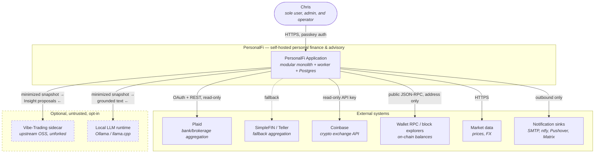
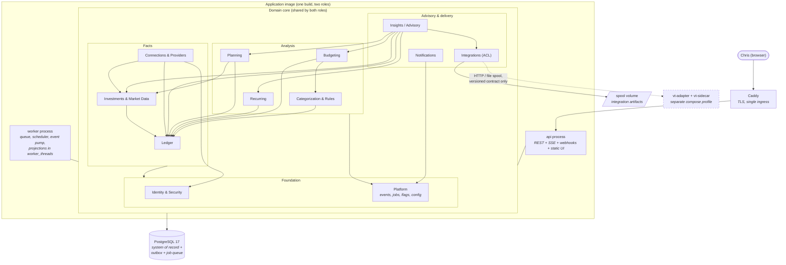
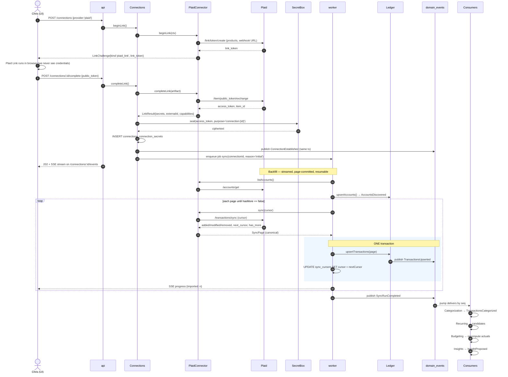
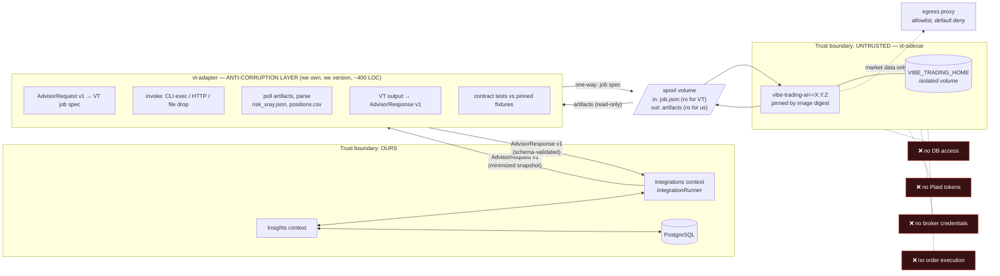

# 08 — System Architecture Memo

**Author:** System Architect (panel)
**Date:** 2026-09-10
**Status:** Proposal for panel reconciliation
**Scope:** Whole-system shape and the seams between parts. Deliberately *not* covering: Plaid API mechanics (see 0x-aggregators), threat model & crypto primitives (0x-security), physical schema/DDL (0x-data-model), component/UX design (0x-frontend), image/CI/licensing detail (0x-devops), projection math (0x-planning-algorithms). Where this memo touches those areas it states an *interface contract*, and the owning member should treat the contract as the requirement and the internals as theirs.

---

## 0. TL;DR

- **Modular monolith.** One deployable image running two process roles (`api`, `worker`) over a shared domain core, plus Postgres, plus optional opt-in sidecars. Eleven bounded contexts with *enforced* import boundaries. Microservices for a single-user, single-maintainer app buy nothing and cost everything.
- **Everything external enters through the `Connector` port.** Plaid is an adapter, not an architecture. SimpleFIN/Teller are drop-in fallbacks. A new provider is a ~200-line adapter plus fixtures, passing a shared conformance suite.
- **All cross-context coupling is an append-only `domain_events` table** (transactional outbox). Budgeting, Recurring, Insights, Notifications are *consumers*, never callers. Consumers are idempotent and replayable, which is also how backfills and rule-rewrites work.
- **Advisors are a plug-in contract, not a code path.** Built-in rules, a local LLM, and the Vibe-Trading sidecar all implement the same versioned JSON contract: read-only minimized snapshot in, proposed `Insight[]` with evidence and confidence out, `requires_review` always true.
- **Vibe-Trading is never forked and never trusted.** It sits behind an anti-corruption layer we own (`vt-adapter`), on an isolated volume, with no DB, no Plaid tokens, no broker credentials, no order capability, and no inbound path to our data.
- **Eleven decisions are effectively irreversible** (money type, multi-currency, `user_id` everywhere, event log from day one, key custody, DB engine, language, boundary enforcement). Everything else — including the aggregator, the LLM, and the entire sidecar — is deliberately deferred behind a port.

---

## 1. Architectural style

### 1.1 The decision

**Modular monolith.** A single Docker image, a single codebase, a single database, two process roles.

The honest argument is about *who pays*. Microservices buy independent deploy cadence, independent scaling, and team-level ownership isolation. There is one user and one maintainer. There is no deploy-cadence conflict, no scaling hot spot (50k transactions is a rounding error for Postgres), and no team boundary to protect. What microservices *cost* here is exactly what a solo maintainer cannot afford: distributed transactions where a single `BEGIN` would do, N Dockerfiles and N CI pipelines, cross-service schema versioning, network partition semantics between "Ledger" and "Budgeting", and a debugging story that starts with correlating three log streams.

The real risk a modular monolith carries is **entropy** — the boundaries dissolve because nothing stops a `SELECT` from Insights straight into `transactions`. So the boundaries must be mechanically enforced from commit #1 (§1.4). That is the whole trade: we accept the discipline tax, not the distribution tax.

**Non-goals, stated so the panel can hold me to them:** no service mesh, no Kubernetes, no message broker (Kafka/Rabbit/Redis), no separate read database, no CQRS write/read split at the infrastructure level (we use read models *inside* the same DB), no GraphQL federation.

### 1.2 Process roles

| Role | Container | Responsibility | Why separate |
|---|---|---|---|
| `api` | same image, `CMD serve` | HTTP: UI static assets, REST API, provider webhook receivers, SSE for live sync status | Must stay responsive; must never block on a 90-second Plaid call |
| `worker` | same image, `CMD work` | Job runner (Postgres-backed queue, `FOR UPDATE SKIP LOCKED`), scheduler/cron, event-consumer pump, projection compute in `worker_threads` | Isolates CPU-heavy and slow-I/O work; restartable without dropping user sessions |
| `db` | `postgres:17-alpine` | System of record + queue + event log | — |
| `proxy` | Caddy | TLS, single ingress | Keeps TLS/cert logic out of app code |
| *(opt-in)* `vt-sidecar` + `vt-adapter` | see §5 | Vibe-Trading integration | Untrusted, scale-to-zero, outside the base resource budget |

Same image for `api` and `worker` is important: one build, one dependency tree, one migration story, and any module can be invoked from either role. The split is a *runtime* concern, not an architectural one.

### 1.3 Bounded contexts

Eleven contexts plus a shared kernel. The rules:

- **Table ownership is exclusive.** Exactly one context may write a table; only that context may read it *directly*. Everyone else goes through the published interface or a read model.
- **Interfaces are in-process TypeScript ports** (plain interfaces, no HTTP), resolved by a tiny composition root. A port is a domain contract, not a repository wrapper.
- **Dependencies point downward only.** Cycles are a build failure. Where a "cycle" seems necessary, the answer is an event, not an import.
- **Read models are owned by their sole writer.** A materialized view fed by a job in Planning is a Planning table, even though its inputs come from Ledger.

#### Shared Kernel (`@core/kernel`) — not a context

Owns no tables. Contains only types that *every* context must agree on and that carry no business logic: `Money` (minor-unit `bigint` + ISO-4217 currency), `Quantity` (decimal), `AccountId`/`TransactionId`/… (branded UUIDv7), `DateOnly`, `Instant`, `Result<T,E>`, `DomainEvent<T>`, `Clock`, `Id.generate()`. Rule: if you are tempted to add something to the kernel, it probably belongs in a context. Kernel changes require a panel-level decision because they ripple everywhere.

#### Platform (`@core/platform`) — infrastructure context

| | |
|---|---|
| **Owns tables** | `domain_events`, `event_consumer_offsets`, `jobs`, `job_runs`, `schedules`, `feature_flags`, `config_snapshots`, `migrations` |
| **Exposes** | `EventBus.publish(tx, event)` / `EventBus.subscribe(consumerId, types, handler)`, `JobQueue.enqueue/claim/complete`, `Scheduler`, `FeatureFlags.isEnabled(key)`, `Clock`, `Logger`, `Metrics` |
| **Depends on** | nothing |

Platform is the only context allowed to know about transactions-as-infrastructure, the queue, and the scheduler.

#### 1. Identity & Security (`@ctx/identity`)

| | |
|---|---|
| **Owns tables** | `users`, `sessions`, `webauthn_credentials`, `totp_secrets`, `recovery_codes`, `api_tokens`, `key_metadata` (KEK/DEK envelope metadata, never key material at rest in plaintext), `audit_log`, `auth_attempts` |
| **Exposes** | `AuthN` (session issue/verify), `AuthZ.can(subject, action, resource)`, **`SecretBox.seal(plaintext, purpose) / open(ciphertext, purpose)`** — the *only* way any context encrypts anything, `AuditSink.record(actorId, action, target, meta)`, `CurrentUser` request context |
| **Depends on** | Platform |
| **Consumed by** | everyone (transitively, via middleware and `SecretBox`) |

`SecretBox` being a single chokepoint is deliberate: the security member gets exactly one place to implement envelope encryption, key rotation, and purpose-binding (AAD), and one place to audit. No context ever imports a crypto library directly. This is a lint rule.

#### 2. Connections & Providers (`@ctx/connections`)

| | |
|---|---|
| **Owns tables** | `providers`, `connections` (a Plaid Item, a Coinbase OAuth grant, a wallet address set, a CSV profile), `connection_secrets` (ciphertext only), `connection_accounts` (provider-side account → our `account_id` mapping), `sync_runs`, `sync_run_items`, `sync_cursors`, `provider_webhooks` (raw, verified, deduped), `connection_health` |
| **Exposes** | `ConnectionService` (create/relink/revoke/list), `SyncOrchestrator.sync(connectionId, mode)`, `ConnectorRegistry.get(providerId)`, `ConnectionHealthReader` |
| **Depends on** | Platform, Identity (`SecretBox`), Ledger (`LedgerWriter` — the *only* upward-ish dependency, see note), Investments (`HoldingsWriter`) |
| **Emits** | `TransactionsUpserted`, `BalancesUpdated`, `HoldingsUpdated`, `AccountsDiscovered`, `ConnectionDegraded`, `ConnectionReauthRequired`, `SyncRunCompleted`, `SyncRunFailed` |

*Note on direction:* Connections depends on Ledger, not the reverse. Ledger has no idea Plaid exists. That asymmetry is what makes "swap the aggregator" a one-context change.

#### 3. Ledger (`@ctx/ledger`)

| | |
|---|---|
| **Owns tables** | `institutions`, `accounts`, `account_balances` (current), `account_balance_history`, `transactions`, `transaction_splits`, `merchants`, `transfer_links` (paired internal transfers), `attachments` |
| **Exposes** | `LedgerWriter.upsertTransactions(connectionId, CanonicalTransaction[])` (idempotent, returns a diff), `LedgerWriter.applyCategorization(txnId, categoryId, source)`, `LedgerReader` (queries, aggregates, the `transactions` list feed), `AccountRegistry` |
| **Depends on** | Platform, Identity |
| **Emits** | `TransactionsUpserted`, `TransactionsRemoved`, `TransactionUpdatedByUser`, `AccountCreated`, `AccountArchived`, `TransfersLinked` |

Ledger is the system of record and the gravitational center. It is deliberately *dumb*: it does not categorize, budget, or interpret. It stores facts and their provenance. Note that `TransactionsUpserted` is emitted by Ledger (the writer), not Connections — Connections emits sync lifecycle events only. One event, one owner.

#### 4. Categorization & Rules (`@ctx/categorization`)

| | |
|---|---|
| **Owns tables** | `category_groups`, `categories`, `rules`, `rule_conditions`, `rule_actions`, `rule_runs`, `merchant_aliases`, `categorization_feedback`, `classifier_versions` |
| **Exposes** | `Categorizer.classify(CanonicalTransaction) → CategorySuggestion`, `RuleEngine.evaluate(txn) → RuleAction[]`, `RuleEngine.backfill(ruleId, range)`, `CategoryReader` (the taxonomy, for Budgeting/Insights) |
| **Depends on** | Platform, Ledger (read + `applyCategorization`) |
| **Consumes** | `TransactionsUpserted` |
| **Emits** | `TransactionsCategorized`, `RuleBackfillCompleted` |

Writes to `transactions.category_id` go through `LedgerWriter.applyCategorization`, never a direct `UPDATE`. That keeps provenance (`source ∈ {rule, classifier, user, provider, import}`) and the resulting event in one place.

#### 5. Budgeting (`@ctx/budgeting`)

| | |
|---|---|
| **Owns tables** | `budgets`, `budget_periods`, `budget_lines`, `budget_line_actuals` (read model), `rollovers`, `budget_alerts_state` |
| **Exposes** | `BudgetReader.status(period)`, `BudgetReader.remaining(categoryId, period)`, `BudgetService` (CRUD) |
| **Depends on** | Platform, Ledger (read), Categorization (`CategoryReader`) |
| **Consumes** | `TransactionsUpserted`, `TransactionsCategorized`, `TransactionsRemoved` |
| **Emits** | `BudgetThresholdCrossed`, `BudgetPeriodClosed` |

#### 6. Recurring (`@ctx/recurring`)

| | |
|---|---|
| **Owns tables** | `recurring_series`, `recurring_occurrences`, `recurring_candidates`, `subscription_metadata` (vendor, cancel URL, trial end, user notes), `price_change_events` |
| **Exposes** | `RecurringReader.upcoming(window)`, `RecurringReader.subscriptions()`, `RecurringService.confirm/ignore/merge(seriesId)` |
| **Depends on** | Platform, Ledger (read), Categorization (read) |
| **Consumes** | `TransactionsUpserted`, `TransactionsCategorized` |
| **Emits** | `RecurringSeriesDetected`, `RecurringPriceIncreased`, `RecurringMissed`, `FreeTrialEnding` |

Detection is a *candidate* pipeline with human confirmation — detection precision on real data is not good enough to act silently, and a false "you have a subscription" is a trust-destroying bug.

#### 7. Investments & Market Data (`@ctx/investments`)

| | |
|---|---|
| **Owns tables** | `securities` (with `symbol`, `cusip`/`isin`, `asset_class`, crypto `chain`+`contract`), `security_identifiers`, `holdings` (current), `holdings_snapshots` (daily), `investment_transactions`, `cost_basis_lots`, `prices` (security × date), `fx_rates` (pair × date), `wallet_addresses`, `price_source_priority` |
| **Exposes** | `HoldingsWriter.upsert(connectionId, CanonicalHolding[])`, `HoldingsReader.asOf(date)`, `PriceReader.price(securityId, date, currency)`, `FxReader.rate(from, to, date)`, `SecurityResolver.resolve(identifier) → securityId` |
| **Depends on** | Platform, Identity, Ledger (`AccountRegistry` — investment accounts are still accounts) |
| **Consumes** | `HoldingsUpdated` (from its own writer), schedule ticks |
| **Emits** | `HoldingsUpdated`, `PricesUpdated`, `SecurityResolutionFailed`, `AllocationDriftDetected` |

`SecurityResolver` is the sneaky-hard part: Coinbase says `ETH`, Plaid says `ETHEREUM`, a wallet says a contract address, a brokerage says a CUSIP. One resolver, one `securities` table, everything else references `security_id`.

#### 8. Planning (`@ctx/planning`)

| | |
|---|---|
| **Owns tables** | `goals`, `goal_contributions`, `risk_profile`, `plan_scenarios`, `plan_assumptions`, `projection_runs`, `projection_percentiles`, `net_worth_daily` (read model; Planning's snapshotter is the sole writer) |
| **Exposes** | `NetWorthReader.series(range)`, `ProjectionService.run(scenarioId) → ProjectionRun`, `GoalReader.progress()`, `PlanningSnapshotView` (for advisors) |
| **Depends on** | Platform, Ledger (read), Investments (read) |
| **Consumes** | `TransactionsUpserted`, `HoldingsUpdated`, `PricesUpdated`, `BalancesUpdated`, daily tick |
| **Emits** | `NetWorthSnapshotTaken`, `ProjectionCompleted`, `GoalOffTrack` |

#### 9. Insights / Advisory (`@ctx/insights`)

| | |
|---|---|
| **Owns tables** | `advisors` (registry + enabled flag + version + granted scopes), `advisor_runs`, `insights`, `insight_evidence`, `insight_actions`, `insight_feedback`, `insight_dismissals`, `snapshot_grants` |
| **Exposes** | `InsightReader.feed(filters)`, `InsightService.review/accept/dismiss/snooze`, `AdvisorRegistry.register(manifest)`, `SnapshotBuilder.build(scopes) → AdvisorSnapshot` |
| **Depends on** | Platform, Ledger/Budgeting/Recurring/Investments/Planning — **read-only, through their public readers, assembled into `AdvisorSnapshot`** |
| **Consumes** | all domain events (for trigger conditions), schedule ticks |
| **Emits** | `InsightProposed`, `InsightAccepted`, `InsightDismissed`, `AdvisorRunFailed` |

Insights is the only context that reads broadly, and it does so through a single assembler (`SnapshotBuilder`) so that data minimization has exactly one implementation point (§4.2).

#### 10. Notifications (`@ctx/notifications`)

| | |
|---|---|
| **Owns tables** | `notification_channels` (type + encrypted config), `notification_rules` (event type → channel + conditions + quiet hours), `notification_outbox`, `delivery_attempts` |
| **Exposes** | `NotificationPort.send(Notification)`, `ChannelRegistry` |
| **Depends on** | Platform, Identity (`SecretBox`) |
| **Consumes** | events named in `notification_rules` — and *nothing else*. It never imports a domain context. |

Notifications knowing only about events is what keeps it from becoming a dumping ground. If Budgeting wants to notify, it emits an event; it does not call Notifications.

#### 11. Integrations (`@ctx/integrations`) — the sidecar contract

| | |
|---|---|
| **Owns tables** | `integrations` (id, kind, image digest, pinned version, enabled, health), `integration_runs`, `integration_artifacts` (hashes + paths in the spool volume, never blobs in the DB), `integration_contract_versions` |
| **Exposes** | `IntegrationRunner.invoke(integrationId, AdvisorRequest) → AdvisorResponse`, `IntegrationHealth` |
| **Depends on** | Platform, Insights (implements `ExternalAdvisor`) |
| **Depends on nothing else, by design** | it must not be able to read Ledger, Connections, or Identity |

Integrations is the anti-corruption layer's home. Every external process — Vibe-Trading, a local LLM server, a future tax tool — is an `integration`, spoken to over the versioned contract in §4, never over our internal ports.

### 1.4 Enforcing the boundaries

Discipline that isn't mechanized is a wish. Four mechanisms, all cheap on day 0:

1. **Package layout.** `src/contexts/<name>/{domain,app,infra,index.ts}`. `index.ts` is the *only* public surface; everything else is internal.
2. **Import lint.** `eslint-plugin-boundaries` (or `dependency-cruiser`) with an explicit allow-list matrix mirroring the table above. Violations fail CI. This is the single highest-leverage 90 minutes in Phase 0.
3. **Schema ownership check.** A CI script parses migrations, builds a `table → owning context` map, greps for raw SQL/query-builder references to tables outside the owner, and fails on cross-context table access.
4. **Architecture test.** One test asserting the dependency graph is acyclic and matches the declared matrix, so the diagram in this memo can never silently drift from reality.

If the panel adopts nothing else from this memo, adopt #2 and #3.

### 1.5 C4 Level 1 — System context



### 1.6 C4 Level 2 — Containers and contexts



**Reading the layers:** arrows only ever point down or sideways-within-a-layer. Facts never know about Analysis; Analysis never knows about Advisory. The only thing that travels upward is an *event*.

---

## 2. Provider abstraction — the `Connector` port

### 2.1 Why this is the most important port in the system

Aggregator risk is the single highest-probability project-killing risk (§9, R1). Plaid production access for a one-person hobby project is sales-gated and not guaranteed; pricing and terms change; an Item can die permanently. Meanwhile the indie landscape is genuinely usable: SimpleFIN Bridge is ~$15/yr read-only with daily refresh limits, and Teller offers a free developer tier of live connections. ([openbankingtracker.com, 2026](https://www.openbankingtracker.com/guides/free-open-banking-apis), [openbankingcompare.com, 2026](https://www.openbankingcompare.com/blog/best-open-banking-api-providers-for-developers-2026))

The architectural response is to make the aggregator a **swappable detail decided at Phase 1, re-decidable at any time**, rather than a foundation. Everything above Connections speaks canonical types only.

### 2.2 Capabilities

Adapters are heterogeneous and we must not pretend otherwise. Capabilities are declared data, and the orchestrator branches on them — no `if (provider === 'plaid')` anywhere outside `adapters/plaid/`.

```ts
type Capability =
  | 'accounts'            // can enumerate accounts
  | 'balances'            // current balance
  | 'transactions'        // cash/card transactions
  | 'investment_txns'     // buys/sells/dividends
  | 'holdings'            // positions
  | 'liabilities'         // APR, statement balance, min payment, payoff
  | 'identity'            // account holder name/mask (we mostly don't want this)
  | 'statements'          // PDF retrieval
  | 'webhooks'            // push notification of new data
  | 'incremental_sync'    // cursor-based deltas, not full re-pull
  | 'on_demand_refresh'   // we can ask for a fresh pull now
  | 'historical_backfill';// can fetch beyond the default window

interface ConnectorCapabilities {
  readonly supports: ReadonlySet<Capability>;
  readonly maxHistoryDays: number | 'unbounded';
  readonly minSyncIntervalSeconds: number;   // politeness / rate-limit floor
  readonly refreshBudgetPerDay: number | null; // e.g. SimpleFIN ~24/day
  readonly currencies: 'multi' | readonly CurrencyCode[];
  readonly requiresPeriodicReauth: false | { everyDays: number };
}
```

### 2.3 The port

```ts
interface Connector {
  readonly providerId: ProviderId;            // 'plaid' | 'coinbase' | 'wallet_rpc' | ...
  readonly displayName: string;
  readonly capabilities: ConnectorCapabilities;

  /** Phase 1 of linking: produce whatever the UI needs (Plaid link_token,
   *  OAuth authorize URL, a form spec for API keys, a file-upload spec). */
  beginLink(ctx: LinkContext): Promise<LinkChallenge>;

  /** Phase 2: turn the user's completion artifact into durable credentials.
   *  Returned secrets are handed straight to SecretBox; the adapter never persists. */
  completeLink(challenge: LinkChallenge, artifact: LinkArtifact): Promise<LinkResult>;

  /** Enumerate accounts. Called after link and on every full sync. */
  listAccounts(conn: ConnectionHandle): Promise<CanonicalAccount[]>;

  /** The core contract. Async-iterable so a 24-month backfill streams in pages
   *  and a crash resumes from the last committed cursor, not from zero. */
  sync(conn: ConnectionHandle, cursor: Cursor | null, opts: SyncOptions): AsyncIterable<SyncPage>;

  /** Verify + normalize an inbound provider webhook. Signature check lives here. */
  verifyWebhook?(raw: Buffer, headers: Headers): ProviderWebhookEvent | null;

  /** What must the user do to fix a broken connection, and how do we start it. */
  reconnect(conn: ConnectionHandle, reason: ReconnectReason): Promise<LinkChallenge>;

  /** Best-effort revocation at the provider, then local destruction. */
  revoke(conn: ConnectionHandle): Promise<void>;

  /** Cheap liveness probe used by the health job; must not consume refresh budget. */
  health(conn: ConnectionHandle): Promise<ConnectorHealth>;
}

interface SyncOptions {
  readonly since?: DateOnly;              // for non-cursor providers
  readonly datasets: ReadonlySet<Capability>; // only ask for what we need
  readonly reason: 'initial' | 'scheduled' | 'webhook' | 'manual' | 'backfill' | 'repair';
  readonly deadline: Instant;             // hard budget; adapter must respect it
  readonly signal: AbortSignal;
}

interface SyncPage {
  readonly dataset: Capability;
  readonly asOf: Instant;
  readonly accounts?: CanonicalAccount[];
  readonly added?: CanonicalTransaction[] | CanonicalInvestmentTxn[];
  readonly modified?: CanonicalTransaction[] | CanonicalInvestmentTxn[];
  readonly removed?: ProviderRef[];
  readonly balances?: CanonicalBalance[];
  readonly holdings?: CanonicalHolding[];
  readonly liabilities?: CanonicalLiability[];
  readonly securities?: CanonicalSecurity[];
  readonly nextCursor: Cursor | null;     // opaque string; we persist, never parse
  readonly hasMore: boolean;
  readonly providerMeta?: Json;           // kept for debugging, never read by domain
}
```

**The cursor contract** — four rules that make sync correct rather than merely working:

1. The cursor is **opaque** to us. It is a string. We never parse it, never compare it, never construct one.
2. A cursor is committed **only in the same transaction that commits the page's data**. This is the whole reason `sync` is an async iterable rather than returning an array: page → `LedgerWriter.upsert` → advance cursor → `COMMIT`, per page. A crash mid-backfill resumes cleanly.
3. `nextCursor === null` with `hasMore === false` means the provider has no incremental support; the orchestrator falls back to a windowed full pull with fingerprint dedupe.
4. A provider may **invalidate** a cursor (`CURSOR_EXPIRED`). The orchestrator responds by restarting from `null` and relying on idempotent upsert — never by deleting data.

### 2.4 Error taxonomy

One error type, one discriminant, and the *orchestrator* — not the adapter — decides policy. This is what stops per-provider retry logic from metastasizing.

```ts
class ConnectorError extends Error {
  kind: ConnectorErrorKind;
  retryable: boolean;
  retryAfterMs?: number;
  userActionRequired: boolean;
  providerCode?: string;      // raw provider code, for the sync-run detail UI
  correlationId: string;
  redactedContext?: Json;     // never contains tokens/PII
}
```

| `kind` | Meaning | Orchestrator policy | Surfaced to user? |
|---|---|---|---|
| `AUTH_REQUIRED` | Credentials/consent revoked or expired | Mark connection `reauth_required`, stop retrying, emit `ConnectionReauthRequired` | Yes — actionable banner + notification |
| `MFA_REQUIRED` | Interactive challenge pending | Same as above, with a resume handle | Yes |
| `CONSENT_EXPIRED` | Time-boxed consent lapsed (open-banking style) | Schedule re-consent prompt before expiry | Yes, proactively |
| `PROVIDER_DOWN` | 5xx / institution outage | Exponential backoff, jitter, cap 6h, up to 72h then degrade | Only after 24h |
| `RATE_LIMITED` | 429 / budget exhausted | Honor `retryAfterMs`; debit the refresh budget counter | No |
| `ITEM_LOCKED` | Provider-side lock / pending resolution | Backoff, long poll, surface at 48h | After 48h |
| `INSUFFICIENT_SCOPE` | Product/permission not granted | Disable that dataset for this connection, keep others | Yes — "reconnect to add holdings" |
| `DATA_UNAVAILABLE` | Institution doesn't expose the dataset | Clear the capability for this connection permanently | Informational |
| `CURSOR_EXPIRED` | Delta token invalid | Restart from `null` | No |
| `MALFORMED_RESPONSE` | Contract violated by provider | Fail run, persist raw payload for forensics, alert | Yes — it's a bug |
| `CONFIG_ERROR` | Our keys/env wrong | Fail fast, alert loudly, do not retry | Yes — operator error |
| `INTERNAL` | Our bug | Fail run, alert | Yes |

Three taxonomies exist system-wide and must not blur (§6.4): `ConnectorError` (something outside us), `DomainError` (an invariant we refuse to violate), `UserError` (the request was wrong). Only `ConnectorError` gets retries.

### 2.5 Canonical model

Every adapter maps *into* these. Provenance is mandatory, so any field in the UI can answer "where did this come from and can I trust it".

```ts
interface ProviderRef { providerId: ProviderId; connectionId: ConnectionId; externalId: string; }

interface CanonicalAccount {
  ref: ProviderRef;
  name: string; officialName?: string; mask?: string;
  type: 'depository'|'credit'|'loan'|'investment'|'crypto'|'property'|'other';
  subtype?: string;                       // 'checking','roth_ira','mortgage','wallet',...
  currency: CurrencyCode;
  balances: { current?: Money; available?: Money; limit?: Money; asOf: Instant };
  institution?: { name: string; externalId?: string; logoRef?: string };
  capabilitiesOnThisAccount: ReadonlySet<Capability>;
  closed: boolean;
}

interface CanonicalTransaction {
  ref: ProviderRef;
  accountRef: ProviderRef;
  amount: Money;                          // SIGN CONVENTION: negative = money leaves the account
  postedDate: DateOnly;                   // account-local calendar date
  transactedAt?: Instant;                 // if the provider gives a real timestamp
  pending: boolean;
  pendingRef?: ProviderRef;               // links a settled txn to the pending one it replaces
  description: string;                    // raw, untouched
  merchant?: { name?: string; externalId?: string; website?: string; mcc?: string };
  providerCategory?: string[];            // a HINT. Never authoritative.
  location?: { city?: string; region?: string; country?: string };
  originalCurrency?: { amount: Money; fxRate?: Decimal };
  fingerprint: string;                    // sha256(accountRef, postedDate, amount, normalized(description))
}

interface CanonicalHolding {
  ref: ProviderRef; accountRef: ProviderRef; securityRef: SecurityIdentifier;
  quantity: Quantity; costBasis?: Money; value: Money; currency: CurrencyCode; asOf: Instant;
}

interface CanonicalSecurity {
  identifier: SecurityIdentifier;         // { kind:'ticker'|'cusip'|'isin'|'chain_contract'|'proprietary', value, chain? }
  name?: string; assetClass?: AssetClass; currency?: CurrencyCode;
  price?: { amount: Money; asOf: Instant };
}

interface CanonicalLiability {
  accountRef: ProviderRef;
  apr?: Decimal; statementBalance?: Money; minimumPayment?: Money;
  nextPaymentDue?: DateOnly; lastPayment?: { amount: Money; date: DateOnly };
  originationPrincipal?: Money; termMonths?: number; interestType?: 'fixed'|'variable';
}
```

Three conventions worth arguing about now, because changing them later is a data migration:

- **Sign convention**: negative = outflow *from the account's perspective*, on every account type including credit cards. Plaid's convention is the inverse for some products; that inversion lives in the Plaid adapter and nowhere else. A "purchase on a credit card" is a negative amount and *increases* the debt balance.
- **`providerCategory` is a hint.** It is stored, it feeds the classifier as a feature, and it never lands in `transactions.category_id` directly. Otherwise switching aggregators re-categorizes the user's entire history.
- **`fingerprint` is mandatory for every adapter**, even ones with stable IDs. It is the dedupe key when a CSV import overlaps a Plaid backfill, and when a provider rotates its IDs.

### 2.6 The adapter roster

| Adapter | Capabilities | Notes |
|---|---|---|
| `PlaidConnector` | accounts, balances, transactions, investment_txns, holdings, liabilities, webhooks, incremental_sync | Primary. `/transactions/sync` cursor maps 1:1 to our contract. |
| `SimpleFinConnector` | accounts, balances, transactions | Fallback #1. Cheap, read-only, hard daily refresh budget → `refreshBudgetPerDay` matters. |
| `TellerConnector` | accounts, balances, transactions | Fallback #2. Free dev tier; mTLS client cert. |
| `CoinbaseConnector` | accounts, balances, holdings, investment_txns | Read-only API key scope **only**; never trade/transfer scopes. |
| `WalletRpcConnector` | accounts, balances, holdings | Address-only, public RPC/explorer. No key material exists, therefore none can leak. |
| `CsvImportConnector` | transactions, holdings (via profile) | Mapping profiles are user data, stored per institution. `fingerprint` does all the work. |
| `ManualConnector` | accounts, balances, transactions, holdings | The user *is* the provider. Property, vehicles, private equity, cash under the mattress. Essential for true net worth. |

`ManualConnector` and `CsvImportConnector` implementing the same port as Plaid is the tell that the abstraction is right: the orchestrator, the UI, the events, and the sync-run history all work identically.

### 2.7 Adding a provider in under a day

Target: **4–6 focused hours**, verified by a stopwatch on adapter #3.

1. `pnpm gen:connector <name>` scaffolds `adapters/<name>/{connector.ts,mapping.ts,manifest.ts,fixtures/,conformance.test.ts}` (~30 min including reading the provider's docs).
2. Record real fixtures once via a capture proxy that redacts secrets → `fixtures/*.json` become the permanent regression corpus (~1h).
3. Write `mapping.ts`: provider shape → canonical. This is the only genuinely bespoke code and is almost always pure functions (~2h).
4. Implement `sync` over the provider's paging (~1h).
5. **Run the shared conformance suite** — it is the deliverable, not an afterthought. It asserts, against fixtures and a fake clock: idempotency (same page twice ⇒ zero net change), cursor resumption (kill at page 2 ⇒ identical end state), sign convention, currency present on every `Money`, pending→settled transition produces one transaction not two, `removed` handling, every error path produces a typed `ConnectorError`, capability declarations match observed behavior, and no secret appears in any log line (~30 min if mapping is right).
6. Register in `ConnectorRegistry`, add the manifest (icon, link UX kind, docs URL). UI needs zero changes — it renders from the manifest + capabilities (~30 min).

The conformance suite is what makes this a day instead of a week, and it is what makes the Plaid→SimpleFIN fallback a config change under pressure rather than a rewrite under pressure.

---

## 3. Event and data flow

### 3.1 Why an in-database event log

Budgeting, Recurring, Insights, and Planning all need to react to new transactions. The three options are: (a) Ledger calls them directly — creates a cycle and makes Ledger know about everything; (b) an in-process emitter — loses the events on crash and can't replay; (c) **a transactional outbox in Postgres** — events are committed in the same transaction as the data, survive restarts, and can be replayed.

(c) costs one table and about 150 lines of pump code, and it buys: crash-safety, replay-driven backfills, an audit trail of *why* the system did something, and genuine decoupling. No broker, no Redis, no extra container.

### 3.2 The event log

```sql
CREATE TABLE domain_events (
  seq          BIGINT GENERATED ALWAYS AS IDENTITY PRIMARY KEY,  -- total order
  id           UUID NOT NULL UNIQUE,                             -- UUIDv7, stable across replay
  user_id      UUID NOT NULL,
  type         TEXT NOT NULL,                -- 'ledger.TransactionsUpserted'
  version      INT  NOT NULL DEFAULT 1,      -- payload schema version
  occurred_at  TIMESTAMPTZ NOT NULL,
  aggregate    TEXT NOT NULL,                -- 'account' | 'connection' | ...
  aggregate_id UUID,
  correlation_id UUID NOT NULL,              -- ties a whole sync run together
  causation_id UUID,                         -- the event/command that caused this one
  payload      JSONB NOT NULL,               -- IDs + small facts. NEVER full entities.
  redaction    TEXT NOT NULL DEFAULT 'none'  -- 'none'|'pii'|'purged'
);
CREATE INDEX ON domain_events (type, seq);
CREATE INDEX ON domain_events (correlation_id);

CREATE TABLE event_consumer_offsets (
  consumer_id  TEXT PRIMARY KEY,             -- 'budgeting.actuals@v3'
  last_seq     BIGINT NOT NULL DEFAULT 0,
  status       TEXT NOT NULL DEFAULT 'running', -- running|paused|replaying|failed
  lag_seconds  INT,
  failed_seq   BIGINT, failed_error TEXT, failed_count INT NOT NULL DEFAULT 0,
  updated_at   TIMESTAMPTZ NOT NULL DEFAULT now()
);
```

Five rules:

1. **Payloads are thin.** `TransactionsUpserted` carries `{accountId, connectionId, addedIds[], modifiedIds[], removedIds[], dateRange, count}` — not the transactions. Consumers re-read current state through the owning context's reader. This keeps the log small, avoids stale duplicates, and means a replay reflects *today's* data rather than resurrecting an old snapshot.
2. **Events are past-tense facts**, never commands. `BudgetThresholdCrossed`, not `SendBudgetAlert`.
3. **Published only inside the writing transaction**, via `EventBus.publish(tx, event)`. There is no path to publish outside a transaction; the signature requires the handle.
4. **The consumer id encodes a version** (`@v3`). Changing a consumer's logic means bumping the version and replaying from `0`, which is a one-line operation instead of a data-repair script.
5. **Notification of new events is an optimization, not the mechanism.** The pump uses `LISTEN/NOTIFY` to wake instantly, and a 5-second poll as the fallback. Correctness never depends on the notification arriving.

### 3.3 Consumers: idempotent, ordered, isolated

The pump (in `worker`) runs one loop per consumer:

```
claim advisory lock (consumer_id)
loop:
  batch = SELECT * FROM domain_events WHERE seq > last_seq AND type = ANY(types) ORDER BY seq LIMIT 500
  for each event:
    BEGIN
      handler(event)                       -- must be idempotent
      UPDATE event_consumer_offsets SET last_seq = event.seq
    COMMIT
```

**Idempotency is the handler's obligation**, achieved structurally rather than by bookkeeping: handlers recompute a deterministic function of current state over an affected window. `Budgeting` on `TransactionsUpserted` recomputes `budget_line_actuals` for the affected `(category, period)` cells from scratch — running it five times is the same as once. Handlers that *cannot* be recomputed (sending a notification, appending an insight) use a natural dedupe key: `notification_outbox (dedupe_key UNIQUE)` where the key is `hash(event.id, channel)`, and `insights (advisor_id, key, period) UNIQUE`.

**Failure isolation:** a handler that throws increments `failed_count` with exponential backoff; after 5 attempts the consumer goes `failed` and *stops* rather than skipping. A stuck consumer is visible in the UI (§6.3) and never silently corrupts a read model. Other consumers are unaffected — one bad Insights rule cannot stop Budgeting.

**Ordering guarantee:** total order within a consumer (single loop, `seq` ascending). No cross-consumer ordering guarantee, and nothing may depend on one. If Insights needs Budgeting's read model to be current, it must tolerate staleness — in practice by reacting to `BudgetThresholdCrossed` (emitted *by* Budgeting after its write) rather than to `TransactionsUpserted`. This event-chaining is how we express "after X, then Y" without coupling.

### 3.4 Replay and backfill

Replay is the answer to four otherwise-painful problems, and it exists only because the log exists.

| Situation | Operation |
|---|---|
| New categorization rule, apply to history | `RuleEngine.backfill(ruleId, range)` → emits `TransactionsCategorized` → downstream consumers react naturally |
| Budgeting logic bug corrupted actuals | Bump consumer to `@v4`, `last_seq = 0`, rebuild read model from current state + event stream |
| New context added in Phase 3 | Its consumer starts at `seq = 0` and catches up over the full history on first boot |
| Insight rules rewritten | Soft-delete machine-generated insights for the advisor, replay, regenerate; user-accepted insights are preserved by `status` |

Replay is exposed as an operator action in the UI (`Settings → Maintenance → Rebuild read model`), with an estimated duration and a progress bar, because a solo operator who must `docker exec` into a container to fix things will eventually not fix things.

**Retention:** the log grows ~1 row per sync run per account per day plus user actions — order 10–50k rows/year. Keep it forever; it's tiny. Compact only if `domain_events` exceeds 5M rows, by folding pre-`N` events into a checkpoint snapshot.

### 3.5 Read models, materialized views, snapshots

Three distinct mechanisms; choosing wrongly is a common source of both slowness and staleness bugs.

| Mechanism | Use when | Examples | Freshness |
|---|---|---|---|
| **Direct query** | The query is fast enough on indexed base tables | Transaction list, search, account detail | Always current |
| **Event-maintained read model** (a real table, written by a consumer) | Aggregation is expensive and the invalidation set is small and knowable | `budget_line_actuals`, `recurring_candidates`, `net_worth_daily` (today's row) | Seconds behind |
| **Scheduled snapshot** (an immutable historical row) | The value is *only* knowable at a point in time and must not be recomputed later | `holdings_snapshots`, `net_worth_daily` (past rows), `projection_runs` | Daily, by design |

The critical distinction is the last one. `net_worth_daily` for a past date must be a **snapshot**, not a recomputation: recomputing it later using today's prices and today's manually-corrected balances produces a net-worth chart that silently rewrites history every night. So: today's row is maintained incrementally and is mutable; at 02:00 local it is sealed and never touched again. Missing days (container was off) are backfilled once by interpolation and flagged `estimated = true`, which the chart renders differently.

Postgres `MATERIALIZED VIEW` is used sparingly — only for pure derivations with no history semantics (e.g. `monthly_cashflow_by_category`), refreshed `CONCURRENTLY` after the daily pipeline. If a thing needs incremental maintenance, it's a table with a consumer, not a matview.

### 3.6 Sequence: first Plaid connection



The boxed region is the correctness core: data and cursor advance atomically, so a crash at page 47 of 60 resumes at 47 with no duplicates and no gap.

### 3.7 Sequence: nightly sync

```mermaid
sequenceDiagram
    autonumber
    participant S as Scheduler (worker)
    participant Q as jobs (Postgres)
    participant O as SyncOrchestrator
    participant C as Connector(s)
    participant LG as Ledger
    participant IV as Investments
    participant EV as domain_events
    participant PL as Planning
    participant NT as Notifications

    Note over S: 03:15 local, jittered ±20m
    S->>Q: enqueue sync(conn) for each enabled connection
    Note over Q: max 2 concurrent; per-provider rate limiter
    loop each connection
        O->>O: check refreshBudgetPerDay, minSyncIntervalSeconds
        O->>C: sync(cursor, datasets = declared ∩ needed, deadline = 10m)
        alt success
            C-->>O: pages
            O->>LG: upsertTransactions → TransactionsUpserted
            O->>IV: upsertHoldings → HoldingsUpdated
            O->>EV: SyncRunCompleted{added, modified, removed, durationMs}
        else ConnectorError kind=AUTH_REQUIRED
            O->>EV: ConnectionReauthRequired
            O->>O: connection.status = 'reauth_required'; cancel further retries
        else kind=PROVIDER_DOWN / RATE_LIMITED
            O->>Q: reschedule with backoff + jitter (cap 6h)
            O->>EV: SyncRunFailed{retryable:true}
        end
    end

    Note over S: 03:45 — market data
    S->>IV: refresh prices + FX for held securities
    IV->>EV: PricesUpdated

    Note over S: 04:00 — seal the day
    EV-->>PL: TransactionsUpserted / HoldingsUpdated / PricesUpdated
    PL->>PL: compute + seal net_worth_daily[yesterday] (immutable)
    PL->>EV: NetWorthSnapshotTaken
    PL->>PL: re-run projections if drift > threshold

    Note over S: 07:30 — digest
    EV-->>NT: rules match accumulated events
    NT->>NT: coalesce into ONE digest (dedupe_key = date+channel)
    NT-->>NT: deliver via ntfy/email; retry w/ backoff on failure
```

Note the deliberate ordering by *time*, not by orchestration: prices refresh after transactions because the schedule says so, and Planning reacts to whatever has landed. Nothing waits on anything. If prices fail, net worth still seals using the last known price, flagged `stale_price = true`.

### 3.8 Sequence: insight generation

```mermaid
sequenceDiagram
    autonumber
    participant T as Trigger (event or schedule)
    participant IN as Insights
    participant SB as SnapshotBuilder
    participant RD as Readers (Ledger/Budget/Recurring/Invest/Plan)
    participant BA as Built-in advisors
    participant EA as External advisor (Integrations)
    participant DB as insights
    participant NT as Notifications

    T->>IN: advisorRun(trigger)
    IN->>IN: select enabled advisors whose triggers match
    loop each advisor
        IN->>SB: build(advisor.grantedScopes)
        SB->>RD: read only the granted views
        RD-->>SB: aggregates
        SB->>SB: minimize: bucket, round, drop identifiers,<br/>enforce granted scopes, compute input_digest
        SB-->>IN: AdvisorSnapshot (contract v1)
        alt built-in (in-process, trusted)
            IN->>BA: evaluate(snapshot)
            BA-->>IN: Insight[] (confidence, evidence)
        else external (sandboxed)
            IN->>EA: invoke(AdvisorRequest) [timeout, size cap]
            EA-->>IN: AdvisorResponse (unvalidated)
            IN->>IN: validate vs JSON Schema; reject on failure
            IN->>IN: sanitize markdown, verify every evidence ref<br/>resolves to a real row we already exposed
        end
        IN->>DB: upsert by (advisor_id, key, period)<br/>status = 'pending_review' ALWAYS
        IN->>IN: publish InsightProposed
    end
    IN->>NT: (via event rules) notify only if severity >= threshold
    Note over DB: Nothing acts. Every insight awaits explicit human review.
```

The `input_digest` is a hash of the exact snapshot sent. It is stored on the run and on every insight, so months later "why did it say that?" is answerable, and so a re-run on unchanged inputs can be skipped entirely.

### 3.9 Sequence: Item reconnect

```mermaid
sequenceDiagram
    autonumber
    participant P as Plaid
    participant API as api (webhook)
    participant CX as Connections
    participant EV as domain_events
    participant NT as Notifications
    actor U as Chris
    participant W as worker

    alt provider pushes
        P->>API: POST /webhooks/plaid (ITEM_LOGIN_REQUIRED)
        API->>API: verify signature (adapter.verifyWebhook)
        API->>CX: record + dedupe by provider event id
    else we discover during sync
        W->>CX: ConnectorError{kind:'AUTH_REQUIRED'}
    end

    CX->>CX: status='reauth_required'; pause scheduled syncs;<br/>PRESERVE cursor and all data
    CX->>EV: ConnectionReauthRequired{connectionId, reason}
    EV-->>NT: rule → "Chase needs reconnection"
    NT-->>U: ntfy / email with deep link

    U->>API: open connection → "Reconnect"
    API->>CX: reconnect(connectionId, reason)
    CX->>P: /link/token/create {access_token, update mode}
    P-->>U: Link in update mode (same Item, same account ids)
    U->>API: completion
    API->>CX: completeReconnect()
    CX->>CX: rotate secret via SecretBox; status='healthy'
    CX->>EV: ConnectionRestored
    CX->>W: enqueue sync(reason='repair')
    W->>W: resume from PRESERVED cursor;<br/>if CURSOR_EXPIRED → restart at null, idempotent upsert heals gaps
    W->>EV: SyncRunCompleted
```

Two invariants: **reconnect never deletes data**, and **reconnect never creates duplicate accounts** — Plaid update mode preserves account ids, and for providers that don't, `connection_accounts` remaps by mask+type+name similarity with a user confirmation step. Losing account identity on reconnect is the classic way a personal finance app silently doubles a user's net worth.

---

## 4. Extension model — the Advisor contract

### 4.1 One contract, three kinds of advisor

The "true advisory service" requirement is the most likely place for this system to grow a mess of special cases: some advice is a `WHERE` clause, some is a Monte Carlo run, some is an LLM, some is an external research agent. The architectural move is to make them **all the same shape**, and to put the *trust* difference in the execution mode rather than in the contract.

| Kind | Runs where | Trust | Examples |
|---|---|---|---|
| `builtin` | In-process, in `worker` | Trusted, reviewed code | "Subscription price rose 22%", "Dining is 140% of budget with 9 days left", "$14k idle cash at 0.01% APY", "Your allocation drifted 8pts from target", "You're on track for 71% of retirement goal" |
| `local_model` | Sidecar (Ollama/llama.cpp), no network egress | Semi-trusted, non-deterministic | Grounded explanation/narration of a built-in finding; anomaly summarization |
| `external` | Sidecar, sandboxed, allowlisted egress | **Untrusted** | Vibe-Trading (§5), a future tax-optimization tool |

All three produce `Insight` objects. All three are subject to the same validation, the same `pending_review` gate, and the same kill switch. The UI shows provenance on every insight (`advisor_id`, `advisor_version`, confidence, evidence) — an insight from an LLM and an insight from a `WHERE` clause are visually distinguishable and equally auditable.

**The invariant that makes this safe:** an advisor cannot *do* anything. It receives a read-only snapshot over a one-way channel and returns proposals. It has no DB handle, no API token, no write port, no ability to trigger a sync, and no ability to send a notification. The worst a fully-compromised advisor can do is propose bad advice into a review queue.

### 4.2 Input: the minimized snapshot

Data minimization is enforced structurally, in `SnapshotBuilder`, not by convention. Every advisor declares required scopes in its manifest; the user grants them explicitly at install; the builder emits *only* granted scopes.

```jsonc
// Advisor manifest (checked into repo for built-ins; registered row for external)
{
  "advisor_id": "vibe-trading",
  "version": "0.4.0",
  "contract_version": "1",
  "kind": "external",
  "display_name": "Vibe-Trading research",
  "requires_scopes": ["holdings.aggregate", "risk.profile", "market.watchlist"],
  "triggers": [{ "type": "schedule", "cron": "0 6 * * 1" }],
  "limits": { "timeout_ms": 300000, "max_insights": 10, "max_response_bytes": 262144 },
  "egress_allowlist": ["api.polygon.io", "query1.finance.yahoo.com"]
}
```

The scope catalogue, ordered by sensitivity. Coarser scopes are strictly preferred; an advisor asking for `transactions.raw` needs a very good reason.

| Scope | Yields | Minimization applied |
|---|---|---|
| `networth.summary` | total assets/liabilities/net worth, 12-month trend | Rounded to $100 |
| `cash.summary` | total cash, count of accounts, blended APY, emergency-fund months | No institution names, no masks |
| `holdings.aggregate` | per-asset-class weights, top-N positions by *symbol + weight* | **No quantities, no account linkage, no cost basis** unless `holdings.detail` granted |
| `holdings.detail` | + quantity, cost basis, lot ages, unrealized P&L | Still no account ids or institution |
| `cashflow.monthly` | income/expense totals by category by month, 24 months | Aggregates only |
| `transactions.summary` | per-merchant-category counts and sums, top merchants | Merchant names normalized; **no descriptions, no dates finer than month** |
| `transactions.raw` | individual transactions | Requires explicit per-run consent; descriptions redacted of digits; **never granted to `external`** |
| `recurring.list` | subscriptions: normalized vendor, amount, cadence, next date | — |
| `budgets.status` | per-category budget vs actual for current period | — |
| `goals.list` | goal name, target, horizon, progress % | — |
| `risk.profile` | risk tolerance, horizon, tax bracket band, account-type mix | Bracket as a band, never exact income |
| `market.watchlist` | symbols the user is tracking | — |

Always stripped, regardless of scope: account numbers and masks, institution names (unless `institutions.names` granted), provider ids, access tokens, the user's name/email/address, any free-text the user wrote in notes, exact balances for `external` advisors (rounded to 2 significant figures).

```jsonc
// AdvisorRequest v1 — what actually crosses the boundary
{
  "contract_version": "1",
  "request_id": "018f2c1a-...",     // UUIDv7
  "advisor_id": "vibe-trading",
  "generated_at": "2026-09-10T06:00:00Z",
  "base_currency": "USD",
  "granted_scopes": ["holdings.aggregate", "risk.profile", "market.watchlist"],
  "input_digest": "sha256:9c4f...",  // hash of `snapshot`, stored on the run
  "limits": { "max_insights": 10, "deadline": "2026-09-10T06:05:00Z" },
  "snapshot": {
    "holdings_aggregate": {
      "as_of": "2026-09-09",
      "by_asset_class": [
        {"asset_class": "us_equity", "weight": 0.62},
        {"asset_class": "intl_equity", "weight": 0.14},
        {"asset_class": "bond", "weight": 0.09},
        {"asset_class": "crypto", "weight": 0.11},
        {"asset_class": "cash", "weight": 0.04}
      ],
      "top_positions": [{"symbol": "VTI", "weight": 0.31}, {"symbol": "BTC", "weight": 0.08}],
      "target_allocation": [{"asset_class": "us_equity", "weight": 0.55}],
      "account_type_mix": {"taxable": 0.4, "tax_deferred": 0.45, "roth": 0.15}
    },
    "risk_profile": { "tolerance": "moderate_aggressive", "horizon_years": 22,
                      "tax_bracket_band": "22-32", "liquidity_need": "low" },
    "market_watchlist": ["VTI","VXUS","BND","BTC","ETH"]
  }
}
```

### 4.3 Output: proposed Insights

```jsonc
// AdvisorResponse v1
{
  "contract_version": "1",
  "request_id": "018f2c1a-...",       // MUST echo; mismatched responses are dropped
  "advisor_id": "vibe-trading",
  "advisor_version": "0.4.0",
  "produced_at": "2026-09-10T06:03:12Z",
  "diagnostics": { "runtime_ms": 191000, "model": "…", "warnings": [] },
  "insights": [
    {
      "key": "allocation.drift.us_equity",   // stable ⇒ idempotent upsert, not duplicates
      "type": "allocation_drift",
      "severity": "info",                    // info | notable | warning | urgent
      "title": "US equity is 7 points above your target weight",
      "summary_md": "Your US equity weight is **62%** against a 55% target…",
      "confidence": 0.78,                    // [0,1], REQUIRED
      "confidence_basis": "deterministic",   // deterministic | model | heuristic
      "horizon": "next_quarter",
      "evidence": [
        { "kind": "metric", "label": "Current US equity weight", "value": "62%",
          "source_ref": "snapshot:holdings_aggregate.by_asset_class[0]" },
        { "kind": "metric", "label": "Target", "value": "55%",
          "source_ref": "snapshot:holdings_aggregate.target_allocation[0]" },
        { "kind": "external", "label": "Methodology", "url": "https://…" }
      ],
      "proposed_actions": [
        { "kind": "suggest_only", "label": "Consider directing new contributions to intl equity",
          "rationale_md": "…", "estimated_impact": { "metric": "tracking_error", "delta": -0.02 } }
      ],
      "caveats": ["Ignores tax lots and wash-sale constraints", "Excludes held-away 401k"],
      "expires_at": "2026-10-10T00:00:00Z"
    }
  ]
}
```

Contract-level rules the validator enforces and the advisor cannot opt out of:

- **`requires_review` is not a field the advisor sets.** Every insight from every advisor is persisted with `status = 'pending_review'`. There is no value an advisor can return that causes an action.
- **`proposed_actions[].kind` is restricted to `suggest_only | open_url | create_goal_draft | create_rule_draft`.** There is no `execute`, no `transfer`, no `trade`. The enum has no such member, so it cannot be smuggled in.
- **Every `evidence.source_ref` must resolve** to a path in the snapshot we sent, or to an allowlisted external URL. An insight citing data we didn't provide is a fabrication and is rejected outright — this is the single most effective anti-hallucination check available, and it's pure validation, not a model.
- **`confidence` is required and `confidence_basis` must be honest.** `deterministic` is reserved for advisors that are provably rule-based; `external` advisors may not claim it.
- **`summary_md` is sanitized**: a restricted Markdown subset (no HTML, no images, links only to `egress_allowlist` domains), length-capped at 2,000 chars.

### 4.4 Versioning, validation, sandboxing, kill switch

**Versioning.** `contract_version` is a single integer, negotiated at registration: the sidecar exposes `GET /contract` returning supported versions; we refuse to invoke an advisor that doesn't support a version we speak. We support N and N-1 simultaneously. JSON Schema files live at `contracts/advisor/v1/{request,response}.schema.json`, are published in the repo, and are the *normative* definition — the TypeScript types are generated from them, not vice versa.

**Validation pipeline** (every external response, in order; any failure fails the run and records the raw payload for forensics):
1. Size cap enforced at read time (streaming, not after buffering).
2. JSON parse with depth and key-count limits.
3. JSON Schema validation (Ajv, `strict`, `additionalProperties: false` everywhere).
4. `request_id` echo check and deadline check (late responses are dropped).
5. Semantic checks: `insights.length <= max_insights`; every `source_ref` resolves; `confidence ∈ [0,1]`; no duplicate `key`.
6. Markdown sanitization and link allowlisting.
7. Upsert as `pending_review`.

**Sandboxing** (the sidecar runs under all of these):
- Separate container, separate compose profile, **not started by default**.
- `read_only: true` rootfs; single writable `tmpfs`; one bind-mounted spool dir, `:ro` on the input side.
- `cap_drop: ALL`, `no-new-privileges`, non-root UID, `pids_limit`, `mem_limit`, `cpus`.
- **Own Docker network with no route to the app network or the DB network.** The only path in is `vt-adapter` → sidecar. There is no path sidecar → us.
- Egress through a forward proxy that enforces `egress_allowlist`; default deny. DNS restricted to the proxy.
- No environment variable containing any of our secrets. Enforced by a boot-time assertion in `vt-adapter` that the sidecar's env contains no key matching our secret name patterns.
- Hard timeout, enforced by us (`AbortSignal` + container kill), not by the sidecar's own settings.

**Kill switches**, at four levels, because one is never enough at 2am:
1. `ADVISORS_ENABLED=false` env → all advisors off at boot, no code path reached.
2. `advisors.enabled` column → per-advisor toggle in the UI, effective on the next run.
3. **Circuit breaker**: 3 consecutive failures or 5 schema violations in 24h ⇒ auto-disable, emit `AdvisorRunFailed`, notify. Re-enable is manual and deliberate.
4. `docker compose --profile advisors down` ⇒ the container is gone; the app degrades to built-ins with an "unavailable" badge, never an error page.

Degradation is a first-class requirement: **no advisor is on the critical path of anything.** The app is fully usable with every advisor off.

### 4.5 The notification port

Symmetric design, much simpler, same principle — one port, adapters, no context knows the channels.

```ts
interface NotificationChannel {
  readonly kind: 'smtp' | 'ntfy' | 'pushover' | 'matrix' | 'webhook';
  readonly capabilities: { markdown: boolean; actions: boolean; attachments: boolean; maxBytes: number };
  send(n: Notification): Promise<DeliveryResult>;
  verify(config: ChannelConfig): Promise<VerifyResult>;   // "Send test notification" button
}

interface Notification {
  dedupeKey: string;            // UNIQUE in notification_outbox — at-most-once delivery
  priority: 'low' | 'normal' | 'high';
  title: string; body_md: string;
  deepLink?: string;            // back into the UI
  actions?: { label: string; url: string }[];   // degraded to links on channels without actions
  groupKey?: string;            // coalescing key for digests
}
```

Delivery is outbox + worker: `notification_rules` map event types to channels with conditions and quiet hours; the consumer inserts into `notification_outbox` (idempotent via `dedupeKey`); a job drains it with exponential backoff and a dead-letter state visible in the UI. Digest mode coalesces by `groupKey` within a window so a 2,000-transaction backfill produces one notification, not 2,000 — this is enforced by the outbox, not by each rule remembering to do it.

---

## 5. The Vibe-Trading integration seam

### 5.1 What we are actually integrating with

`HKUDS/Vibe-Trading` (MIT, Python 3.11+, ~33.2k stars as of 2026-09-10) describes itself as "Your Personal Trading Agent" and is substantially larger in scope than "research agent". Relevant observed shape:

- **Entry points:** a CLI (`vibe-trading run`, `show <run_id>`, `portfolio show|refresh|sources`, `connector setup`, `update`), a REST API + WebUI (loopback port), and an MCP stdio/HTTP-SSE surface.
- **State & artifacts on disk:** `~/.vibe-trading/` (relocatable via `VIBE_TRADING_HOME`), with `sessions/`, `runs/`, and outputs including `positions.csv`, `target_positions.csv`, `risk_xray.json`, and tearsheets. An append-only hash-chained audit ledger at `live/audit.jsonl`.
- **Config:** `.env` and `agent.json` hold broker API keys, LLM credentials, and connector profiles.
- **Install:** `pip install vibe-trading-ai`; Docker builds are supported.
- **It executes live trades.** ~13 broker connectors (Alpaca, IBKR, OKX, Futu, Binance, eToro, MT5, Zerodha Kite, …) with market/limit/stop orders, position flattening, and rebalancing. It also offers read-only portfolio aggregation.
- It runs LLM-generated strategy code in its own sandbox that blocks `socket`, `subprocess`, `os.system`, `ctypes`, and broker imports.

Three consequences for our architecture:

1. **The surface we want (research, risk analytics, factor/tearsheet artifacts) is bundled with a surface that can move real money.** Our integration must be *subtractive*: we deliberately never configure the capabilities we don't want, and we structurally prevent them.
2. **Its useful outputs are files in a known directory.** That is a gift: a read-only bind mount of an artifact spool is a far better seam than coupling to its HTTP API, which is an internal-facing surface likely to churn at this velocity.
3. **It updates independently and fast** (35+ releases-worth of news through 2026-09-10, an `update` subcommand that self-upgrades, LLM-provider env vars that shift with the ecosystem). Anything we couple to tightly will break.

### 5.2 The seam: never fork, always translate



**`vt-adapter` is ours and is the entire point.** It is a small service (a module in our image running as a third role, or a tiny separate container — either is fine) whose only job is translation. It contains 100% of our knowledge of Vibe-Trading's file names, CLI flags, JSON shapes, and quirks. When upstream renames `risk_xray.json`, exactly one file in our codebase changes and its contract tests tell us immediately. Nothing in `@ctx/insights` or anywhere else ever learns that Vibe-Trading exists.

**Invocation preference order:** (1) file spool + `docker exec`-style one-shot CLI run — most stable, most auditable, easiest to sandbox; (2) its REST API if the file route proves insufficient; (3) its MCP surface last, since MCP tool schemas are the most likely to churn. Start with (1).

### 5.3 The never list

Non-negotiable, and each one is enforced by a mechanism, not a policy document:

| Never | Enforcement |
|---|---|
| **Never auto-execute a trade** | `proposed_actions[].kind` enum has no execution member (§4.3); all insights are `pending_review`; we hold no broker credentials so there is nothing to execute *with* |
| **Never give it broker/exchange credentials** | `.env` and `agent.json` are generated by `vt-adapter` from a template containing only market-data and (optionally) LLM keys; a boot assertion fails the container if any broker-shaped key is present; `vibe-trading connector setup` is never run |
| **Never give it database access** | Separate Docker network with no route to the DB; the DB publishes no host port; no DSN in its env |
| **Never give it Plaid/Coinbase tokens or any `SecretBox` material** | `SnapshotBuilder` output is the *only* data that crosses, and it contains no identifiers by construction (§4.2) |
| **Never let it write to our filesystem or DB** | Spool mounted `:ro` on its input dir; its output dir is read `:ro` by us; response enters only through schema validation |
| **Never let it initiate anything** | Strictly request/response, initiated by us, on our schedule. No inbound port from the sidecar to our network. No webhooks. |
| **Never fork it** | Pinned upstream image digest + pinned PyPI version; zero patches; all adaptation lives in `vt-adapter` |
| **Never auto-update it** | `vibe-trading update` disabled; read-only rootfs prevents self-upgrade; upgrades are deliberate PRs |
| **Never let its output reach the user unreviewed** | §4.3/§4.4 validation + `pending_review` + provenance badge in UI |
| **Never let it see the internet unfiltered** | Egress proxy, default deny, per-advisor allowlist |

### 5.4 Pinning and upstream drift

- Pin the **image by digest** (`sha256:…`), and inside it pin `vibe-trading-ai==X.Y.Z` with a hash-locked requirements file. Two locks, because the package can move under a floating tag.
- **We build the sidecar image ourselves** from a 15-line Dockerfile that installs the pinned package — we do not consume an upstream-published image whose contents we can't diff. Use `python:3.12-slim` (Debian), **not Alpine**: the scientific stack (numpy/scipy/pandas) on musl is a known pain point despite PEP 656 musllinux wheels improving availability, and this container is the one place where Alpine buys us nothing and costs us build fragility. ([pythonspeed.com](https://pythonspeed.com/articles/alpine-docker-python/)) Our own services stay Alpine.
- A weekly `upstream-watch` job checks for new upstream releases and opens a PR with the release notes; it never merges.
- **Contract tests are the gate.** `vt-adapter` ships a corpus of recorded artifacts (`risk_xray.json`, `positions.csv`, a full run directory) per pinned version. CI replays them through the parser. A version bump PR that fails contract tests does not merge.
- **Shadow canary:** after a bump, the new version runs alongside the old for one week in `shadow` mode — results recorded to `integration_runs`, never surfaced as insights — and we diff. Cheap, because runs are already persisted.
- If upstream breaks us badly, the fallback is trivial: disable the advisor. We lose one optional feature and nothing else. This is the entire justification for the seam's strictness.

### 5.5 Staged integration plan

Each stage is independently valuable and independently abandonable. Do not start any of this before Phase 5 is done.

**Stage 0 — Manual export (0.5 day).** A UI button: "Export portfolio for external analysis" → a CSV/JSON in the minimized snapshot format, downloaded by Chris, fed to Vibe-Trading by hand, wherever and however he wants. No container, no network, no coupling. *Exit:* the export format is stable and actually useful. **This stage alone may be the correct permanent answer**, and we should be honest about that before building Stages 1–3.

**Stage 1 — Scheduled run, ingest as Insights (3–5 days).** Sidecar under a compose profile, `vt-adapter` implementing `ExternalAdvisor`, weekly schedule, spool-file invocation, artifact parsing, schema validation, insights land in the review queue with a clear "external research — not advice" badge. *Exit:* four consecutive weekly runs with zero schema violations; a documented one-command teardown; verified via container inspection that no credential, DB route, or writable mount exists. *Depends on:* §4 contract shipped and exercised by at least two built-in advisors and one local-model advisor first.

**Stage 2 — Interactive panel (5–8 days).** A dedicated UI section: run on demand with a chosen scope, watch progress over SSE, browse rendered artifacts (tearsheets, risk x-ray) served through our own sanitizing proxy — never by iframing its WebUI, which would import its entire attack surface into our origin. Run history, diffs between runs, per-run snapshot digest. *Exit:* p95 run-to-render under 5 minutes; artifacts render without embedding third-party JS; a run can be cancelled and leaves no partial state.

**Stage 3 — Deliberately not planned.** No trade execution, no write-back, no auto-acceptance of signals, ever. If this list is ever revisited, it is a new architecture memo with a new threat model, not an increment.

---

## 6. Cross-cutting concerns

### 6.1 Configuration

12-factor, with one deviation and one addition.

- **Typed schema, validated at boot, fail-fast.** A single `config.ts` defines a Zod schema for every setting; the process refuses to start on violation and prints *every* problem at once (not the first), with the offending key and a remediation hint. A container that starts in a broken state and fails at 03:15 during a sync is far worse than one that never starts.
- **Three tiers, strictly separated:**
  - *Secrets* — `MASTER_KEY`/KEK, `PLAID_SECRET`, SMTP password. Injected via Docker secrets or an env file with `0600` perms, never in `docker-compose.yml`, never in the image, never logged. `config.secrets` is a distinct object with a `Redacted<T>` branded type whose `toString()`/`toJSON()` return `'[redacted]'`, so a secret cannot be accidentally serialized into a log or an error.
  - *Deployment config* — `DATABASE_URL`, `BASE_URL`, `TZ`, `LOG_LEVEL`, port bindings. Env vars.
  - *User preferences* — base currency, budget period start, categories, notification rules, quiet hours, feature toggles. **Database, not env.** Deviation from strict 12-factor and correct: these are user data, must be editable in the UI, and must be included in export/backup.
- **Config is a first-class module** (`Platform`). Nothing reads `process.env` outside `config.ts` — a lint rule.
- `config_snapshots` records the non-secret effective config at each boot, so "what changed?" after a behavior shift is answerable.
- `GET /health` (liveness) and `GET /ready` (DB reachable, migrations current) for the operator and for compose healthchecks.

### 6.2 Background jobs and scheduling

Postgres is the queue. No Redis, no BullMQ, no extra container, no second durability story.

```sql
CREATE TABLE jobs (
  id UUID PRIMARY KEY, kind TEXT NOT NULL, payload JSONB NOT NULL,
  dedupe_key TEXT UNIQUE,                 -- "one sync per connection in flight"
  priority INT NOT NULL DEFAULT 100,
  run_after TIMESTAMPTZ NOT NULL DEFAULT now(),
  attempts INT NOT NULL DEFAULT 0, max_attempts INT NOT NULL DEFAULT 5,
  status TEXT NOT NULL DEFAULT 'pending', -- pending|running|succeeded|failed|dead
  locked_by TEXT, locked_at TIMESTAMPTZ, heartbeat_at TIMESTAMPTZ,
  correlation_id UUID, last_error JSONB
);
-- claim: SELECT ... WHERE status='pending' AND run_after<=now()
--        ORDER BY priority, run_after FOR UPDATE SKIP LOCKED LIMIT 1;
```

- **Heartbeats, not just locks.** A long sync heartbeats every 30s; a reaper reclaims jobs whose heartbeat is 3× stale. Without this, one `docker kill` mid-sync leaves a job `running` forever.
- **Dedupe keys prevent the classic bug**: webhook + schedule + user clicking "refresh" firing three concurrent syncs of one connection.
- **Backoff** is exponential with full jitter, capped at 6h; `max_attempts` exhausted ⇒ `dead`, visible in the UI, manually retryable. Nothing is silently dropped.
- **Scheduler** is a table (`schedules`: cron expression, timezone, `next_run_at`, enabled, `last_run_at`), evaluated every 30s by the worker under an advisory lock. Cron in a table rather than in code means the user can see and change the nightly sync time, and a missed window (container was off) is detected and run once on startup rather than 40 times.
- **Concurrency caps** per kind: `sync` ≤ 2 global and ≤ 1 per connection; `projection` ≤ 1 (it's CPU-bound); `notification` ≤ 4.
- CPU-heavy work (Monte Carlo, large CSV parse, categorization backfill) runs in `worker_threads` so the job loop and heartbeats stay responsive.

### 6.3 Observability

The operator, the developer, and the user are the same person, so observability is a *product feature*, not an ops afterthought.

- **Structured JSON logs** (pino) with a mandatory `correlation_id` propagated from HTTP request or job through every event and every downstream call. One `correlation_id` reconstructs an entire sync. A redaction serializer scrubs token-shaped values and any `Redacted<T>` by construction.
- **`sync_runs` is the observability surface that matters.** Every run — success or failure — records: connection, trigger reason, start/end, duration, per-dataset counts (added/modified/removed), the typed error kind and provider code, and the correlation id. `Settings → Connections → History` renders it, with a "what happened?" detail view. This single feature eliminates most "why is my balance wrong" debugging.
- **Consumer lag and job queue health are UI surfaces too**: a maintenance page shows each consumer's lag, each failed/dead job, each advisor's last run and circuit-breaker state, DB size, and last successful backup with its age. A red dot in the nav when anything is unhealthy.
- **Metrics**: Prometheus `/metrics` (opt-in, off by default), counters and histograms for sync duration by provider, job queue depth, event lag, HTTP latency by route, projection runtime. Grafana optional and out-of-image.
- **No third-party telemetry, ever.** No Sentry, no analytics, no phone-home. Errors go to the log and to a local `errors` table with a UI. This is a non-negotiable property of a self-hosted finance app and should be stated in the README.
- **Tracing**: OpenTelemetry spans are wired but export to a no-op exporter by default. Cheap to add now, impossible to retrofit cleanly later.

### 6.4 Error taxonomy

Three families, three behaviors, never blurred:

| Family | Meaning | HTTP | Retry | Logged at | Shown to user as |
|---|---|---|---|---|---|
| `UserError` | The request was invalid or not permitted | 400/403/404/409/422 | No | `info` | The specific field and fix |
| `DomainError` | A business invariant refuses the operation ("cannot delete a category with 1,412 transactions", "budget period already closed") | 409/422 | No | `warn` | The rule, plus the way forward |
| `ConnectorError` | Something outside our boundary failed (§2.4) | 502/503 or async | Per kind | `warn`/`error` | Connection-level status, not a stack trace |
| `InternalError` | Our bug | 500 | No | `error` + alert | An error id to quote, never internals |

Rules: `ConnectorError` never escapes the Connections context unwrapped — it becomes a connection *status* plus an event. An unrecognized exception is `InternalError` (fail closed). Error responses are RFC 9457 `application/problem+json` with a stable `type` URI, so the frontend switches on a code, not on a message string. Every `DomainError` carries a machine code, because user-facing copy will be rewritten a dozen times.

### 6.5 Time and money

**The two most expensive things to get wrong.** Both are kernel types, both are irreversible decisions (§8.4).

*Money:*
```ts
type Money = { readonly minor: bigint; readonly currency: CurrencyCode };  // 1234n, 'USD' = $12.34
```
- Storage: `BIGINT minor_units` + `CHAR(3) currency`, **always as a pair**. Never a bare number, never a float, anywhere, ever — a lint rule bans `number` in any identifier matching `/amount|balance|price|value|cost/`.
- `NUMERIC(38,18)` for *quantities* (crypto has 18 decimals) and `NUMERIC(20,10)` for FX rates and unit prices. Quantities are not money and must not be `Money`.
- Arithmetic only via `Money.add/sub/mul/allocate`. `add` on mismatched currencies throws. `allocate` does largest-remainder distribution so splitting $10 three ways yields 3.34/3.33/3.33 and not a lost cent.
- Serialization as a string (`"1234"`), never a JSON number — `bigint` and IEEE-754 both make JSON numbers a liability.

*Time:*
- All instants are `TIMESTAMPTZ`, stored UTC. All *calendar* dates are `DATE` with no timezone — `posted_date` is a bank's calendar date and converting it through a timezone is how transactions jump months.
- A single `USER_TIMEZONE` setting (DB, not env) drives all period boundaries: budget months, "today", digests, the daily snapshot seal. Never the container's `TZ`, never the browser's.
- `Clock` is injected everywhere. `new Date()` and `Date.now()` are lint-banned outside `Clock`. This makes every time-dependent test deterministic, and time-dependent bugs are the dominant bug class in budgeting and recurring detection.
- Period boundaries are computed once in a `Period` value object (`monthOf(date, userTz)`, `startOfBudgetPeriod`), supporting non-calendar budget periods (e.g. starting on payday) from day one — retrofitting that means touching every aggregate.

### 6.6 Multi-currency readiness

Full multi-currency is deferred; *readiness* is not. The cost of readiness now is near zero; the cost later is a migration of every monetary column and every aggregate.

- Every `Money` carries a currency from day one, even in a USD-only deployment.
- Every aggregate table stores **both** the native amount and the base-currency amount, plus `fx_rate` and `fx_rate_date`. Converting on read is wrong: last year's net worth must use last year's rate, or the chart moves every time rates move.
- `fx_rates` table (pair × date) and `FxReader` exist from Phase 3, populated for whatever pairs appear. A missing rate is an explicit `FxRateUnavailable` domain error with a UI affordance to enter one manually — never a silent 1.0.
- `base_currency` is a user setting. Changing it re-derives display values from stored native amounts and historical rates; it never mutates stored native amounts.
- Crypto is treated as a currency *and* an asset: a BTC balance is a `Quantity` of a security with a price, not `Money` in `BTC`. This distinction prevents a whole class of rounding and aggregation bugs.

### 6.7 Data export, deletion, portability

A self-hosted app earns trust by making leaving easy, and this is also our disaster-recovery story.

- **Full export** — one button, one job, one `personalfi-export-YYYYMMDD.zip` containing: `data/*.json` (one file per table, canonical form, versioned with a `manifest.json` declaring schema version and export contract version), `csv/` (transactions, accounts, holdings, budgets — the formats a human or a spreadsheet actually wants), `attachments/`, and `dump.sql.gz` (a `pg_dump` for exact restore). Secrets are exported **encrypted or omitted by choice**, and the manifest says which.
- Export runs as a job with progress, streams to disk rather than buffering, and is itself covered by a restore test in CI (export → fresh DB → import → row counts and checksums match). An untested export is not an export.
- **Deletion**: per-connection delete (unlink + destroy secrets + optionally keep historical transactions as `manual`, because deleting a bank connection should not delete five years of history — offer both, default to keep); per-account purge; full wipe with typed confirmation. Deletion cascades are explicit and previewed ("this will remove 1,412 transactions and 3 budgets") before execution.
- Deleting data emits `redaction`-flagged events and rewrites affected `domain_events` payloads to `purged`, preserving the log's ordering and structure without retaining the deleted facts.

### 6.8 Demo and seed mode

`DEMO_MODE=true` boots with a deterministic synthetic dataset: 3 years of plausible transactions across 6 accounts, a brokerage with 12 positions, 2 crypto wallets, budgets, goals, and a handful of insights. Generated from a seeded PRNG so it's byte-identical across runs.

Why this is architecture and not a nicety: it is the fixture for UI development without touching real money data, the substrate for performance testing (§7 numbers are measured against a 50k-transaction seed), the safe environment for screenshots and README GIFs, and the reproducer format for bug reports. It also forces the codebase to have a clean "data in, no provider" path from day one — which is exactly the `ManualConnector`/`CsvImportConnector` path. Demo mode refuses to start if any real connector credential is configured.

### 6.9 Feature flags

`feature_flags` table, typed keys, defaults in code, overrides in DB, editable in Settings. Not for A/B testing — for **progressive module rollout and safe degradation**:

- Each context ships behind a flag (`module.budgeting`, `module.investments`, `module.advisors`, `advisor.<id>`, `provider.<id>`). A half-finished Phase 3 can be merged to `main` behind `module.investments=false` rather than living on a branch for six weeks — which for a solo dev is the difference between shipping and a merge nightmare.
- Flags gate **navigation and job registration**, not just render — a disabled module registers no consumers and no schedules, so it costs nothing at runtime.
- Every flag has an owner and a removal criterion recorded in the table. Flags that outlive their phase are technical debt, and a CI warning nags about flags older than 90 days.

### 6.10 Migrations

- **Forward-only, SQL files, checked in, never edited after merge.** No down migrations: for a single-user app, the recovery path is restore-from-backup, and maintained-but-untested `down` scripts are a liability that provides false comfort.
- Applied automatically at `api` boot under an advisory lock (only one process migrates), before accepting traffic. `/ready` is false until migrations match.
- **Expand → migrate → contract** for anything destructive, even solo: add nullable column, backfill in a job, switch reads, switch writes, drop old column in a later release. This keeps every migration fast enough to run at boot; a migration that locks `transactions` for 40 seconds during startup is how a nightly sync gets missed.
- A **pre-migration automatic backup** of the DB is taken by the entrypoint before applying anything new, retained for 7 days. This is the cheapest possible insurance and turns a bad migration from a disaster into an inconvenience.
- Migration tests run against a seeded prior-version database in CI, not just an empty one.
- Event payload schemas are versioned independently (`domain_events.version`); consumers must handle all versions they might replay, or the log must be upcast at read time. Pick one and document it — I recommend an upcast function per event type, kept forever, because it's ~10 lines and makes replay from `seq=0` always work.

---

## 7. Non-functional requirements

Numbers are **budgets to be measured against the 50k-transaction demo seed in CI**, not aspirations. Each has a test that fails the build when violated. Reference hardware: the target Linux box, assumed ≥4 cores and ≥8 GB RAM, with the app constrained as below.

### 7.1 Latency and throughput

| Metric | Budget | Measured how |
|---|---|---|
| Webhook received → new transactions visible in UI | **p95 ≤ 60s**, p99 ≤ 180s | End-to-end test with a stubbed provider |
| Nightly sync, 10 connections, incremental | **p95 ≤ 5 min** wall clock | `sync_runs` aggregate, alert at 10 min |
| Initial backfill, 24 months, one connection | ≤ 90s to first transactions visible; ≤ 10 min complete | Fixture replay |
| Transactions list, 50k rows, paginated 50, filtered + sorted | **server p95 ≤ 120 ms**, p99 ≤ 300 ms | `pg_stat_statements` + route histogram |
| Full-text search across 50k descriptions | **p95 ≤ 250 ms** | GIN index on `to_tsvector` |
| Dashboard (net worth + budget + insights + upcoming) | **p95 ≤ 250 ms** server, ≤ 1.5s TTI on LAN | Read models, ≤ 4 queries total |
| Net worth chart, 5 years daily (1,825 points) | p95 ≤ 150 ms | Straight from `net_worth_daily` |
| Category rollup, 24 months | p95 ≤ 200 ms | Matview |
| Any single API route | p99 ≤ 1s, hard timeout 30s | Route middleware |
| Categorization of 1,000 new transactions | ≤ 3s (rules) / ≤ 10s (classifier) | Consumer benchmark |
| CSV import, 10k rows | ≤ 30s including dedupe | Job benchmark |

The transaction-list budget is the one that decides whether this feels like Rocket Money or like a hobby project, and it is entirely an indexing problem: a covering index on `(user_id, posted_date DESC, id)` with the filter predicates, keyset pagination (not `OFFSET`), and a count that is estimated rather than exact beyond page 5.

### 7.2 Computation

| Metric | Budget | Notes |
|---|---|---|
| Monte Carlo, **10,000 paths × 40 years monthly (4.8M steps)** | **p95 ≤ 800 ms single core** | `Float64Array`, xoshiro256++ PRNG, cached Box-Muller pairs, no allocation in the inner loop. Naive implementation is ~150 ms; the budget leaves 5× headroom for contributions, rebalancing, glidepath, taxes, and sequence-of-returns withdrawal logic. Runs in a `worker_thread`; UI shows a progress bar above 300 ms. |
| Same, 100k paths (power-user mode) | ≤ 8s, backgrounded with a job + notification | Not on the interactive path |
| Percentile extraction from 10k paths × 480 steps | ≤ 100 ms | Partial sort on retained checkpoints only, not the full matrix |
| Recurring detection over 50k transactions (full rebuild) | ≤ 20s | Nightly, not interactive |
| Daily net worth snapshot | ≤ 2s | |
| Built-in advisor sweep (≈20 rules) | ≤ 5s | Nightly |

Determinism requirement: a projection with a fixed `seed` in `plan_assumptions` must be byte-reproducible. Stored on `projection_runs`. Without it, "my number changed and I didn't change anything" is unanswerable and destroys trust in the whole feature.

### 7.3 Availability, backup, recovery

| Metric | Target |
|---|---|
| **RPO** | **≤ 1 hour.** Continuous WAL archiving to a second local volume; `pg_dump` nightly. Missing at most one hour of syncs, which are re-derivable from providers anyway — the truly irreplaceable data is *user-authored* (categories, rules, budgets, goals, manual accounts, notes). |
| **RTO** | **≤ 30 minutes** from a cold box: `docker compose up` + restore latest dump. Documented in `docs/RUNBOOK.md` with literal commands. |
| **Restore drill** | Quarterly, calendared, and additionally on every CI run against the demo dataset. An untested backup is not a backup. |
| Backup retention | 7 daily, 4 weekly, 12 monthly, encrypted at rest, one copy off-box (user-configured target: rsync/S3/Borg). |
| Backup monitoring | "Last successful backup" age is a UI health indicator and triggers a notification at 48h. Silent backup failure is the #1 way self-hosters lose data. |
| Uptime | No formal target. Single user, restarts are acceptable. But: **the container must be safely killable at any instant** — no in-memory state that matters, every job resumable, every sync cursor-committed. |
| Planned restart cost | ≤ 15s to `/ready` |

### 7.4 Resource envelope

Target: the base system fits comfortably in **2 GB RAM** and idles near zero CPU.

| Container | RAM limit | Typical | CPU |
|---|---|---|---|
| `postgres:17-alpine` | 512 MB | 180–300 MB (`shared_buffers=128MB`, `work_mem=8MB`, `max_connections=20`) | <1% idle |
| `api` (Node) | 512 MB | 120–200 MB (`--max-old-space-size=384`) | <1% idle |
| `worker` (Node) | 640 MB | 150–250 MB; peaks during projection and large imports | spikes to 1 core |
| `proxy` (Caddy) | 64 MB | 20 MB | negligible |
| **Base total** | **~1.7 GB limit / ~600 MB typical** | | |
| *(opt-in)* `vt-sidecar` + `vt-adapter` | **+2 GB, explicitly outside the budget** | Python + scientific stack + LLM client | bursty |
| *(opt-in)* local LLM | +4–8 GB, or an external endpoint | | |

Disk: ~2 GB for the base image set, ~500 MB DB at 50k transactions plus 5 years of daily snapshots, plus backups. A 20 GB volume is generous.

Note the sidecars are *deliberately* outside the envelope and scale-to-zero (started by `docker compose --profile advisors up`, stopped after runs). The base app must never require them.

### 7.5 Security and correctness NFRs

(Detail belongs to the security member; stated here as constraints on the shape.)

- No secret in any log line, any error response, any export, or any advisor snapshot — enforced by the `Redacted<T>` type and a CI log-scanning test against the demo run.
- Provider credentials encrypted at rest under a KEK not stored in the database (§8.4, D5).
- All state-changing routes are authenticated; session is the only ambient authority; CSRF via `SameSite=Strict` + origin check.
- Zero outbound network calls except to declared providers and user-configured notification sinks. Verifiable by an egress-deny default in compose.
- Correctness: for any account and any date, `sum(transactions) + opening_balance` must reconcile to the provider's reported balance or produce an explicit, visible `ReconciliationDiscrepancy`. Silent drift is unacceptable in a ledger; a visible discrepancy is merely a bug report.

---

## 8. Phased delivery roadmap

Effort is in **focused developer-days for a solo dev with strong AI assistance** — days where real work happens, not calendar days. My honest multiplier for calendar time is 2.5–3× if this is evenings and weekends. Ranges are P50–P80.

### 8.1 Phase table

#### Phase 0 — Foundations (8–13 days)
*Deliverables:* monorepo layout with the eleven context folders stubbed; **boundary lint + schema-ownership CI check** (§1.4); typed config with boot validation; Postgres + migration runner + advisory-lock boot migration; `domain_events` + outbox + consumer pump + `jobs` queue + scheduler; kernel types (`Money`, `Quantity`, `DateOnly`, `Clock`, ids); structured logging with correlation ids + redaction; auth (passkey/WebAuthn primary, TOTP fallback, sessions) and `SecretBox`; `docker compose` with all four base containers, healthchecks, non-root, read-only rootfs; CI (typecheck, lint, unit, migration test, image build, SBOM, license check); backup + restore scripts + the first restore drill; `RUNBOOK.md`; demo-seed generator skeleton; feature-flag table.
*Exit criteria:* `docker compose up` on a clean box yields a login screen over TLS in <60s; a boundary violation fails CI; a deliberately-killed worker resumes a synthetic job; restore-from-backup verified end to end; zero secrets in logs verified by a test.
*Dependencies:* all of §8.4 decided.
*Risk of skimping:* this is the phase that everyone wants to shorten and the phase whose omissions compound. The boundary lint and the event log specifically cannot be added later at this price.

#### Phase 1 — Ledger + Plaid + categorization + transaction UI (15–22 days)
*Deliverables:* Ledger context (accounts, transactions, splits, transfer linking, reconciliation check); `Connector` port + conformance suite; `PlaidConnector` (link, exchange, `/transactions/sync`, webhooks, update mode); `CsvImportConnector` + `ManualConnector`; `SyncOrchestrator` with cursor-per-page commit, backoff, dedupe keys; Categorization (taxonomy, rule engine, merchant normalization, `providerCategory` as a feature, user override with provenance); transactions UI (virtualized list, keyset pagination, filters, search, bulk edit, split, rules-from-transaction); connection management UI + `sync_runs` history view.
*Exit criteria:* two real institutions connected and syncing nightly and on webhook; 50k-transaction seed meets the §7.1 list/search budgets; conformance suite green for all three adapters; a forced reauth cycle completes without data loss or duplicate accounts; ≥85% of seeded transactions auto-categorized.
*Dependencies:* Phase 0; **Plaid production access granted** (start that application during Phase 0 — it is the longest-lead item in the project).

#### Phase 2 — Budgeting + recurring + insights v1 (10–15 days)
*Deliverables:* Budgeting (periods incl. non-calendar, lines, rollover, actuals read model, threshold events); Recurring (candidate detection, confirmation UX, subscription metadata, price-change detection, upcoming calendar); Insights v1 with the **full §4 contract** implemented for `builtin` advisors only (≈15–20 rules); insight feed UI with evidence, confidence, provenance, review/dismiss/snooze; Notifications context with ntfy + SMTP adapters, rules, quiet hours, digest coalescing.
*Exit criteria:* a month closes and rolls over correctly across a timezone boundary and a DST transition; recurring detection ≥80% precision on real data with confirmation UX covering the rest; every built-in advisor produces resolvable evidence refs; digest coalescing verified against a 2,000-transaction backfill producing one notification.
*Dependencies:* Phase 1. *Note:* building the advisor contract here — with only trusted in-process advisors — is deliberate. It gets the contract exercised and stable long before anything untrusted arrives.

#### Phase 3 — Investments + crypto + net worth + market data (12–18 days)
*Deliverables:* Investments context (securities, `SecurityResolver`, holdings, holdings snapshots, investment transactions, cost-basis lots); `CoinbaseConnector` (read-only scope) and `WalletRpcConnector`; price + FX ingestion with source priority and staleness flags; `fx_rates` and dual-amount storage everywhere; `net_worth_daily` snapshotter with seal semantics; net worth, allocation, and holdings UI.
*Exit criteria:* net worth reconciles to hand-computed truth across all account types including a manual asset and a liability; a past date's net worth is provably immutable across a re-run; ETH held on Coinbase and in a wallet resolves to one `security_id`; a missing FX rate surfaces rather than silently defaulting.
*Dependencies:* Phase 1 (accounts); benefits from Phase 2 but not blocked by it.

#### Phase 4 — Goals + retirement projection (8–12 days)
*Deliverables:* Planning context (goals, contributions, risk profile, scenarios, assumptions); Monte Carlo engine in a `worker_thread` meeting §7.2 with a stored seed; glidepath, contribution schedules, Social Security and pension inputs, tax-bucket awareness; projection UI (fan chart, percentile bands, scenario compare, sensitivity); `GoalOffTrack` events feeding Insights.
*Exit criteria:* 10k paths ≤ 800 ms p95; identical seed ⇒ identical output byte-for-byte; results validated against an independent implementation (a spreadsheet or a published calculator) within tolerance; assumptions are visible, editable, and cited in the UI.
*Dependencies:* Phase 3 (holdings, net worth history).

#### Phase 5 — Advisory engine v2 (8–12 days)
*Deliverables:* `local_model` advisor kind; local LLM sidecar (Ollama) behind the same §4 contract, no egress; **grounded** explanation only — the model narrates a built-in finding and its evidence and may not introduce new numbers (enforced by requiring every numeric claim to appear in the snapshot); the full sandbox harness, circuit breaker, and four-level kill switch; advisor management UI with scope grants; the "why did it say that?" run inspector with `input_digest`.
*Exit criteria:* the LLM advisor can be killed at any of four levels with the app fully functional; a red-team pass (prompt-injected merchant names, adversarial snapshot content) produces zero schema-valid insights containing fabricated figures; ≥95% of generated insights pass evidence-ref validation on first attempt.
*Dependencies:* Phase 2 (contract), Phases 3–4 (enough substance to advise about).

#### Phase 6 — Vibe-Trading sidecar (Stage 0: 0.5 day; Stage 1: 3–5 days; Stage 2: 5–8 days)
*Deliverables:* per §5.5.
*Exit criteria:* per §5.5, plus a container-inspection test asserting no credential, no DB route, no writable mount, and no inbound port.
*Dependencies:* Phase 5 complete and the sandbox harness proven on a lower-stakes advisor first. **Explicitly the last phase, and explicitly optional.**

### 8.2 Roadmap shape

```mermaid
gantt
    title PersonalFi phases (focused dev-days, P50)
    dateFormat X
    axisFormat %s
    section Foundation
    P0 Foundations           :p0, 0, 10
    section Core
    P1 Ledger + Plaid + Cat  :p1, after p0, 18
    P2 Budget + Recurring + Insights v1 :p2, after p1, 12
    section Wealth
    P3 Investments + Crypto + Net worth :p3, after p1, 15
    P4 Goals + Projection    :p4, after p3, 10
    section Advisory
    P5 Advisory v2 (local LLM) :p5, after p4, 10
    P6 Vibe-Trading (optional) :p6, after p5, 8
```



P2 and P3 are genuinely parallelizable in dependency terms (both need only P1) but not in solo-developer terms. Ship P2 first: budgeting and subscription insight deliver visible daily value on a dataset that already exists, whereas investments require a second aggregation surface before showing anything.

### 8.3 A note on sequencing philosophy

Every phase must leave the system **usable and shippable**. There is no "big bang integration" phase. This matters more than usual for a solo project, because the most common failure mode is not technical — it is a six-month build with nothing to use, followed by abandonment. Phase 1 alone, standing on its own, is already better than a spreadsheet.

### 8.4 Irreversible decisions — must be settled before Phase 0

These are decisions where the cost of changing course grows superlinearly and is effectively prohibitive after Phase 1. Each has my recommendation; the panel should ratify or override *now*.

| # | Decision | Recommendation | Why irreversible |
|---|---|---|---|
| **D1** | **Language/runtime** | **TypeScript on Node 22 LTS**, one language across API, worker, and UI | A rewrite. TS wins here specifically because shared Zod schemas between backend and frontend eliminate an entire class of contract bugs for a solo dev, and because the Vibe-Trading sidecar being Python is irrelevant — we never share a process with it. |
| **D2** | **Database engine** | **PostgreSQL 17** | SQLite is tempting (file backup, zero ops) but we need `FOR UPDATE SKIP LOCKED`, `LISTEN/NOTIFY`, `NUMERIC`, JSONB, GIN full-text, materialized views, and concurrent writers from api+worker. Retrofitting Postgres later means rewriting every query and the entire queue/event machinery. 300 MB of RAM is a fair price. |
| **D3** | **Money representation** | `BIGINT` minor units + ISO-4217 currency, always paired; `NUMERIC(38,18)` for quantities | Changing the money type touches every table, every query, every aggregate, and every test. Floats are a correctness bug, not a style choice. |
| **D4** | **Multi-currency readiness** | Currency on every amount; dual native+base storage with historical `fx_rate` on aggregates (§6.6), from day one | Retrofitting requires re-deriving all historical aggregates with rates we may no longer have. |
| **D5** | **Key custody model** | User-supplied passphrase → Argon2id → KEK, unwrapping per-purpose DEKs; KEK **never** in the DB; a printed recovery code; explicit "key loss = credential loss, not data loss" scope decision | Determines whether a lost key costs re-linking providers (acceptable) or costs all data (catastrophic). **Recommend encrypting only provider secrets and channel configs at the row level, not the whole DB** — so key loss means re-linking accounts, and backups stay restorable. Panel/security member must ratify. |
| **D6** | **`user_id` on every table** | Yes, from the first migration, even with one user | Adding a tenant discriminator to a mature schema is one of the most painful migrations that exists. It costs a column and an index prefix today. |
| **D7** | **Event log from day one** | Yes — `domain_events` in Phase 0, before any consumer exists | You cannot retroactively create history. Contexts added in Phase 3 replay from `seq=0` only if the log has been recording since Phase 0. |
| **D8** | **Module boundary enforcement** | Boundary lint + schema-ownership CI check on day 1 (§1.4) | Cheap now, impossible at 30k lines. This is the single decision that determines whether the modular monolith stays modular. |
| **D9** | **API contract style** | **OpenAPI-first REST**, TS client generated from the spec | tRPC is more ergonomic but locks the API to a TS client, which forecloses non-TS consumers — including our own `vt-adapter`, any future CLI, and any scripting Chris wants to do. A published spec is also documentation. |
| **D10** | **Identifier strategy** | UUIDv7 primary keys everywhere; provider natural keys as separate unique columns; UUIDs exposed in URLs | Changing PK type is a full-schema migration; UUIDv7 gives index locality *and* offline generation, which the outbox needs. |
| **D11** | **License and dependency policy** | MIT for our code; **permissive-only dependencies** (MIT/Apache-2.0/BSD/ISC); no AGPL/GPL/SSPL in the distributed image; `license-checker` gate in CI from Phase 0 | Discovering an AGPL dependency deep in the tree at Phase 4 can force replacing a core library. The check costs one CI step. Note Vibe-Trading is MIT, which is compatible — but we never link it anyway, we invoke it as a separate process. |
| **D12** | **Base image policy** | **Alpine for our Node services and Postgres; Debian slim for any Python container** | Not strictly irreversible, but cheap to get right now. Alpine/musl remains a real friction point for the scientific Python stack despite musllinux wheel availability improving. ([pythonspeed.com](https://pythonspeed.com/articles/alpine-docker-python/), [uv#16349](https://github.com/astral-sh/uv/issues/16349)) Node on Alpine is fine; verify any native module (`argon2`, `sharp`) has a musl prebuild during Phase 0, not Phase 4. |

### 8.5 Explicitly deferred — do not decide now

Deciding these early is premature commitment; each is protected by a port or a flag.

- **Which aggregator.** The `Connector` port means Plaid vs SimpleFIN vs Teller is a Phase-1 implementation choice, changeable under pressure. Apply to Plaid early, but architect as if the answer might be no.
- **Categorization approach** (rules-only → rules + embeddings → small classifier). The `Categorizer` port hides it; `classifier_versions` lets us A/B against held-out data.
- **LLM provider and whether there is one at all.** Phase 5, behind the advisor contract. A local model and a hosted API are the same interface.
- **Chart/UI library, design system.** Frontend member's call; the API contract is what matters here.
- **PWA / mobile / offline.** Responsive web first; revisit after Phase 2 with real usage data.
- **Whether `worker` is a separate container.** Same image, so it's a compose-file change.
- **The specific insight rules.** These will be rewritten many times; replay makes that cheap.
- **Vibe-Trading, entirely.** Stage 0 (a CSV export button) may be the permanent answer, and we should be willing to say so.
- **Full multi-currency behavior** (as distinct from readiness, D4): which currencies, how to display mixed portfolios, whether to support multi-currency budgets.

